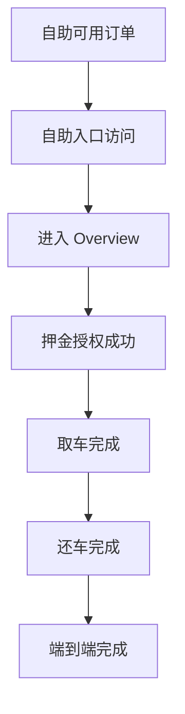

# 自助取还业务P0数据指标口径

## 文档信息

| 字段 | 内容 |
|---|---|
| 创建时间 | 2026-07-09 |
| 文档类型 | 数据指标口径 |
| 适用范围 | Customer 自助取还业务，覆盖 `/selfservice.html` 主流程 |
| 指标优先级 | P0 |
| 基线依赖 | `specs/epic/selfservice-rental-baseline.md`、`specs/modules/selfservice-rental/pickup-inspection-security.md` |

## 1. 目标

本文定义自助取还业务第一阶段必须落地的 P0 数据指标，用于支撑业务总览、主流程漏斗、门店运营质量和异常归因分析。

第一阶段指标只回答四类问题：

1. 自助取还可覆盖多少订单。
2. 用户是否进入并完成自助取还主流程。
3. 主流程具体掉在哪个步骤。
4. 自助取还是否真正减少人工介入。

本文不定义埋点事件明细、BI 报表视觉样式、数据仓库表结构和客服/门店工单流程。后续如需落地事件追踪，应在 `docs/shared/event-taxonomy/` 或对应 feature spec 中补充稳定事件契约。

## 2. 业务漏斗口径

自助取还 P0 指标按以下业务漏斗聚合：

漏斗阶段定义：

| 阶段 | 判定口径 | 说明 |
|---|---|---|
| 自助可用订单 | 订单满足自助取还准入条件，且 `is_selfservice_eligible=true` | 分母基础，不等同于用户已打开链接 |
| 自助入口访问 | 用户打开自助取还入口并发起订单识别或鉴权 | 用于衡量触达与入口使用 |
| 进入 Overview | 通过订单主状态、Online Check-in、selfservice eligibility 等门禁后进入主流程首页 | 排除取消、未核验、非自助订单 |
| 押金授权成功 | 押金状态进入可放行取车的成功类状态 | 当前 spec 口径为 `status IN (3, 4, 5)` |
| 取车完成 | 订单主状态进入 `PICKED_UP` | 代表客户完成取车侧关键动作 |
| 还车完成 | 订单主状态进入 `RETURNED` 或业务等价的 `DROP_OFF` | 代表客户完成还车侧关键动作 |
| 端到端完成 | 同一订单完成自助入口访问、取车、还车全链路 | 用于评价完整自助旅程表现 |

## 3. 通用统计规则

| 规则 | 口径 |
|---|---|
| 统计对象 | 默认按去重订单统计，除非指标明确写为次数 |
| 统计周期 | 默认支持日、周、月；经营看板优先按门店当地日期聚合 |
| 去重键 | 优先使用订单唯一 ID；缺失时使用平台订单号的 canonical 映射 |
| 时间归属 | 取车、还车类指标按实际事件发生时间归属；可用订单类指标按计划取车日或订单确认日二选一，报表需显式标注 |
| 自助主流程 | 指 `/selfservice.html` 中 Auth、Overview、Deposit、Inspection、Contract、Completion、Return、Trip Ended 等乘客端流程 |
| 人工介入 | 包含客服介入、门店电话协助、人工审核异常、运营后台手动改状态、人工兜底完成取还车等行为 |
| 排除规则 | 测试订单、内部演示订单、已取消后再次打开入口的无效访问，默认从经营指标中排除，但可保留在异常安全看板 |

## 4. P0 指标口径表

以下表格合并指标总览与指标明细。每行代表一个 P0 指标，经营看板默认按去重订单统计；如需展示次数，应在指标名称中显式标注“次数”。

| 优先级 | 指标 | 类型 | 定义与用途 | 计算公式 | 分子 | 分母 | 推荐维度 | 关键过滤与备注 |
|---|---|---|---|---|---|---|---|---|
| P0 | 自助可用订单数 | 规模指标 | 在统计周期内满足自助取还准入条件的去重订单数；用于衡量自助取还业务可覆盖的订单池 | `count_distinct(order_id where is_selfservice_eligible=true and order_status in valid_selfservice_entry_statuses)` | 满足自助取还准入条件的去重订单 | 无 | 日期、国家、城市、门店、品牌、渠道、车型组、计划取车时段 | 排除测试订单、内部演示订单、已取消且从未进入可服务状态的订单 |
| P0 | 自助入口访问率 | 触达指标 | 用户实际打开自助取还入口的订单占自助可用订单的比例；用于判断用户是否知道并愿意使用自助入口 | `自助入口访问订单数 / 自助可用订单数` | 至少一次打开自助取还链接，并发起订单识别或鉴权的去重订单数 | 同周期自助可用订单数 | 日期、门店、渠道、通知触达批次、语言、设备类型、计划取车提前量 | 同一订单多次打开只计 1 单；重复刷新可作为次数类辅助分析，不进入本指标 |
| P0 | 端到端完成率 | 转化指标 | 进入自助取还主流程后，最终完成取车并完成还车的订单比例；用于衡量完整自助旅程质量 | `端到端完成订单数 / 进入 Overview 订单数` | 同一订单进入 Overview 后，最终进入 `PICKED_UP` 且进入 `RETURNED` 或业务等价的 `DROP_OFF` | 进入 Overview 的去重订单数 | 日期、门店、渠道、车辆类型、语言、是否异地还车、计划取车时段 | 因订单取消、门店主动改为人工服务等外部原因终止的订单应单独标记，报表需支持包含/排除两种视图 |
| P0 | 自助取还成功完成订单数 | 规模指标 | 在统计周期内通过自助流程完成取车并完成还车的去重订单数；用于衡量自助取还真实业务产出 | `count_distinct(order_id where picked_up_by_selfservice=true and returned_by_selfservice=true)` | 取车完成与还车完成均归属于自助流程的订单 | 无 | 日期、门店、城市、渠道、品牌、车辆类型、计划取车时段、计划还车时段 | 若取车为自助、还车由人工兜底完成，不计入成功完成订单数，应进入人工介入分析 |
| P0 | 无人工介入完成率 | 质量指标 | 自助成功完成订单中，全程未发生人工介入的订单比例；用于衡量自助流程是否真正减少人工兜底 | `无人工介入自助完成订单数 / 自助取还成功完成订单数` | 自助取还成功完成，且无客服、门店、运营后台、人工审核异常等介入记录的订单数 | 自助取还成功完成订单数 | 日期、门店、渠道、异常类型、车辆类型、语言、是否首次使用自助取还 | 系统自动通知、自动状态同步、自动风控校验不算人工介入；人工查看但未改变流程是否计入需在数据源中单独标记 |
| P0 | 主流程各步骤转化率 | 漏斗指标 | 自助取还主流程相邻步骤之间的订单转化比例；用于定位入口、押金、取车、合同、还车等主流程掉点 | `下一步骤完成订单数 / 当前步骤进入订单数` | 完成下一漏斗步骤的去重订单数 | 进入当前漏斗步骤的去重订单数 | 日期、门店、渠道、语言、设备类型、失败原因、是否首次使用自助取还 | 同一订单在同一步骤多次进入只计 1 单；步骤内重试次数作为辅助指标，不进入转化率分母 |
| P0 | 押金授权成功率 | 支付指标 | 发起押金预授权后，成功进入可放行取车状态的订单比例；用于判断押金环节是否成为取车前阻塞点 | `押金授权成功订单数 / 发起押金预授权订单数` | 押金状态进入 `3 / 4 / 5` 的去重订单数 | 至少一次发起押金预授权的去重订单数 | 日期、门店、渠道、支付方式、币种、发卡地区、失败原因、3DS 状态 | 用户未进入押金页或未发起支付的订单不进入分母；需与失败原因、Requires Action、过期状态联动分析 |
| P0 | 取车完成率 | 履约转化指标 | 进入自助取车前置流程后，最终完成自助取车的订单比例；用于衡量用户是否能完成押金、验车、合同等取车侧关键动作 | `取车完成订单数 / 进入 Overview 订单数` | 状态进入 `PICKED_UP` 的去重订单数 | 进入 Overview 的去重订单数 | 日期、门店、渠道、车辆类型、计划取车时段、押金状态、验车异常状态 | 若订单被取消或改为柜台服务，应单独记录终止原因，报表需支持是否排除该类订单 |
| P0 | 还车完成率 | 履约转化指标 | 已完成自助取车的订单中，最终完成自助还车的订单比例；用于衡量自助还车侧是否顺畅 | `还车完成订单数 / 取车完成订单数` | 状态进入 `RETURNED` 或业务等价 `DROP_OFF` 的去重订单数 | 状态进入 `PICKED_UP` 的去重订单数 | 日期、门店、还车点、是否异地还车、计划还车时段、位置校验结果、车辆类型 | 已取车但尚未到计划还车时间的订单，不应纳入最终失败判断；可在实时看板中标记为进行中 |
| P0 | 人工介入率 | 异常指标 | 进入自助取还主流程后，发生人工协助或人工兜底的订单比例；用于衡量自助订单对人工支持的依赖程度 | `发生人工介入订单数 / 进入 Overview 订单数` | 发生客服、门店电话协助、门店人工处理、运营后台改状态、异常人工审核、人工完成取还车等介入行为的去重订单数 | 进入 Overview 的去重订单数 | 日期、门店、渠道、介入类型、介入步骤、异常原因、语言、车辆类型 | 自动通知、自动风控、自动状态同步不计入人工介入；用户主动查看帮助但未产生人工动作，可作为帮助使用指标另行统计 |

## 5. 主流程漏斗节点

主流程各步骤转化率建议第一版覆盖以下漏斗节点：

| 漏斗节点 | 进入或完成判定 |
|---|---|
| `selfservice_entry_opened` | 打开自助取还入口 |
| `auth_passed` | 订单鉴权与准入门禁通过 |
| `overview_entered` | 进入 Overview |
| `deposit_authorized` | 押金授权成功 |
| `inspection_completed` | 取车验车完成 |
| `contract_signed` | 合同签署完成 |
| `pickup_completed` | 状态进入 `PICKED_UP` |
| `return_started` | 用户发起自助还车 |
| `return_completed` | 状态进入 `RETURNED` 或 `DROP_OFF` |

## 6. 推荐看板结构

第一版 P0 看板建议分为三块：

| 看板区块 | 展示指标 | 业务问题 |
|---|---|---|
| 业务规模 | 自助可用订单数、自助入口访问率、自助取还成功完成订单数 | 自助取还覆盖面有多大，用户是否进入入口 |
| 主流程漏斗 | 主流程各步骤转化率、端到端完成率、押金授权成功率、取车完成率、还车完成率 | 用户卡在哪一步 |
| 质量约束 | 无人工介入完成率、人工介入率 | 自助是否真正降低人工依赖 |

## 7. 数据落地注意事项

1. 指标应同时支持订单数和次数两个视角，但经营主指标默认使用去重订单数。
2. `PICKED_UP`、`RETURNED`、押金状态等结果类事实应优先来自订单域、支付域、履约域的状态真值，不应只依赖前端页面浏览事件。
3. 前端事件适合补充入口访问、步骤进入、按钮点击、阻断曝光和重试行为；不应单独作为订单完成事实。
4. 人工介入需要明确来源，包括客服系统、门店工单、运营后台操作日志、异常审核记录和人工取还车登记。
5. 报表必须区分“进行中订单”和“已失败订单”，避免把尚未到还车时间的订单误判为还车失败。
6. 每个百分比指标都应在看板中同时展示分子与分母，避免样本量过小时误读趋势。
