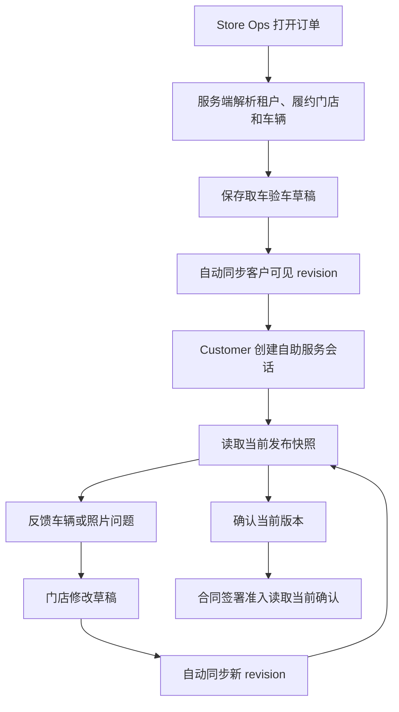

# 门店客户取车验车联动接口契约

> **文档角色**：跨角色 API Contract
> **适用范围**：Store Ops 门店端与 Customer 客户端之间的订单验证、取车验车资料发布、客户查看、客户确认和问题反馈
> **版本**：v0.5
> **最后更新**：2026-10-28
> **状态**：设计稿，待后端接口评审

## 1. 目标与边界

本契约定义门店端和客户端共同消费的稳定业务语义。两端通过服务端共享订单、实际履约门店、车辆、取车验车发布快照和客户确认记录，不直接互相导入组件、读取对方私有存储或依赖同一浏览器环境。

当前前端适配器使用 `VITE_CUSTOMER_SELF_SERVICE_API_BASE_URL` 作为显式开关：未配置时继续使用 IndexedDB/localStorage 原型，配置后 Store Ops 和 Customer 均调用本契约接口。浏览器存储回退只用于本地演示，不能作为生产授权、跨设备同步或订单归属事实。

本契约覆盖：

- 客户自助服务会话创建与订单验证；
- Store Ops 取车验车草稿及客户可见发布快照；
- 客户读取当前发布版本、记录查看、确认当前版本或反馈问题；
- Store Ops 查看客户查看、确认和问题处理状态；
- 发布版本、车辆归属、租户隔离、并发控制、幂等和审计。

本契约不覆盖：

- 证件审核内部流程和证件原图向客户展示；
- 合同文件生成、电子签名提供商和支付授权；
- Store Ops 或 Customer 的页面布局、按钮样式和角色专属文案；
- 车辆 IoT 实时状态和远程车控。

证件核验、条款确认、在线验车和合同签署继续作为不同能力维护；本契约只规定它们在订单上下文中共享身份、版本和完成状态所需的接口边界。

## 2. 术语

| Term | 定义 |
|---|---|
| `tenant` | 商户或租户边界，所有订单和媒体访问都必须归属一个租户 |
| `fulfillmentStore` | 本次订单实际履约的门店，不等同于下单门店或二维码生成门店 |
| `publication` | 门店已保存且已上传的资料自动生成的不可变客户可见快照，可包含部分资料 |
| `revision` | 同一订单、同一车辆的单调递增发布版本号 |
| `current publication` | 当前允许客户读取并参与完成判断的唯一发布版本 |
| `customer confirmation` | 客户针对实际 `publicationId + revision` 做出的确认；同车后续更新通过稳定 `reviewRevision` 保留确认事实 |
| `issue` | 客户针对指定发布版本反馈的车辆照片或车况问题，不等于客户确认 |
| `draft` | 门店尚未保存或上传完成的资料；完成部分自动同步到客户可见快照 |

## 3. 总体流程



发布、客户查看和客户确认必须通过服务端写入事实。通知可以使用轮询、页面重新获得焦点、SSE 或 WebSocket，但通知丢失不能导致资料错误；客户端始终可以重新读取当前版本恢复状态。

## 4. 状态模型

发布生命周期和客户核验状态分开保存。它们不得合并为一个单一枚举。

### 4.1 发布生命周期

| 状态 | 说明 | 客户是否可见 |
|---|---|---:|
| `DRAFT` | 门店编辑中，尚未对客户开放 | 否 |
| `PUBLISHED` | 当前完整快照已成功发布 | 是 |
| `SUPERSEDED` | 被后续 revision 替代，仅供审计 | 否，作为当前版本 |
| `PUBLISH_FAILED` | 本次发布失败，不能生成新的当前版本 | 继续读取旧版本 |

服务端只允许一个 `orderId + vehicleId` 组合存在一个当前 `PUBLISHED` 版本。新版本成功提交后，旧版本原子地变为 `SUPERSEDED`。

### 4.2 客户核验状态

| 状态 | 说明 |
|---|---|
| `NOT_VIEWED` | 当前版本已发布，但客户尚未完成查看请求 |
| `VIEWED` | 客户已打开当前版本 |
| `CONFIRMED` | 客户已确认当前版本无异议 |
| `ISSUE_REPORTED` | 客户已反馈问题，等待门店处理 |
| `RECONFIRM_REQUIRED` | 当前版本发生变化，旧确认不再作为当前完成依据 |

客户确认必须绑定 `orderId + vehicleId + publicationId + revision`。自动同步新 revision 后，旧确认保留为历史审计记录，当前订单的在线验车完成状态变为 `RECONFIRM_REQUIRED`。

### 4.3 与取车登记的关系

- `PUBLISHED` 只表示客户可以查看门店资料，不表示取车登记已提交。
- `CONFIRMED` 只表示客户已查看当前资料并声明无异议，不表示车辆已交付、合同已签署或客户已开始用车。
- 合同签署准入只能读取当前车辆、当前合同配置和当前 publication revision 的有效确认。
- 订单取消、订单转店、车辆更换或订单过期时，服务端重新计算当前发布和确认是否有效。

## 5. 共享数据模型

### 5.1 取车验车发布快照

```ts
type CustomerInspectionPublication = {
  publicationId: string;
  tenantId: string;
  merchantId: string;
  orderId: string;
  fulfillmentStoreId: string;
  vehicleId: string;
  vehiclePlateNo?: string;
  revision: number;
  status: 'PUBLISHED' | 'SUPERSEDED';
  publishedAt: string;
  publishedBy: string;
  changeReason?: string;
  changedGroups: string[];
  vehicle: {
    model: string;
    plate: string;
  };
  groups: {
    exteriorAndDamage: PublicationPhotoGroup;
    lightPhotos: PublicationPhotoGroup;
    tirePhotos: PublicationPhotoGroup;
    interiorPhotos: PublicationPhotoGroup;
    metrics: PublicationPhotoGroup;
    keyStoragePhotos: PublicationPhotoGroup;
    etcDevicePhotos: PublicationPhotoGroup;
    inspectionAndPaperChecklist: PublicationPhotoGroup;
  };
  metrics: {
    energyType: 'FUEL' | 'BATTERY' | 'UNKNOWN';
    energyPercent?: number | null;
    mileage?: number | null;
    recordedAt?: string | null;
  };
};

type PublicationPhotoGroup = {
  photos: PublicationPhoto[];
};

type PublicationPhoto = {
  photoId: string;
  mediaObjectId: string;
  vehicleId: string;
  category: string;
  capturedAt?: string | null;
  uploadedAt: string;
  source: 'CURRENT_PICKUP' | 'HISTORICAL_PICKUP';
  sourceRecordId?: string | null;
  signedUrl?: string;
};
```

约束：

- `publication` 是完整快照。新版本发布时整体替换当前客户可见资料，不允许客户端把不同 revision 的分类拼接成一个版本。
- `orderId`、`vehicleId`、`fulfillmentStoreId` 和 `tenantId` 必须由服务端从已验证上下文解析并校验，不能只接受客户端提交的字段。
- 仪表盘照片以及油量／电量、里程记录必须遵守本次取车现场证据规则，不能把历史照片当成本次读数证据。
- 车身外观、灯光、轮胎、内饰、钥匙存放、ETC 设备和车检证明可以按既定门店规则复用或补拍，但发布时必须保留来源和审计元数据。
- 客户端不得读取证件照片、门店内部备注、审核意见或未发布草稿。
- `signedUrl` 应为短时有效的媒体访问地址，永久媒体地址和原始存储路径不返回给客户。

### 5.2 客户确认

```ts
type CustomerInspectionConfirmation = {
  confirmationId: string;
  tenantId: string;
  orderId: string;
  vehicleId: string;
  publicationId: string;
  revision: number;
  confirmedAt: string;
  confirmedBy: string;
  locale: string;
  declarationVersion: string;
  idempotencyKey: string;
};
```

确认记录不可更新为另一个 revision。客户重复提交相同幂等键时返回原确认结果；客户使用旧 revision 提交时返回版本过期错误，不得静默转移到新版本。

### 5.3 客户问题反馈

```ts
type CustomerInspectionIssue = {
  issueId: string;
  tenantId: string;
  orderId: string;
  vehicleId: string;
  publicationId: string;
  revision: number;
  category: 'PHOTO_MISMATCH' | 'VEHICLE_CONDITION' | 'MISSING_PHOTO' | 'OTHER';
  description?: string;
  relatedPhotoIds: string[];
  createdAt: string;
  createdBy: string;
  status: 'OPEN' | 'IN_PROGRESS' | 'RESOLVED' | 'CLOSED';
  resolvedAt?: string | null;
  resolvedBy?: string | null;
};
```

客户问题反馈不会自动修改 publication，也不会自动将客户标记为已确认。门店处理后是否要求客户重新确认，由当前 revision 是否变化决定；若资料发生变化，必须生成新 revision。

### 5.4 客户条款确认快照

客户在取车前准备中完成的租车条款、注意事项及其他可提前确认项，作为独立于车辆验车 publication 的订单级事实保存。Store Ops 只读消费该快照，不把它转换为车辆照片确认或现场取车完成。

```ts
type CustomerTermsConfirmationSnapshot = {
  orderId: string;
  configurationRevision: string;
  configurationPublishedAt: string;
  language: string;
  confirmedAt: string;
  items: Array<{
    id: string;
    text: string;
    confirmedAt: string;
  }>;
};
```

约束：

- 服务端根据已验证客户会话解析 `orderId`，不接受客户端把另一个订单号写入确认事实；`sourceOrderId` 只允许本地演示映射使用。
- 客户只有在当前配置要求的可提前确认项全部完成时才写入快照；取消、版本变化、语言变更导致文案不匹配或确认项缺失时，当前快照失效或删除。
- Store Ops 读取时必须匹配当前订单、合同配置版本及发布时间、确认项 ID 和配置文案。匹配项可显示已勾选、确认时间并锁定控件；失配项继续现场确认，不得用读取时间补齐确认时间。
- 条款确认快照与 `CustomerInspectionConfirmation` 分开审计。发布新车辆验车 revision 不自动清除条款确认；订单、合同配置或客户条款事实变化时由服务端重新计算签署准入。

## 6. 鉴权与订单验证

### 6.1 客户会话

生产环境优先使用订单级安全链接或二维码：

1. 服务端生成不可猜测、短时有效、单订单绑定的签名 token。
2. Customer 使用 token 创建自助服务会话。
3. 服务端解析 token，确认租户、订单、客户和实际履约门店归属。
4. 必要时再要求短信 OTP 或联系电话后四位作为二次校验。
5. 会话、token 过期、撤销和重复使用情况写入审计记录。

“订单号 + 联系电话后四位”只作为本地演示或低风险辅助校验，不作为生产唯一授权凭证。服务端不得信任 URL 中明文 `orderId`、前端 `localStorage`、IndexedDB 或客户端自行传入的 `storeId` 和 `vehicleId`。

### 6.2 Store Ops 会话

Store Ops 必须使用员工登录会话和门店角色权限。发布和重新发布接口至少校验：

- 操作人员所属租户与订单租户一致；
- 操作人员对实际履约门店具有操作权限；
- 订单处于允许准备取车资料的生命周期；
- 车辆仍是当前订单已分配车辆；
- 当前草稿基线与服务端当前 revision 一致。

## 7. API 约定

以下路径为逻辑接口名，最终网关前缀和版本号由后端 API 规范统一确定。

| Method | Path | 调用方 | 说明 |
|---|---|---|---|
| `POST` | `/customer/self-service/sessions` | Customer | 创建客户自助服务会话 |
| `GET` | `/orders/{orderId}/pickup-inspection` | Store Ops | 读取当前订单验车草稿、发布状态和车辆上下文 |
| `PUT` | `/orders/{orderId}/pickup-inspection/draft` | Store Ops | 保存门店草稿，不改变客户当前资料 |
| `POST` | `/orders/{orderId}/pickup-inspection/publications` | Store Ops | 首次发布或创建新 revision |
| `GET` | `/customer/orders/{orderId}/pickup-inspection/current` | Customer | 读取当前客户可见完整快照 |
| `POST` | `/customer/orders/{orderId}/pickup-inspection/{publicationId}/view` | Customer | 记录客户查看当前版本 |
| `POST` | `/customer/orders/{orderId}/pickup-inspection/{publicationId}/confirmation` | Customer | 确认当前 revision |
| `POST` | `/customer/orders/{orderId}/pickup-inspection/{publicationId}/issues` | Customer | 反馈当前版本的问题 |
| `GET` | `/orders/{orderId}/customer-self-service-status` | Store Ops | 查询客户查看、确认和问题处理状态 |
| `GET` | `/orders/{orderId}/customer-terms-confirmation` | Store Ops | 读取当前合同配置匹配的客户条款确认快照 |
| `PUT` | `/customer/orders/{orderId}/customer-terms-confirmation` | Customer | 保存当前订单完成的客户条款确认快照，支持幂等重试 |
| `DELETE` | `/customer/orders/{orderId}/customer-terms-confirmation` | Customer | 客户确认失效时撤销当前快照，不删除审计历史 |

### 7.1 发布请求

```http
POST /orders/ORD-20260319-012/pickup-inspection/publications
Idempotency-Key: 2e7421b2-...
If-Match: pickup-inspection-revision-7
Content-Type: application/json
```

```json
{
  "changeReason": "车辆准备完成",
  "changedGroups": ["exteriorAndDamage", "metrics", "etcDevicePhotos"],
  "draftId": "draft_123"
}
```

服务端应在一次事务中完成权限校验、草稿完整性校验、车辆归属校验、revision 递增、快照落库、旧版本失效和审计记录写入。写入成功后再返回当前 publication。

### 7.2 当前快照响应

```json
{
  "orderId": "ORD-20260319-012",
  "vehicleId": "vehicle_123",
  "publicationId": "publication_456",
  "revision": 8,
  "status": "PUBLISHED",
  "publishedAt": "2026-10-25T01:30:00Z",
  "customerReview": {
    "status": "RECONFIRM_REQUIRED",
    "confirmedRevision": 7,
    "confirmedAt": "2026-10-24T23:10:00Z"
  },
  "vehicle": {
    "model": "Toyota Yaris",
    "plate": "成田330あ1234"
  },
  "groups": {},
  "metrics": {}
}
```

客户接口只返回当前客户有权访问的车辆资料和必要的核验状态，不返回 Store Ops 草稿、内部操作人、内部备注或证件审核材料。

## 8. 并发、幂等与失败恢复

- 保存草稿使用草稿版本号；发布使用 `If-Match` 或等价的 `expectedRevision`，防止旧页面覆盖其他工作人员的新版本。
- 发布、客户确认和问题反馈必须支持 `Idempotency-Key`。
- 发布失败不改变当前 publication、不失效旧确认、不清空 Store Ops 表单。
- 客户确认时如果 publication 已经变化，返回 `PUBLICATION_REVISION_CONFLICT`，客户需要重新加载和查看。
- 客户读取失败时显示可重试错误；不能回退到其他订单、其他车辆或任意旧版本。
- 通知丢失不影响正确性；页面重新获得焦点、手动刷新或重新进入时必须从服务端重新读取当前快照。
- 客户正在查看大图时，服务端可以发布新版本；客户端不强制替换当前大图，关闭后提示资料已更新并重新读取。

## 9. 错误码

| 错误码 | HTTP | 说明 | 客户端恢复 |
|---|---:|---|---|
| `SELF_SERVICE_TOKEN_INVALID` | 401 | 客户 token 无效或已过期 | 重新验证订单 |
| `ORDER_ACCESS_DENIED` | 403 | 会话不属于该订单或租户 | 终止读取 |
| `FULFILLMENT_STORE_MISMATCH` | 403 | 当前实际履约门店不匹配 | 终止操作并记录审计 |
| `VEHICLE_CONTEXT_CHANGED` | 409 | 订单车辆已更换 | 重新读取订单上下文 |
| `PUBLICATION_NOT_FOUND` | 404 | 当前没有客户可见版本 | 显示等待门店准备 |
| `PUBLICATION_REVISION_CONFLICT` | 409 | 提交基于旧版本 | 重新加载后再确认或发布 |
| `PUBLICATION_VALIDATION_FAILED` | 422 | 必填照片、读数或来源校验失败 | 显示具体缺项并允许修改 |
| `IDEMPOTENCY_REPLAY` | 200/409 | 重复请求 | 返回原结果或原错误 |
| `MEDIA_ACCESS_EXPIRED` | 410 | 图片临时访问地址失效 | 重新获取当前快照 |
| `SERVICE_UNAVAILABLE` | 503 | 服务暂时不可用 | 保留当前页面并重试 |

## 10. 事件与审计

服务端至少记录以下事件：

| Event | 触发条件 | 必要关联字段 |
|---|---|---|
| `pickup_inspection_draft_saved` | 门店保存草稿 | `tenantId`, `orderId`, `vehicleId`, `draftId`, `operatorId` |
| `pickup_inspection_published` | 新 publication 成功 | `publicationId`, `revision`, `operatorId` |
| `customer_inspection_viewed` | 客户读取当前版本 | `publicationId`, `revision`, `customerSessionId` |
| `customer_inspection_confirmed` | 客户确认当前版本 | `publicationId`, `revision`, `confirmationId` |
| `customer_inspection_issue_reported` | 客户反馈问题 | `publicationId`, `revision`, `issueId` |
| `pickup_inspection_republished` | 已发布订单创建新 revision | `previousPublicationId`, `publicationId`, `changedGroups` |
| `pickup_inspection_publish_failed` | 发布校验或持久化失败 | `orderId`, `vehicleId`, `operatorId`, `errorCode` |

事件用于审计和运营指标，不作为客户端唯一事实来源。客户端完成判断必须读取当前 publication 和当前确认记录。

## 11. 从本地原型迁移

本地原型的 IndexedDB、旧 localStorage 和 `BroadcastChannel` 保留用于开发演示和兼容读取，但生产环境不得依赖它们进行授权、跨设备同步或订单归属判断。

迁移顺序：

1. 后端先提供当前快照读取和发布接口。
2. Store Ops 建立 API adapter，发布成功后仍沿用现有页面状态和 revision 语义。
3. Customer 建立 API adapter，保留 `loading / empty / error / ready` 四类页面状态。
4. 以服务端会话替换本地订单验证；`PREP01 + 5678` 只保留为开发 fixture。
5. 服务端确认记录接入合同签署准入，旧本地确认不迁移为生产事实。
6. API 和人工验收完成后，再关闭生产构建中的浏览器存储 fallback。

### 前端适配落点（v0.2）

- `src/shared/contracts/customerInspection.ts`：共享请求、响应、发布、确认和问题反馈类型。
- `src/shared/contracts/customerTermsConfirmation.ts`：共享客户条款确认快照及历史确认项兼容 ID。
- `src/shared/services/customerInspectionApi.ts`：统一 API client；配置服务端地址时调用会话、草稿、发布、当前快照、查看、确认、问题反馈、Store Ops 状态和客户条款确认接口；未配置时委托现有本地适配。
- `src/shared/services/customerTermsConfirmationStorage.ts`：本地演示的订单级条款确认 IndexedDB 与通知适配器。
- Customer 在线验车读取、版本确认和合同准入通过该 adapter 消费当前快照；Store Ops 发布先保存草稿，再自动同步新 revision。
- 现阶段仓库没有对应后端实现，故本次交付不能宣称真实跨设备同步已经可用。后端接入后需按第 12 节验收并人工验证不同设备、权限、并发和失败恢复。

## 12. 交付验收

```gherkin
Scenario: 门店发布后客户在另一台设备查看
  Given Store Ops 已为当前订单和当前车辆准备完整取车验车资料
  When 门店成功发布新的 publication
  And 客户在不同设备通过有效自助服务会话进入订单
  Then 客户只能读取该订单当前车辆的 publication
  And 客户不会读取 Store Ops 草稿或其他订单照片

Scenario: 客户确认当前 revision
  Given 客户读取当前 publication revision 8
  When 客户确认车辆照片无异议
  Then 服务端保存绑定 revision 8 的 confirmation
  And Store Ops 查询到客户确认时间
  And 该确认可以参与当前版本的合同签署准入

Scenario: 门店重新发布使旧确认失效
  Given 客户已经确认 publication revision 8
  When 门店修改草稿并成功发布 revision 9
  Then 客户仍可审计 revision 8 的历史确认
  And revision 8 不再作为当前完成依据
  And Customer 显示需要重新查看和确认 revision 9

Scenario: 发布失败保留上一版
  Given 客户当前正在查看 publication revision 8
  When 门店发布 revision 9 失败
  Then 客户继续读取 revision 8
  And Store Ops 保留草稿并显示可重试状态
  And 系统不生成 revision 9 的成功发布记录

Scenario: 旧页面并发发布
  Given 两个 Store Ops 页面都基于 publication revision 8 编辑
  When 页面 A 成功发布 revision 9
  And 页面 B 使用 revision 8 再次发布
  Then 页面 B 收到版本冲突
  And 页面 B 不得覆盖 revision 9
  And 页面 B 可以重新加载后继续编辑

Scenario: 客户问题反馈
  Given 客户正在查看 publication revision 9
  When 客户提交一个关联照片的问题
  Then 服务端创建 issue 记录
  And Store Ops 可以查看处理状态
  And 客户不会因此自动变为已确认
```

本契约通过后，Customer 和 Store Ops 的 lane spec 应分别引用本文件的资源、状态和错误码；页面文案、入口样式、六语资源和角色专属交互仍保留在各自 lane 中维护。

### 三项条款确认示例一致性（2026-10-25）

ORD-20260319-012 两端使用 customer-narita-terms-emergency-v1、2026-10-25T12:00:00+09:00。第三项历史 ID accident_emergency_acknowledgement 规范化为 confirm-emergency-process，文案按快照语言严格校验；不跳过版本校验。

### 客户提前签名事实

客户签名记录包含 orderId、configurationRevision、inspectionRevision、signature（图片）、signedAt、language。客户完成条款与当前验车确认后写入；门店按订单读取，用于主驾驶人签名及取车登记载荷。PUT /customer/orders/{orderId}/pickup-signature 幂等保存，GET /orders/{orderId}/pickup-signature 读取，404表示尚无签名。服务端必须验证订单会话、条款及验车版本；正式合同生成仍由取车登记提交成功触发。本地同源适配器仅供演示。

### 客户正式合同文件

GET /customer/orders/{orderId}/contract 返回当前可供客户下载的正式合同：orderId、documentId、contractNumber、fileName、generatedAt、url。尚不可用返回404或null。服务端须验证会话订单权限，只返回生成成功且有效的正式PDF及短时受控URL，不暴露其他订单文件。客户页无文件时统一等待展示。原型由门店PDF生成器产生 Blob，按同源订单持久化，跨设备必须使用真实服务端实现。


### 合同文件关联履约状态（2026-10-26）

CustomerContractFile 可携带 orderLifecycleStatus，表示生成文件所关联订单的当前履约状态，必须与同订单正式合同独立校验。PICKED_UP 表示已取车进入用车阶段；缺失表示未知，不得从签名或文件存在推断已取车。提供方状态变化须刷新并通知消费者；生产响应由服务端按当前订单状态返回，旧记录无该字段时按未知处理。


## 客户签署结果原子发布（2026-10-26）

pickup-signature 写入承载完整签署结果：submissionId（同订单及同次签署稳定）、primaryDriverId、termsConfirmation（订单、配置版本与发布时间、语言、确认事项原文及时间）及既有签名、签署时间、inspectionRevision。本地采用单条 IndexedDB 记录提交，远程沿用 PUT /customer/orders/{orderId}/pickup-signature，要求服务端原子保存及幂等，GET /orders/{orderId}/pickup-signature 返回完整结果。旧独立条款接口仅为历史兼容，不作为新草稿发布入口；旧签名与条款只有订单、配置、语言及时间关系有效且完整时才能配对。签署结果缺失或版本不符不得单独回填条款；客户端只消费成功提交结果，服务端必须复验订单归属、配置和验车版本。前端实现不代表后端原子提交已上线。

### AC-SIGN-COMMIT-01 提交之前与失败均不发布
```gherkin
Given 当前订单尚未成功签署
When 客户勾选条款、绘制笔迹、刷新页面或签署提交失败
Then 门店客户确认事项及签名均不因本次草稿更新
And 客户草稿可恢复并重试
```

### AC-SIGN-COMMIT-02 完整提交一次回填
```gherkin
Given 条款与签名完整且订单、配置、语言和验车版本有效
When 客户确认签署成功且门店读取该提交
Then 客户确认事项与主驾驶人签名在同一次表单更新中回填
And 重复提交不产生新签署事实，原有六语展示保持
```

### AC-SIGN-COMMIT-03 历史兼容与读取恢复
```gherkin
Given 存在历史在线勾选或完整有效签署
When 门店恢复草稿、切换订单或读取失败
Then 无对应成功签署的旧在线勾选不得作为已确认状态
And 现场记录与有效历史签署保留，暂时读取失败不清空此前有效结果
```


## 验车照片自动同步与确认保留（2026-10-28）

本节替代此前人工确认照片准备、编辑后再次发布和同车照片更新后重新确认／重签规则。Current Code Binding：`usePickupInspectionPublication`、`PickupInspectionPublicationAction`、客户 `inspection` 模块及共享验车适配器。In Scope：同一订单同一车辆的自动同步、首次确认完整性与成功确认保留。Out of Scope：换车、正式取车后的补传补录、合同条款配置变化、生产后端实现。Related Specs：门店取车登记、客户取车前准备及门店客户验车联动契约。

- 删除“确认已准备好照片”、二次发布弹窗及“修改客户可见照片”；原位置可直接编辑。保存成功且上传完成的客户可见照片自动同步；正在上传／失败的新增照片不对客户开放，替换上传未成功时保留上一张。照片变更短暂合并，内容相同不创建新版本。证件原图、内部备注不开放。
- 区分可查看和可完成：已有部分资料即可查看；首次确认时必填照片、纸质检查单及有效里程油量按现有采集配置校验。未齐显示准备中并禁用确认，展示可恢复的缺项提示。客户已确认后，不因照片变更、缺项、重试、时间变化清空已确认或签署。
- 照片每次同步保留独立 `revision` 和同步时间；同一订单同一车辆使用稳定 `reviewRevision` 作为本次验车确认及签署关联。首次迁移沿用已存在快照的 `reviewRevision ?? revision`；换车或实际里程、油量等非照片核验数据变化沿用既有失效语义，建立新关联，不跨订单继承。本次保留例外仅适用于照片变更。确认记录保留当时实际照片版本，不能把新增图片视为客户逐张确认。历史快照不可改写。
- 客户已确认后继续自动同步照片；保留原确认时间及既有签署状态，不显示待重新确认，不清空条款、笔迹或签名，不因照片版本变化阻止签署。条款和主驾驶人签名仍仅在确认签署提交成功后原子回填门店。
- 门店复用 DG-CARD-001 的标题布局和现有 InlineNotice：同步中、待确认、已确认、同步失败及重试；最近同步时间与原客户确认时间分别显示。失败保留上次成功资料和本次编辑，重试不重复改确认时间。并发冲突重新读取后重试，不静默覆盖他人资料。
- phone/tablet 同规则，原位更新、不新增路由、不重置滚动或打断大图；复用相机相册权限及降级，不增加设备依赖。Store Ops 六语新增同步状态与时间文案；Customer 六语新增资料补充中说明，保留原签署提示。
- 同源本地演示使用 IndexedDB 与变更事件；生产由授权服务端存储、保留确认及推送／前台轮询同步。跨设备生产同步需独立联调，不以同源浏览器结果替代。

### 验收标准 AUTO-SYNC

1. Given 部分照片上传保存成功，When 无任何人工发布点击，Then 客户可查看该部分资料，但资料未齐不能首次确认。
2. Given 图片上传中或失败，Then 不发布未完成图片；替换失败保留客户旧图，完成后自动替换；删除保存后同步移除且历史保留。
3. Given 客户已确认，When 同车照片新增替换删除或重复保存，Then 双端保留已确认和原时间，不提示重新确认；客户条款、笔迹、已签署及门店签名回填不撤销。
4. Given 上传与签署同时发生，Then 照片 revision 变化不阻止已有确认后的签署；订单、车辆或合同配置不匹配继续拒绝。
5. Given 同步失败或多人冲突，Then 编辑和旧照片保留，显示页内重试；成功后读取最新资料，不重复创建无变更版本。
6. Given 客户正在大图预览或填写，When 照片更新，Then 不卸载整个页面、不丢输入、不强制跳页；前台接收事件或轮询更新。
7. 构建、六语与确认／签署模型回归必须通过；phone/tablet 浏览器交互由人工验收。

### 自动同步字段及兼容要求

`revision` 仍标识不可变照片快照；`reviewRevision` 为同订单同车的稳定确认关联，未提供时兼容旧 `revision`。`readyToConfirm` 与 `missingFields` 由服务端按当前采集配置复验，不信任前端声明。确认提交使用实际照片 `revision`，确认记录和状态响应同时返回稳定 `reviewRevision`，原照片版本及确认时间不改写；签署中的 `inspectionRevision` 对应稳定关联。首次确认校验资料齐全，已确认后不因图片变化撤销。

原 draft PUT 与 publications POST 由前端自动触发；服务端须对 expectedRevision 执行并发比较并原子生成快照、保留 reviewRevision 和已确认事实，响应完整新快照。旧后端若仍以照片版本撤销确认，需先升级契约后再验收生产联动。原型 IndexedDB 写入也执行比较并归档旧快照，不能只依赖写入前读取。
