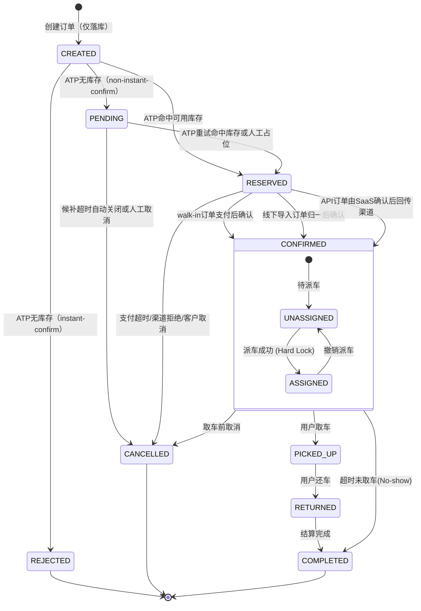

# 业务总控：Order Management (订单域状态机与行为路由)

> **Role**: 订单域状态流转的 Source of Truth，以及所有具体业务特征（Features）的导航入口。
> **AI Context Instruction**: 本文档定义状态机、跨域依赖、行为边界与高危不变量。纯静态的数据结构与枚举口径请查阅 `@docs/sys_domain/orders.md`。

## 1. Feature Map (功能导航 / Sub-specs)
**AI 在处理具体订单需求时，请强制索引对应 Spec：**

- **订单列表与详情**: `@specs/order/feat_orderlist&detail_spec.md`
- **订单新增与导入**: `@specs/order/feat_order_import_spec.md`
- **派车与车辆分配**: `@specs/order/feat_order-vehicle-allocation_spec.md`
- **订单日历**: `@specs/order/feat_order_calendar_spec.md`
- **自助取还订单**: `@specs/order/feat_selfservice_spec.md`

## 2. Cross-Module Dependencies (跨模块边界与依赖)
| 外部模块 | 依赖动作 | 约束与说明 |
| :--- | :--- | :--- |
| **Inventory Service** | `checkAvailability(sipp, start, end)` / `lockInventory(vehicle_id)` | 需保证 `check + lock` 原子性；取消/完成时需触发释放链路。 |
| **Pricing Engine** | `calculateQuote(params)` | 用于价格校验与计价能力，不在订单域内重复实现。 |
| **Channel Adapter Layer** | `normalizeInboundStatus(channel, rawStatus, payload)` / `mapOutboundStatus(target, canonicalStatus, context)` | 入站做语义归一，出站做契约映射，禁止绕过订单域主状态裁决。 |

## 3. 责任边界与处理流水线
**硬约束：任何外部报文不得直接改写订单终态。必须遵循以下流水线：**

1. **Inbound Adapter**：将渠道原始状态归一为统一语义输入。
2. **Domain FSM**：基于库存、支付、超时、人工决策裁决 canonical 主状态。
3. **Outbound Adapter**：按目标契约能力映射为外部可识别状态。

边界规则：
- Inbound 只做语义归一，不得直接写 `CONFIRMED/CANCELLED/COMPLETED`。
- Domain FSM 是唯一状态裁决层。
- Outbound 不反向驱动 Domain 状态。

## 4. 核心状态机 (Domain FSM)

## 5. Critical Invariants (研发高危排雷)
1. **内部主状态唯一性**：`status` 仅允许由 Domain FSM 变更。
2. **终态不可逆**：进入 `COMPLETED`、`CANCELLED`、`REJECTED` 后为终态。
3. **No-show 建模保持现状**：No-show 不作为独立主状态，统一落 `COMPLETED + completion_type=NO_SHOW`。
4. **库存释放防线**：处理 `COMPLETED` 事件时必须检查 `completion_type`；`NO_SHOW` 场景必须补执行库存锁释放。
5. **状态越权防线**：外部回调状态不得直接覆盖内部状态，必须经过 Inbound -> FSM -> Outbound 流水线。
6. **渠道映射边界**：`Accepted` 仅在目标契约支持时外发，不做全渠道硬统一。

默认假设（精简）：
- 默认采用 `RESERVED` 作为“待最终确认”主状态。
- `source_subtype` 分流（`walk_in` / `offline_ota_import` / `api_ota`）保持当前口径，不在本轮扩展。
- 本文档不承载静态字段字典与类型明细，统一收敛到 `docs/sys_domain/orders.md`。
