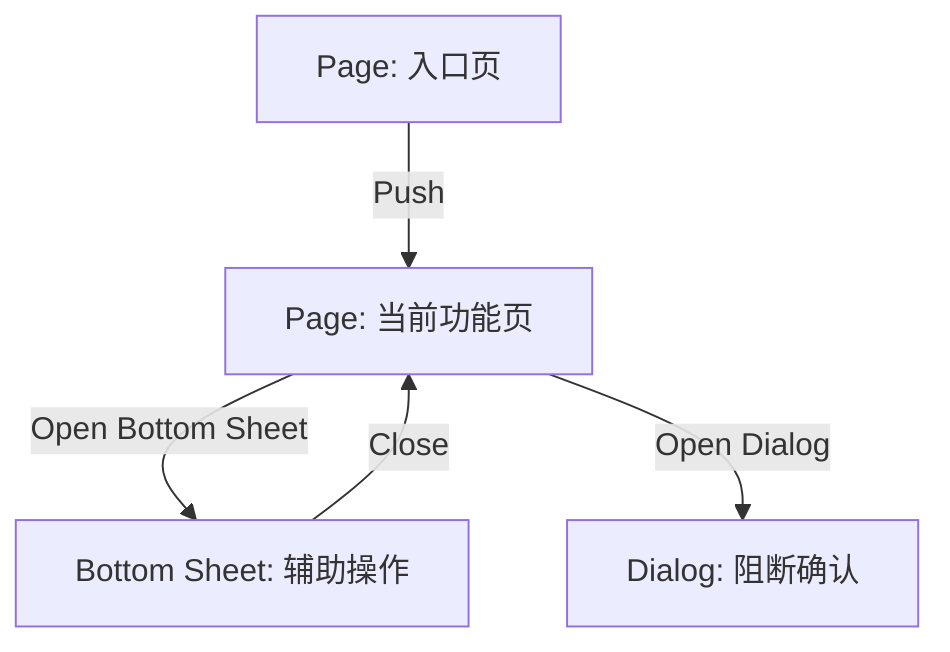
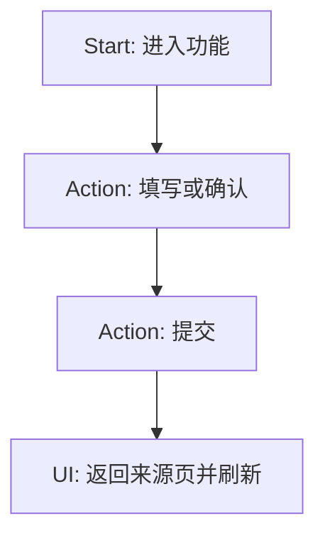
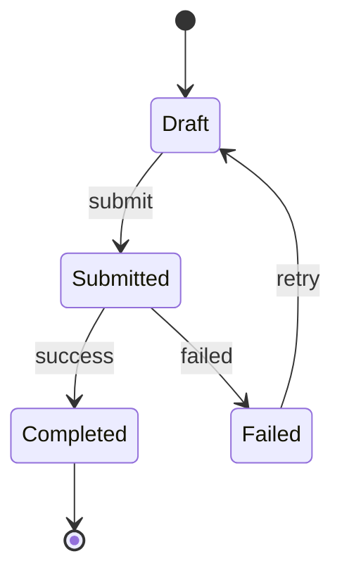

# [移动端模块/页面名称] Specification

> **应用类型**: [H5 / React Native / Flutter / 微信小程序]
> **版本**: v1.0
> **最后更新**: 2026-03-27
> **作者**: [你的名字]
> **Authoring Mode**: [Core / Full]

---

> [!IMPORTANT]
> **使用方式**
> 1. 所有 feature 都必须完成第 1-9 章，这些是必填核心章节。
> 2. 只有高风险、高复杂度 feature 才需要继续完成第 10-15 章。
> 3. lane 若提供 `Lane Charter / Pattern Pack / Feature Brief`，先读它们，再用本模板落 canonical spec。

> [!IMPORTANT]
> **Mermaid.js 语法要求**
> 1. 所有 Mermaid 示例必须使用可直接渲染的严格语法。
> 2. 节点 ID 使用英文字母、数字或下划线，不在 ID 中使用空格或中文。
> 3. 节点文案统一写在方括号或引号标签内，不在 Mermaid 节点中嵌入 Markdown。
> 4. 一个语句一行，避免多条边或多条状态定义写在同一行。
> 5. 若状态机包含说明，使用 `note right of` / `note left of` 标准写法。

---

## 1. 文档控制与模式选择

### 1.1 适用范围

- 当前 feature / 页面：
- 所属 lane：
- primary reader：
- 影响范围：

### 1.2 模式判断

- 当前模式：`Core / Full`
- 升级为 Full Mode 的触发原因：
- 选中的 lane 规则：
  - `Lane Charter`:
  - `Pattern Pack`:
  - `Feature Brief`:

---

## 2. 场景目标与角色

### 2.1 场景目标

- 谁在什么场景下使用：
- 为什么现在要做：
- 页面需要帮助用户在多短时间内做出什么决定：
- 页面明确不承载什么：

### 2.2 角色与权限

| 角色 | 可见范围 | 可执行动作 | 禁止动作 |
|------|----------|------------|----------|
| [角色] | [哪些模块可见] | [哪些动作可做] | [哪些动作不可做] |

### 2.3 成功标准

- 流程完成后确认了什么事实：
- 回写了哪些对象或状态：
- 用户离开页面时应该得到什么结果：

---

## 3. 触发条件与进入方式

| 来源入口 | 触发条件 | 进入方式 | 目标上下文 |
|---------|----------|----------|------------|
| [入口名称] | [何时允许进入] | `Push / Replace / Sheet / Dialog` | [必须带入的上下文] |

---

## 4. 字段清单与字段分类

> [!IMPORTANT]
> 字段必须按“操作决策”分类，而不是按数据库实体分类。

| 字段 / 资源 | Source Type | 业务用途 | 是否阻塞 | 是否必填 | 默认值 | 校验规则 | 错误文案 |
|------------|-------------|----------|----------|----------|--------|----------|----------|
| [ADD] `field_name` | `Stored / Derived / Mapped` | [用于什么判断] | `是 / 否` | `是 / 否` | [默认值] | [格式 / 规则] | [页内文案] |

### 4.1 字段分组建议

- **主决策字段**：
- **执行证据字段**：
- **风险判断字段**：
- **可选补充字段**：
- **异步产物字段**：上传、OCR、签字、草稿等

---

## 5. 交互草案 (必填核心)

### 5.1 首屏层级

描述首屏一屏内必须优先看到的区块与顺序：

1. [第一层信息]
2. [第二层信息]
3. [第三层信息]

### 5.2 字段重组与步骤划分

- 按什么任务节点分组：
- 每组想让用户完成什么判断：
- 哪些字段延后到次级步骤 / Sheet / Drawer：

### 5.3 CTA 策略

| 操作 | 类型 | 触发位置 | 阻断条件 | 成功后行为 |
|------|------|----------|----------|------------|
| [主动作] | `Primary / Secondary / Text` | [底部 / 卡片 / Sheet] | [哪些条件阻断] | [刷新 / 回跳 / Replace] |

### 5.4 交互容器选择

| 交互对象 | 容器 | 原因 |
|---------|------|------|
| [筛选 / 说明 / 设置] | `Page / Bottom Sheet / Dialog / Drawer` | [为什么] |

---

## 6. 异常中断与恢复

| 触发场景 | 当前状态 | 阻断级别 | 恢复策略 | 页内反馈 |
|---------|----------|----------|----------|----------|
| [权限拒绝 / 弱网 / 上传失败] | [当前页状态] | `阻断 / 可继续` | [如何恢复] | [在哪里提示] |

### 6.1 提交拦截条件

- [ ] 文件仍在上传中
- [ ] 必填未完成
- [ ] Admission Guard 未通过
- [ ] 风险说明与风险证据未齐备
- [ ] 其他：

---

## 7. i18n 增量资源包

> [!IMPORTANT]
> 新增 UI 文案必须同时提供 `zh-CN / en / ja`。运行时 fallback 不计入交付完成。

| resource_key | zh-CN | en | ja | 说明 |
|--------------|-------|----|----|------|
| `feature.section.title` | [中文] | [English] | [日本語] | [按钮 / 标签 / 错误] |

### 7.1 数据源分类

- **系统文案**：
- **核心业务枚举文案**：
- **原样展示的业务数据**：

---

## 8. BDD 验收标准

```gherkin
Scenario: [主流程场景]
  Given [前置条件]
  When [触发动作]
  Then [预期结果]
  And [回写 / 刷新 / 风险提示]

Scenario: [关键阻断场景]
  Given [前置条件]
  When [触发动作]
  Then [页面阻断]
  And [页内错误提示]
```

### 8.1 验收清单

- [ ] 首屏能在一次滚动内找到主任务和主动作
- [ ] 字段未按数据库结构平铺
- [ ] 阻断原因页内可见
- [ ] CTA 唯一且明确
- [ ] 新增文案已补齐 `zh-CN / en / ja`

---

## 9. Feature Brief 摘要

用一句话总结本 feature 的“业务差异”：

- 本次只新增 / 变更：
- 不涉及：
- 复用的 pattern：

---

## 10. [Conditional] 导航栈与页面流转

> 仅在 Full Mode 下保留本章。

### 10.1 Stack Map



### 10.2 登录、权限、深链拦截

- 登录拦截：
- 权限拦截：
- 深链进入：

---

## 11. [Conditional] Logical View & State

> 仅在 Full Mode 下保留本章。

```ts
interface FeatureView {
  ui_state: 'loading' | 'empty' | 'error' | 'success';
  overlay_state: {
    active_dialog: 'none';
    active_sheet: 'none';
  };
}
```

### 11.1 字段来源标注

| 字段 | 来源 | 说明 |
|------|------|------|
| `ui_state` | `Derived` | [如何得出] |

---

## 12. [Conditional] 主流程、Interruptions 与状态机

> 仅在 Full Mode 下保留本章。

### 12.1 Main Happy Path



### 12.2 Interruptions

| 场景 | 恢复策略 |
|------|----------|
| [切后台] | [如何恢复] |

### 12.3 State Machine



---

## 13. [Conditional] 存储、草稿、离线、并发与审计

> 仅在 Full Mode 下保留本章。

| 能力 | 方案 | 说明 |
|------|------|------|
| 草稿 | [本地 / 会话 / 不支持] | [何时保存 / 清理] |
| 离线 / 弱网 | [策略] | [恢复方式] |
| 并发 | [抢占 / 锁定 / 幂等] | [冲突表现] |
| Audit | [事件或日志] | [必填字段] |

---

## 14. [Conditional] Mobile Constraints / JSBridge / 权限

> 仅在 Full Mode 下保留本章。

### 14.1 物理约束

- `safe-area-bottom` 处理：
- 软键盘遮挡处理：
- 物理返回键拦截：
- 横竖屏策略：

### 14.2 宿主能力

| 场景 | JSBridge / 设备能力 | 降级方案 |
|------|---------------------|----------|
| [拍照 / 定位] | [调用方式] | [fallback] |

---

## 15. [Conditional] 非功能需求与验证

> 仅在 Full Mode 下保留本章。

### 15.1 性能

- 首屏目标：
- 主动作响应目标：
- 上传 / OCR / 列表滚动目标：

### 15.2 Tracking / Audit

| 事件名 | 触发时机 | 关键属性 |
|--------|----------|----------|
| [event_name] | [when] | [props] |

### 15.3 Full Mode Checklist

- [ ] 已定义完整 Stack Map
- [ ] 已定义 Logical View 与字段来源
- [ ] 已覆盖主流程、状态机与关键中断
- [ ] 已说明草稿、离线、并发与审计
- [ ] 已说明权限、JSBridge 与物理约束
