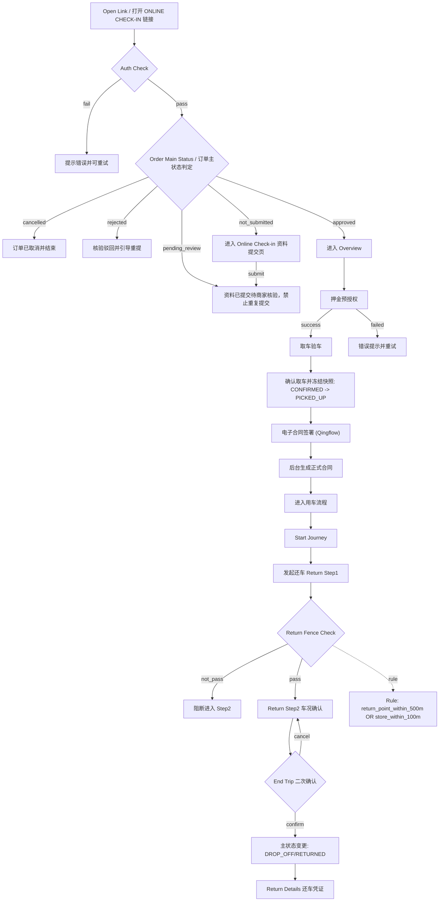
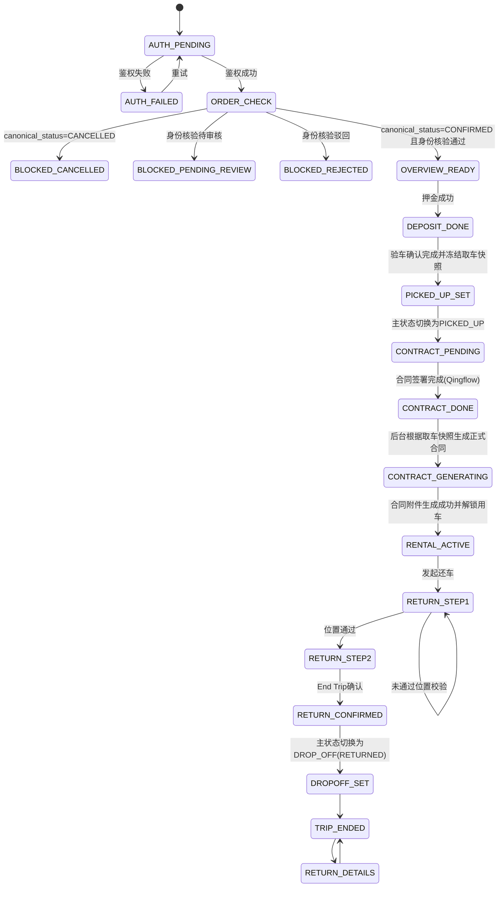

# 自助取还 ONLINE CHECK-IN 需求规格说明（生产基线）

- 文档版本：**v1.0（PROD 基线）**
- 基线日期：2025-10-15
- 当前维护日期：2026-10-29
- 说明：本文件的业务版本固定为 `v1.0`。后续 AI 或人工改动统一记录在「11. AI 修改记录」，不变更业务版本号。

### 0.1 车辆读数提交增量（2026-08-28）

本节当前口径修订于2026-10-29：自助取车仅保留页面顶部只读仪表板，删除“油量/电量与里程”填写区、仪表盘照片上传、来源时间及手动修正操作。缺失或无效读数、未上传仪表盘照片均不阻断验车确认或合同准入；最终取车动作不再要求或新建客户车辆读数检查点。新验车记录可以保存来自同一有效来源的只读读数快照，缺失字段保持为空，不伪造默认值；历史检查点和照片保留兼容读取，不自动当作本次新增证据。

客户还车第二步继续按 §5.4.1 执行。运营端的读数填写、证据要求及共享控件不受此修订影响。

#### 0.1.1 取车只读仪表板（2026-10-16）

- 角色与入口：客户打开自助取车“车辆查验”页，首屏顺序为仪表板 → 驾照与车牌合照 → 车辆控制 → 当前车况；本卡片不新增导航、按钮或提交门槛。
- 结构：白色圆角卡片，标题左侧为品牌色仪表图标；下方两列浅灰面板，左侧为千位分隔的“里程数（公里）”，右侧为油量八格条（E 至 F），电动车显示电量百分比；窄屏允许标签换行、数字缩小，不横向溢出。
- 数据：使用当前订单车辆的里程、油量百分比及车机有效性判定，与现有车辆读数来源解析共用；不包含填写或修正操作；验车记录中的只读读数快照使用同一有效来源。油量格数由有效百分比换算，不将百分比伪装为升数，不新增油箱容量推算。
- 状态与恢复：该卡片复用已加载的订单数据，不单独请求设备；订单加载与失败重试沿用页面入口。设备离线、未安装、读取失败或某字段无有效读数时，对应字段显示“暂无资料”，不得以 0、满格或截图中的样例数值替代。真实零值正常显示。
- 提示：卡片底部常驻浅橙提示块和警示图标：“提示：若里程或油量等资料与实际不符，请立即联系门店。”电动车使用电量对应文案；提示不新增弹窗或强制确认。
- 国际化：运行时覆盖现有英语、繁中、日语、韩语、泰语；系统文案进入 `pickupDashboardTranslations`，读数按当前语言格式化。核心资源包如下（简中用于规格口径）：

| key | zh-CN | zh-TW | en | ja |
|---|---|---|---|---|
| pickupDashboardTitle | 仪表板 | 儀表板 | Dashboard | メーター情報 |
| pickupDashboardMileage | 里程数（公里） | 里程數（公里） | Mileage (km) | 走行距離（km） |
| pickupDashboardFuel | 油量 | 油量 | Fuel level | 燃料残量 |
| pickupDashboardBattery | 电量 | 電量 | Battery level | バッテリー残量 |
| pickupDashboardUnavailable | 暂无资料 | 暫無資料 | No data available | データがありません |
| pickupDashboardFuelNotice | 提示：若里程或油量等资料与实际不符，请立即联系门店。 | 提示：若里程或油量等資料與實際不符，請立即聯絡門市。 | If the mileage or fuel level differs from the vehicle, please contact the store immediately. | 走行距離や燃料残量が実際と異なる場合は、すぐに店舗へご連絡ください。 |
| pickupDashboardBatteryNotice | 提示：若里程或电量等资料与实际不符，请立即联系门店。 | 提示：若里程或電量等資料與實際不符，請立即聯絡門市。 | If the mileage or battery level differs from the vehicle, please contact the store immediately. | 走行距離やバッテリー残量が実際と異なる場合は、すぐに店舗へご連絡ください。 |

验收场景：

- Given 有有效车辆读数，When 进入取车验车页，Then 驾照与车牌合照上方显示只读仪表板，左侧千位分隔里程、右侧八格油量及联系门店提示；卡片不包含输入框、上传或刷新操作。
- Given 读数缺失或设备不可用，When 展示卡片，Then 缺失字段显示“暂无资料”，不生成虚假格数，不因卡片新增阻断。
- Given 客户查看或提交验车，Then 页面仅保留只读仪表板，不显示下方读数填写及仪表盘上传区；读数缺失或照片为空不新增阻断。
- Given 窄屏或切换语言，When 展示卡片，Then 文案完整且无横向溢出，电动车显示百分比和电量提示。

验收要求：

- 自助取车不显示读数填写或仪表盘上传区，不要求新建 `SELF_SERVICE_CUSTOMER_PICKUP` 检查点；
- 只读仪表板缺失读数时显示“暂无资料”，不伪造为零，不阻断取车；
- 自助还车仅在有效读数完整时保存 `SELF_SERVICE_CUSTOMER_RETURN` 检查点，详见 §5.4.1；
- 历史取车检查点与仪表盘照片继续保留，不作为新取车的必填门槛；
- 运营端读数区及其检查点要求保持原有范围；
- Customer 页面不展示 provider 技术错误码。

---

## 1. 文档目标与范围

### 1.1 目标

统一 ONLINE CHECK-IN 的核心业务目标、流程、字段约束与状态流转，确保产品、开发、测试、运营在同一基线上协作。

### 1.2 业务范围

- 在线核验（鉴权）
- Online Check-in 乘客端资料提交（本地演示流程）
- 押金预授权
- 取车验车
- 电子合同签署（Qingflow 低代码）
- 自助还车（两步）
- 还车后凭证查看

### 1.3 不在本期范围

- 计费引擎细则
- 第三方支付网关完整风控细节
- 运营 BI 报表实现细节

---

## 2. 核心业务规则（必须遵守）

1. 一个 ONLINE CHECK-IN 链接唯一指向一个订单；同一订单可存在多个链接。
2. 鉴权规则：`平台订单号 + 订单联系电话后四位`（2026-11-03 产品确认与默认入口统一，电话去除空格、括号、连字符等格式字符后取末四位，仅接受4位数字）。
3. 订单状态判定（主状态 + 子状态）：
   - 主状态为已取消（`canonical_status=CANCELLED`）：禁止进入流程，提示订单已取消。
   - 身份核验状态为待审核（`online_checkin_verification_status=PENDING_REVIEW`）：提示资料已提交、待商家核验，不允许重复按新用户逻辑提交。
   - 身份核验状态为驳回（`online_checkin_verification_status=REJECTED`）：提示驳回并引导重提资料。
   - 身份核验状态为未提交（`online_checkin_verification_status=NOT_SUBMITTED`）：允许进入 Online Check-in 资料提交页；提交成功后进入待商家审核状态，不得直接进入自助取还流程。
   - 身份核验状态为通过（`online_checkin_verification_status=APPROVED`）：允许进入后续流程。
4. 多语言优先交付：英语、繁中、日语、韩语、泰语。
5. 语言默认策略：港澳台-繁中，日本-日语，韩国-韩语，泰国-泰语，其余-英语。
6. 轻流表单提交后必须进入提交完成落地页，且可跳回 ONLINE CHECK-IN 首页。
7. 电子合同签署由 Qingflow 低代码表单/合同能力承载。
8. 用户取车不执行 H5 硬围栏拦截。
9. 商家投递软围栏属于运营侧流程，不进入本文件“租车客户主状态流程”。
10. 用户还车执行硬围栏校验：`距还车点<=500m` 或 `距门店<=100m`。
11. 客户完成现场验车并确认取车时，订单域先写入 `pickup_completed_at`、将 `canonical_status` 推进为 `PICKED_UP`，并冻结订单、车辆、证据和完整附加项快照；随后进入合同签署。合同签署阶段的数据采集、附件上传、签署留痕由 Qingflow 承载；签字成功后才触发正式合同生成。
12. 合同资料必须满足等保与数据监管的可追溯、可审计、可导出要求；H5 不落地持久化原始证件文件。
13. 取车前不生成正式合同。门店取车前调整附加项不触发合同作废或重签；合同只读取取车完成时冻结的附加项快照。
14. `pickup_completed_at` 一旦写入，尚未签字、签字失败、合同生成中或合同生成失败均不得重新开放取车前附加项入口。合同签署后的加购留待后续“支持合同补充协议”需求，一期继续拒绝。

---

## 3. 端到端业务流程（Human Friendly）

### 3.1 主流程图（Mermaid）



### 3.2 状态约束图（Mermaid）



---

## 4. 页面职责与准入/准出约束

| 页面 | 职责 | 准入条件 | 准出条件 |
|---|---|---|---|
| Auth | 鉴权入口 | 打开链接 | 鉴权成功 + `canonical_status=CONFIRMED` + `online_checkin_verification_status=APPROVED` |
| Online Check-in Submission | 乘客端资料提交（本地演示） | 鉴权成功 + `online_checkin_verification_status=NOT_SUBMITTED` | 资料填写完成并提交，进入待审核 |
| Overview | 展示订单与步骤 | 鉴权成功 | 进入押金/验车/合同/还车 |
| Deposit | 押金预授权 | 订单可处理 | 预授权成功 |
| Inspection | 取车验车与确认取车 | 已完成押金 | 原子写入 `pickup_completed_at`、`canonical_status=PICKED_UP`，冻结完整取车快照并进入合同签署 |
| Contract | 电子合同签署（Qingflow） | 取车事实已成立且冻结快照存在 | 在 Qingflow 完成主驾驶+额外驾驶人（最多3人）信息与证件提交、签约确认；签字成功后触发合同生成，不再修改取车主状态 |
| Completion | 签约完成结果（UI） | 主状态已 `PICKED_UP` 且签字成功 | 展示合同生成状态；仅合同附件 `READY` 且 `isRentalActive=true` 时进入用车页面（不改变主状态） |
| Return Step1 | 位置确认与还车检查提示 | 用车中 | 位置通过 |
| Return Step2 | 车况确认 | Step1 条件满足 | End Trip 确认 |
| Trip Ended | 成功结束与返回首页入口 | `canonical_status=RETURNED (DROP_OFF)` | 返回 Overview（Back Home） |
| Return Details | 查看还车凭证 | `canonical_status=RETURNED (DROP_OFF)` | 返回 Trip Ended |

---

### 4.1 我的行程首页展示优化（2026-10-19）

Current Code Binding：`OverviewScreen.tsx`、`OverviewHeader.tsx` 与既有 `LanguageContext`、`i18n/preparation.ts`。遵循 Customer H5 设计基线，品牌与车辆数据以线上截图为视觉参考；不将截图中的订单号、车型、完成状态、地址或日期写入实际订单。

- 页头保持品牌橙背景，左侧品牌 `IX RENTAL` 与“我的行程”页面标题分层，右侧仅显示当前语言的原生选择入口。支持当前上下文六语，包含简体中文；控件具有本地化可访问名称、44px 最小触控高度及可见焦点。320px 手机与平板均不得横向溢出，语言选项通过选择控件展开，不将六种语言平铺在页头。
- 订单确认码与复制动作分离：字段名使用辅助文字，订单号完整换行、可进入预订详情；复制动作独立且至少 44px。复制成功继续使用既有反馈，权限或接口失败在该区域显示可重试说明，不影响其他行程操作。
- 车辆待取车卡片强化车型、车辆照片、停车位置及车牌／颜色的层级，照片保持固定缩略区域并使用既有缺图回退。长车型、位置、订单号及泰语等文案须换行。缺少停车位时使用订单实际取车位置，仍无位置则显示位置待确认，不虚构 A-23。
- 行程步骤沿用既有状态与门禁：已完成为次要样式、当前可操作步骤为主色、未解锁步骤为禁用样式；文字与动作避免挤压，动作至少 44px，步骤按钮支持键盘。车辆准备中、待取车、用车中、已还车均保留现有卡片与行为；不因对齐截图提前显示还车或更改验车／合同准入。
- 保留取车停车费提示、联系门店、文件及条款入口；首页底部门店联系卡片按 §4.1.1 展示门店资料。还车停车计划仍为独立数据，不作为门店资料来源。页头与底部条款区域考虑安全区，无新增服务端接口、权限或费用行为。相机、定位、支付、签约与失败恢复继续服从原有专项规范。
- i18n 增量沿用 `i18n/preparation.ts` 六语资源列，`prepOverviewBrand` 为品牌原文；`prepLanguage`、`myRentalTitle`、`copy`、`copied` 复用既有文案。

| key | zh-CN | en | ja |
|---|---|---|---|
| `prepOverviewBrand` | IX RENTAL | IX RENTAL | IX RENTAL |
| `prepCopyFailed` | 复制失败，请重试或手动复制订单号。 | Could not copy. Try again or copy the booking number manually. | コピーできませんでした。再試行するか、予約番号を手動でコピーしてください。 |

```gherkin
Scenario: 长订单号与多语言页头
  Given 任一支持语言和长订单号
  Then 页头展示品牌、我的行程与当前语言入口且不溢出
  And 订单号完整可读，预订详情与复制可独立操作
Scenario: 复制失败
  When 剪贴板不可用或权限拒绝
  Then 订单区域显示失败说明且可重试，其他操作保持可用
Scenario: 行程状态保持隔离
  Given 订单分别处于准备中、待取车、用车中、已还车
  Then 展示各自真实车辆状态及原有可用步骤
  And 不提前开放验车、合同或还车
  And 门店联系卡片按独立门店资料展示，不受还车停车计划状态影响
```

#### 4.1.1 门市资讯卡片（2026-10-28）

- 角色与入口：已鉴权客户在「我的行程」首页的行程步骤下方、文件入口上方查看门店联系方式；沿用准备中、待取车、用车中及已还车状态的可见范围。
- 以白底圆角卡片展示「门店信息」（繁中「門市資訊」）、门店名称和地址；名称加粗，地址使用较小辅助文字并允许多行。底部仅保留浅灰底、橙色电话图标与文案的全宽「致电」按钮；移除分隔线和并排消息入口。按钮触控高度至少 44px，并提供可见键盘焦点；320px 窄屏、长地址及六语不得横向溢出。
- 数据绑定统一使用订单的 `pickupLocationDetails.name / address / phone`。其中 `address?: string` 为兼容旧订单的可选增量字段；不从 `returnParkingPlan`、`pickupLocation`、`returnLocation` 或车辆位置推导门店地址，不把参考图中的门店名称和地址写入订单。当前演示订单补齐其既有 Ginza 地点的明确地址。
- 名称或地址为空时分别显示「门店名称待确认」「门店地址待确认」，保留卡片及其他有效资料；电话为空或不符合可拨号格式时展示禁用的「暂无联系电话」，不得生成空的 `tel:` 链接，也不得用其他订单电话代替。
- 点击有效电话直接打开系统拨号入口（`tel:`），电话号码去除空格、括号和连字符后使用可选首位 `+` 及数字格式。拨号不改变订单或旅程状态；不请求网络、发送消息或新增弹窗。终端不支持拨号时由终端处理，用户可通过原预订确认材料联系门店。
- i18n 沿用 `i18n/preparation.ts` 六语资源列，新增资源如下；按钮的可访问名称与可见文案一致。

| key | zh-CN | zh-TW | en | ja | ko | th |
|---|---|---|---|---|---|---|
| `prepOverviewStoreInfoTitle` | 门店信息 | 門市資訊 | Store information | 店舗情報 | 매장 정보 | ข้อมูลสาขา |
| `prepOverviewStoreCall` | 致电 | 致電 | Call | 電話する | 전화하기 | โทร |
| `prepOverviewStoreNamePending` | 门店名称待确认 | 門市名稱待確認 | Store name to be confirmed | 店舗名を確認中 | 매장명 확인 중 | รอยืนยันชื่อสาขา |
| `prepOverviewStoreAddressPending` | 门店地址待确认 | 門市地址待確認 | Store address to be confirmed | 店舗住所を確認中 | 매장 주소 확인 중 | รอยืนยันที่อยู่สาขา |
| `prepOverviewStorePhoneUnavailable` | 暂无联系电话 | 暫無聯絡電話 | Phone number unavailable | 電話番号がありません | 연락처 없음 | ไม่มีหมายเลขโทรศัพท์ |

```gherkin
Scenario: 门店资料与还车停车计划不同
  Given 订单包含门店名称、地址和电话，且还车停车计划为不同地点
  When 客户查看我的行程首页
  Then 门市资讯卡片只展示门店名称与地址，并提供一个全宽致电入口
  And 卡片没有消息入口或还车停车场信息
  When 客户点击致电
  Then 拨号链接使用该门店电话，订单及旅程状态不变
Scenario: 门店资料缺失与旧订单兼容
  Given 旧订单缺少门店地址，或门店名称及电话为空
  Then 对应字段显示待确认或电话不可用提示，不借用停车计划或预约地点
  And 无有效电话时按钮禁用，不出现空拨号链接
Scenario: 多语言与移动端布局
  Given 使用任一支持语言且门店名称和地址较长
  Then 名称和地址完整换行，致电入口保持至少44px触控高度与键盘焦点样式
```

## 5. 字段级约束（Dev/Ops 对齐重点）

### 5.1 链接与鉴权字段

| 字段 | 必填 | 约束 | 用途 |
|---|---|---|---|
| `vendor_brand` | 是 | 非空字符串 | 品牌展示 |
| `platform_order_no` | 是 | 可唯一定位订单 | 鉴权主键 |
| `phone_last4` | 是 | 订单联系电话去除格式字符后的末四位，仅4位数字 | 鉴权校验 |
| `channel_id` | 是 | 渠道标识 | 统计归因 |

说明：历史参数 `confirmation_code` 可保留兼容，但语义应映射到平台订单号。

### 5.2 主状态与 CONFIRMED 子状态字段（最小必需）

| 字段 | 类型 | 说明 |
|---|---|---|
| `canonical_status` | enum | 订单主状态（由订单域 FSM 裁决），如 `CREATED/RESERVED/PENDING/CONFIRMED/PICKED_UP/RETURNED/COMPLETED/CANCELLED/REJECTED` |
| `online_checkin_verification_status` | enum | Online Check-In 身份核验状态：`NOT_SUBMITTED/PENDING_REVIEW/APPROVED/REJECTED` |
| `deposit_preauth_status` | enum | 押金预授权状态：`NOT_STARTED/SUCCEEDED/FAILED/EXPIRED` |
| `pickup_completed_at` | datetime | 实际取车完成时间；现场验车确认成功时由服务端统一时钟写入，是取车前附加项调整的截止事实 |
| `pickup_addons_snapshot` | object | 取车完成时冻结的线上预订项与门店新增项完整快照；后置合同只读使用 |
| `contract_sign_status` | enum | 合同签署状态：`UNSIGNED/SIGNING/SIGNED/SIGN_FAILED` |
| `contract_signed_at` | datetime | 可信签字成功时间；`SIGNED` 时必填 |
| `contract_attachment_status` | enum | 合同附件状态：`NOT_READY/GENERATING/READY/FAILED` |
| `contract_attachment_url` | string | 合同 PDF 下载链接（仅 `READY` 时可用） |
| `isIdentityVerified` | boolean | 派生字段，等价于 `online_checkin_verification_status=APPROVED` |
| `isDepositPaid` | boolean | 派生字段，等价于 `deposit_preauth_status=SUCCEEDED` |
| `contractSigned` | boolean | 派生字段，等价于 `contract_sign_status=SIGNED` |
| `isRentalActive` | boolean | 是否用车中（等同于 `PICKED_UP` 已取车、合同附件 `READY` 且未还车） |
| `isReturned` | boolean | 是否还车完成 |

说明：

1. `canonical_status` 是订单域唯一真值，禁止被本模块直接改写为自定义主状态。
2. 核验与押金属于 `CONFIRMED` 阶段子状态；现场验车确认成功形成取车事实并把主状态推进为 `PICKED_UP`，合同签署和附件生成发生在取车之后。
3. `pickup_completed_at` 与 `canonical_status=PICKED_UP` 应在同一服务端事务写入；完成还车后主状态切换为 `RETURNED (DROP_OFF)`。
4. 取车完成后、签字前 `contract_attachment_status=NOT_READY`；签字成功后进入 `GENERATING`，显示“合同生成中”并禁点；仅 `READY` 且有下载链接时设置 `isRentalActive=true`、解锁用车并显示 `View` 直接触发 PDF 下载；`FAILED` 展示可恢复错误且保持非用车中。
5. 取车完成事务必须冻结 `pickup_addons_snapshot`。签字和合同附件状态变化不修改该快照，也不改变附加项入口的关闭状态。

### 5.3 取车验车（Inspection）页面内容规范

> 以下以生产截图（2026-03-09）为基线，描述 Inspection 页面的真实区块构成、顺序与字段约束。
> 说明：`Vehicle Exterior / Lights Check / Damage Report` 及其 `Photo Guide` 的展示风格与还车阶段（Return Step2）保持一致。

#### 5.3.0 页面区块顺序（本期基线）

| 顺序 | 区块名称 | 是否必填 |
|---|---|---|
| 1 | License & Plate Photo（驾照与车牌合照） | 必传 ≥1 张 |
| 2 | Vehicle Controls（车辆控制） | 页面初始化后即可操作 |
| 3 | Vehicle Exterior（车辆外观四方位拍照） | 必传，每方位 ≥1 张 |
| 4 | Lights Check（灯光检查） | 建议必传，前灯/后灯各 ≥1 张 |
| 5 | Damage Report（车损报告） | 可选文字 |
| — | 底部固定按钮：Continue to Contract | 满足条件后可点击 |

#### 5.3.1 车辆基础信息展示边界

除 §0.1.1 顶部只读仪表板展示的里程和油量／电量外，取车页不重复展示首页已经提供的车辆基础信息，不新增以下独立字段或区块：

- 车牌号（`license_plate`）
- 车辆品牌（`vehicle_brand`）
- 车型（`vehicle_model`）
- 油量 / 电量（`vehicle_fuel_level` / `vehicle_battery_level`）
- 里程（`vehicle_mileage`）

上述数据仍可由订单域或验车记录保存；里程和油量／电量仅在顶部只读仪表板展示，不提供填写、修正或仪表盘上传，也不作为车门控制或验车提交的前置条件。

#### 5.3.2 驾驶证件与车牌合照（2026-10-28 修订）

本区块用于提醒每位已登记驾驶人在取车时拿出随身携带的证件，保存一张证件与本次车辆车牌同框的现场照片；不重复 Online Check-in 的完整证件采集，不进行新一轮 OCR、身份匹配或模拟审核。详细状态、恢复及验收见 [取车验车安全规格 §3.2.2.1](../modules/selfservice-rental/pickup-inspection-security.md#3221-多人驾驶证件与车牌合照2026-10-28)。

| 字段 | 类型 | 最小要求 | 说明 |
|---|---|---|---|
| `onlineCheckinDrivers` | object | 当前订单已提交且已通过资格审核的名单快照 | 包含快照版本、每人稳定ID、姓名、角色、驾驶资格类型；不按国籍或居住身份推断资格 |
| `driverPhotoConfirmation` | object | 取车确认时必填 | 绑定订单、车辆、名单版本及完整驾驶人名单；每人一张照片及保存时间 |
| `verificationPhotos / verificationStatus` | legacy | 旧记录兼容 | 新记录聚合状态为 `uploaded`，不得写成资格审核 `approved`；无逐人绑定的旧照片不能自动分配到当前驾驶人 |

- 保持当前页面位置，主驾驶在前、额外驾驶人依已登记顺序展示，最多1名主驾驶加3名额外驾驶人；名单只读，不在这里新增或移除驾驶人。
- 卡片标题下常驻浅橙提示，繁中最终文案为：“駕駛時請隨身攜帶證件”；正文为“依日本《道路交通法》，每位駕駛人（含額外駕駛人）駕駛時，均須攜帶適用且有效的駕駛證件。請在駕駛前確認已帶齊相關證件。”不增加照片替代说明或确认勾选。
- 每人一个拍照位置，明确姓名、角色和上传状态，支持拍摄、预览、重拍和失败重试；主区及示例不展示补充清晰度说明，人员行不展示证件类型提示，也不保留对应空白；无逐人提交按钮，无新办理子页。展示已上传人数，不展示审核等待或通过提示。
- 照片同时显示本人驾驶证件与前或后车牌；IDP客户展示IDP，不统一要求本国驾照；驾照加译本资格沿用前序审核，不重新逐页采集护照、译本或入境资料。マイナ免許証照片只作实体卡在手提醒，驾驶资格沿用前序审核。
- 全员照片保存成功后才满足此项取车条件，异常证据及车门操作等待条件继续适用；车辆读数和仪表盘照片不再构成提交条件。车门控制入口、合同签署及驾驶授权规则不由本次改动改变。
- 当前自助取还运行时为本地演示：已审核名单来自显式订单快照，照片存入浏览器IndexedDB，界面已上传仅代表本地留存成功，不宣称已连接生产上传或核验服务。生产需替换订单及媒体适配器；不得将 Blob URL 当可恢复的持久照片。

#### 5.3.3 车辆控制（Vehicle Controls）

| 内容 | 规则 |
|---|---|
| 展示位置 | 位于 License & Plate Photo 之后、车辆外观验车之前 |
| 进入条件 | 页面初始化后即可操作；不自动解锁，用户必须主动点击 |
| 控制动作 | `解锁车门`、`锁闭车门`；每次点击前先查询当前状态 |
| 解锁成功后 | 提示用户立即打开车门并开始验车，之后不再要求先完成其他拍照任务 |
| 弱网处理 | 处理中弹窗不可关闭；单次操作 20 秒超时后允许重新查询并重试 |

#### 5.3.4 车辆外观拍照（Vehicle Exterior）

| 字段 | 方位标签（UI 显示） | 最小要求 | 说明 |
|---|---|---|---|
| `inspection_photos.front` | Front | 必传 ≥1 张 | 车头正面或斜前方 |
| `inspection_photos.rear` | Rear | 必传 ≥1 张 | 车尾正面或斜后方 |
| `inspection_photos.left` | Left Side | 必传 ≥1 张 | 左侧整体 |
| `inspection_photos.right` | Right Side | 必传 ≥1 张 | 右侧整体 |

UI 说明：
- 标题右侧提供 **Photo Guide** 入口，点击弹出拍摄角度示意图（图文说明）。
- 四方位 2×2 网格排列，每格独立上传，单槽位 1 张。

#### 5.3.5 灯光检查（Lights Check）

| 字段 | 方位标签（UI 显示） | 最小要求 | 说明 |
|---|---|---|---|
| `inspection_photos.front_lights` | Front Lights (On) | 建议 ≥1 张 | 拍摄开启状态的前大灯 |
| `inspection_photos.rear_lights` | Rear Lights (On) | 建议 ≥1 张 | 拍摄开启状态的后尾灯 |

UI 说明：
- 与外观拍照共用 **Photo Guide** 弹窗，或可独立关联同一 Guide 入口。
- 2×1 排列，各独立上传，单槽位 1 张。

#### 5.3.6 车损报告（Damage Report）

| 字段 | 类型 | 最小要求 | 说明 |
|---|---|---|---|
| `damage_description` | string | 可选，≤1000 字 | 损伤描述，Placeholder：`Describe any scratches, dents or cleanliness issues...` |

UI 说明：
- 无损伤标签（Tag）多选项，仅保留文本框输入。
- 文本框标题：`Damage Description`。

#### 5.3.7 取车验车提交与条款区移除（2026-10-16）

取车验车页删除整块“租车条款与注意事项”，包含租车条款附件、租车注意事项附件、客户确认说明和两个独立复选框；车况确认区后直接展示 `Continue to Contract` 主 CTA。页面不再为该区块展示预览层或配置缺失错误，不新增文案与 i18n key。

提交及路由准入规则：

1. 当前已登记的每位驾驶人均有保存成功的驾驶证件与车牌合照；异常模式所需照片完整；不要求读数填写、仪表盘照片或客户读数检查点。
2. 上述条件满足后允许继续签署合同。页面按钮、提交处理及应用路由不得依赖 `contractConfirmationRecord`、`termsAgreedAt / termsVersion`、材料配置 revision 或材料附件完整性。
3. 不生成新的租车材料双确认记录，不将删除控件视为客户同意；历史验车记录中已有的确认内容和时间原样保留。
4. 合同签署页继续保留手写签名与最终签署同意，按原有合同签署规则处理；本次删除仅适用于取车验车页。
5. 返回验车或恢复草稿后，保留已上传证据、异常说明及历史检查点和仪表盘照片；旧材料配置缺失或旧确认未完成均不得额外阻断取车验车提交。驾驶人合照或异常证据缺失时继续提示补充；缺失读数或仪表盘照片不阻断。

### 5.4 还车上传字段约束

| 字段 | 约束 |
|---|---|
| `keyReturnReminder` | 单行文字提示（无拍照语义、无上传字段） |
| `parkingPhoto` | 0~1 张（建议必传） |
| `appearancePhotos` | 前/后/左/右（建议各>=1） |
| `return_dashboard_photo` | 第二步不再新增上传；兼容历史凭证，不作为提交条件 |
| `return_vehicle_fuel_level` | 右侧只读油量八格 E/F 指示；电动车展示电量百分比；无有效读数时显示“暂无数据”，不能伪造为零或换算成升 |
| `return_vehicle_mileage` | 左侧只读里程，单位公里、千位分隔；无有效读数时显示“暂无数据” |
| `parkingNote` | 文本，可选，建议 <= 500 字 |
| `damageNote` | 文本，可选，建议 <= 1000 字 |
| `hasDamage` | 无／有单选，默认无；选有时展开描述与最多 4 张照片，均可选；提交无时排除隐藏的描述和照片 |

#### 5.4.0 Return Step 1 还车检查清单（2026-10-28）

停车信息下方以白底圆角卡片展示「还车检查清单」，按钥匙、灯泡、锁图标依次提示：将车钥匙放回手套箱内钥匙盒、关闭车头灯和车内灯、点击「结束行程」后自动锁车。使用浅橙圆形图标底、深色线性图标和简短正文，窄屏与多语言文案允许自然换行。

三项仅作静态提示，不增加勾选或车控请求，不代表已确认实际状态。取消钥匙照片上传、必填标签及缺图阻断；下一步仅沿用定位校验门禁，定位检查中或围栏外不可继续，重试通过后可进入车辆检查。五语资源、失败恢复和 BDD 详见 `../modules/selfservice-rental/return-location-parking.md` §3.6.2、§3.6.4 场景 C。

#### 5.4.1 Return Step 2 页面顺序

Return Step 2 固定按以下顺序展示：

1. 仪表板：仪表图标与标题，下方双列浅灰只读卡片；左侧里程，右侧油量／电量。
2. 车辆外观：车辆图标与拍照指南，前方／后方／左侧／右侧两列排列，方向位于上传框上方；框内显示加号与“新增照片”。
3. 损伤报告：显示“本次租赁期间是否发生任何损伤？”，默认选“无”；选择“有”才展开描述和补充照片。
4. 与门市确认还车：浅橙提示卡，提示离开前致电确认停车位、钥匙归还和车辆上锁已完成；仅保留全宽描边“致电”按钮。
5. 可能产生的租后费用：浅黄提示卡，保留费用类型与明细凭证说明。
6. 底部“确认还车”CTA，保留结束行程二次确认弹窗及安全区。

第二步不显示灯光／锁车勾选清单、仪表盘拍照上传、可编辑读数、读取时间或独立读数确认按钮。第一步的三项提示和定位准入按 §5.4.0 执行，不再要求钥匙照片。

数据与恢复规则：只读仪表板使用当前订单车辆的有效来源读数，不以历史还车记录回填；本原型未接入真实车机拉取接口。读数完整时在最终确认动作生成 `SELF_SERVICE_CUSTOMER_RETURN` 检查点；缺失／无效时允许完成还车，检查点为空，不生成假读数。外观照片及损伤选择、描述、照片提交后保存在本次演示会话订单中，不宣称服务端上传或持久化。返回第一步后再次进入应保留第二步照片和损伤输入；取消文件选择保持原值，照片可删除重选。照片权限、相册与拍摄能力依赖宿主原生文件选择器；取消或拒绝授权不阻断还车，可重试。

i18n 增量：`returnDashboardTitle`、`returnMileageLabel`、`returnFuelLabel`、`returnBatteryLabel`、`returnReadingUnavailable`、`returnAddPhoto`、`returnDamageQuestion`、`returnDamageNo`、`returnDamageYes`、`returnContactTitle`、`returnContactBody`；覆盖英语、繁中、日语、韩语、泰语。繁中关键文案分别为“儀表板”“里程數（公里）”“油量”“電量”“暫無資料”“新增照片”“本次租賃期間是否發生任何損傷？”“無”“有”“與門市確認還車”“離開前，請致電門市確認還車指示已完成（停車位、鑰匙歸還和車輛上鎖）。”。

BDD 验收：

- Given 已进入还车第二步，When 页面显示，Then 区块顺序为仪表板、车辆外观、损伤报告、联系门市、租后费用，读数只读且不出现旧清单、短信和仪表盘上传。
- Given 有有效读数，When 展示及确认还车，Then 左侧千位分隔里程、右侧油量八格／电量百分比来自同一来源，并生成还车检查点。
- Given 读数缺失或设备不可用，When 确认还车，Then 显示暂无数据且仍可完成，未读取数据不保存为零。
- Given 默认损伤为无，When 选择有，Then 描述和照片展开；切回无提交时不包含隐藏证据。
- Given 已添加外观照片，When 返回第一步再进入第二步，Then 照片仍可见；删除并重选可替换，最终提交保存本次会话证据。
- Given 任一支持语言，When 切换语言，Then 新增标题、空态、上传及损伤选项同步翻译。

### 5.5 客户侧地理围栏规则（MVP）

| 场景 | 判定规则 | 执行策略 |
|---|---|---|
| 客户还车硬围栏校验 | `dist(current_location, return_point) <= 500m` OR `dist(current_location, store_location) <= 100m` | 满足则允许进入 Step2 |
| 客户还车围栏不满足 | 超出还车围栏阈值 | 阻断并提示用户靠近还车点 |

说明：

1. 该规则参考 `docs/feat_selfservice_management_spec.md`（6.6.3 MVP版本还车位置约束）。
2. 距离计算建议使用 Haversine；若定位失败需提供重试与手动刷新机制。
3. 默认阈值：POI 半径 500m，门店兜底 100m；阈值应支持后续配置化。
4. 商家投递软围栏属于运营侧流程，作为上下文存在，但不进入本文件客户主状态机。

### 5.6 电子合同（Qingflow）字段约束

#### 5.6.1 合同载荷结构（逻辑模型）

| 字段 | 类型 | 约束 | 说明 |
|---|---|---|---|
| `additional_driver_count` | integer | `0..3` | 额外驾驶人数量选择 |
| `primary_driver` | object | 必填 | 主驾驶人信息对象 |
| `additional_drivers` | array<object> | 长度必须等于 `additional_driver_count`，最大 3 | 额外驾驶人信息数组 |
| `primary_driver.first_name` | string | 必填 | 主驾驶名字 |
| `primary_driver.last_name` | string | 必填 | 主驾驶姓氏 |
| `primary_driver.residency_status` | enum | 必填，`local` / `international` | 居住身份（本地/国际访客） |
| `primary_driver.home_country_license_front` | file | 基础必填 | 本国驾照正面 |
| `primary_driver.home_country_license_back` | file | 基础必填 | 本国驾照反面 |
| `primary_driver.passport_front` | file | 条件必填 | 护照正面 |
| `primary_driver.passport_back` | file | 条件必填 | 护照反面 |
| `primary_driver.idp` | file | 条件必填 | 国际驾照（IDP） |
| `primary_driver.certified_translation` | file | 条件必填 | 认证翻译件 |
| `primary_driver.entry_exit_records` | file | 条件必填 | 出入境记录 |
| `additional_drivers[i]` | object | 同构约束 | 每位额外驾驶人字段与主驾驶同构，含身份与证件集合 |

#### 5.6.2 条件必填策略

1. 基础必填：主驾驶及每位额外驾驶人均需提交本国驾照正反面（`home_country_license_front/back`）。
2. 条件必填：护照、IDP、认证翻译、出入境记录由居住身份（`residency_status`）与门店模板规则联合触发。
3. 条件规则由 Qingflow 模板配置驱动，本文定义规则框架，不固化单门店差异阈值。

#### 5.6.3 重复录入规则（额外驾驶人）

1. 当 `additional_driver_count = N`（`N∈[0,3]`）时，系统需展示并要求完成 `N` 组额外驾驶人信息录入。
2. 当 `additional_driver_count = 0` 时，不展示额外驾驶人录入块。
3. 截图示例为 `N=2`，即需录入 2 组额外驾驶人信息；该值是示例，不是固定上限。
4. 电子签名提交前需要上传「手写签名」，不论主驾驶人还是额外驾驶人。

#### 5.6.4 合同最终签署确认边界

合同页只保留对订单、车辆、租期、费用和合同正文无误的最终签署确认。取车验车页已经完成的“租车条款”和“租车注意事项”双确认不得在合同页重复展示或再次采集；合同页最终确认不能反向补齐缺失的材料确认审计记录。
---

## 6. ONLINE CHECK-IN 子流程状态流转矩阵（Dev/Ops）

| 当前状态 | 触发动作 | 守卫条件（Guard） | 下一状态 | 失败处理 |
|---|---|---|---|---|
| `AUTH_PENDING` | 提交鉴权 | 订单号+电话后四位匹配 | `ORDER_CHECK` | 鉴权失败提示 |
| `ORDER_CHECK` | 状态核验 | `canonical_status=CANCELLED` | `BLOCKED_CANCELLED` | 拦截并提示订单已取消 |
| `ORDER_CHECK` | 状态核验 | `online_checkin_verification_status=PENDING_REVIEW` | `BLOCKED_PENDING_REVIEW` | 提示资料待商家核验，禁止重复提交 |
| `ORDER_CHECK` | 状态核验 | `online_checkin_verification_status=REJECTED` | `BLOCKED_REJECTED` | 提示驳回并引导重提资料 |
| `ORDER_CHECK` | 状态核验 | `canonical_status=CONFIRMED` 且 `online_checkin_verification_status=APPROVED` | `OVERVIEW_READY` | - |
| `OVERVIEW_READY` | 支付押金 | 预授权成功 | `DEPOSIT_DONE` | 错误码提示+重试 |
| `DEPOSIT_DONE` | 提交验车并确认取车 | 证据满足最小要求、订单未取消且尚未取车、没有并发附加项保存 | `PICKED_UP_SET` | 表单校验或并发冲突提示；不得形成半份取车快照 |
| `PICKED_UP_SET` | 进入合同签署（Qingflow） | `canonical_status=PICKED_UP`、`pickup_completed_at` 和冻结快照存在 | `CONTRACT_PENDING` | 状态加载失败时保留取车事实并重试 |
| `CONTRACT_PENDING` | 完成合同签字 | 签名非空+同意条款 | `CONTRACT_DONE` | 按钮禁用/提示；失败不回滚取车 |
| `CONTRACT_DONE` | 触发正式合同生成 | `contract_sign_status=SIGNED` 且冻结快照存在 | `CONTRACT_GENERATING` | 进入生成中；失败可重试，不回滚取车或重新开放附加项 |
| `CONTRACT_GENERATING` | 合同附件生成成功 | `contract_attachment_status=READY` 且存在下载链接 | `RENTAL_ACTIVE` | 设置 `isRentalActive=true` 并解锁用车；失败保持 `PICKED_UP` 非用车中 |
| `RENTAL_ACTIVE` | 发起还车 | 无 | `RETURN_STEP1` | - |
| `RETURN_STEP1` | Next Step | `dist(current,return_point)<=500m` OR `dist(current,store)<=100m` | `RETURN_STEP2` | 阻断+提示 |
| `RETURN_STEP2` | End Trip | 二次确认 | `RETURN_CONFIRMED` | 返回当前页 |
| `RETURN_CONFIRMED` | 完成还车（Dropoff） | 主状态写入：`canonical_status: PICKED_UP -> RETURNED` | `TRIP_ENDED` | 状态写入失败则阻断并告警 |

注：额外驾驶人完整性、证件条件必填与签署校验属于 `Contract(Qingflow)` 内部校验，不新增主流程状态节点，不改变上述 Guard 表达式。

---

## 7. 平台端与商户端配置要求

### 7.1 平台端（租户级）

- `enable_online_checkin`：默认关闭。
- `supplier_service_email`：必填，邮箱格式校验。
- 关闭已启用能力必须二次确认，防止影响进行中订单。

### 7.2 商户端（模板级）

通知方式：**Email（本期）**。

核心模板（生产落地）：

1. 订单确认 ONLINE CHECK-IN 邮件模板（邀请客户提交）
2. ONLINE CHECK-IN 待审核通知模板（通知商户审核人）
3. ONLINE CHECK-IN 审核通过模板（通知客户）
4. ONLINE CHECK-IN 审核驳回模板（通知客户重提）
5. 合同签署完成模板（通知客户下载合同）
6. 自助取还取车通知模板（车辆就绪时，按业务配置触发）

### 7.3 通知触发矩阵（Email）

| 事件ID | 流程节点（见第3章） | 触发条件 | 接收人 | 模板名称 | 主题（示例） | 本期必需 |
|---|---|---|---|---|---|---|
| `EVT_01_ORDER_CREATED` | `C -> D` 后（订单可处理） | 新增并确认 ONLINE CHECK-IN 订单 | 客户 | 订单确认 ONLINE CHECK-IN 邮件模板 | `Complete Your Online Check-In — Save Time at Pickup` | 是 |
| `EVT_02_SUBMITTED_PENDING_REVIEW` | 客户提交资料后 | ONLINE CHECK-IN 资料提交成功，进入待审核 | 门店/商户审核人 | ONLINE CHECK-IN 待审核通知模板 | `New Online Check-In Submission – Please Review Now` | 是 |
| `EVT_03_REVIEW_APPROVED` | 审核完成 | ONLINE CHECK-IN 审核通过 | 客户 | ONLINE CHECK-IN 审核通过模板 | `Your Online Check-In Has Been Approved — See You Soon!` | 是 |
| `EVT_04_REVIEW_REJECTED` | 审核完成 | ONLINE CHECK-IN 核验驳回 | 客户 | ONLINE CHECK-IN 审核驳回模板 | `Action Required — Your Online Check-In Could Not Be Verified` | 是 |
| `EVT_05_CONTRACT_SIGNED` | `G -> H` | 客户完成电子合同签署 | 客户 | 合同签署完成模板 | `Your Rental Agreement Has Been Signed — Download Your Copy` | 是 |
| `EVT_06_VEHICLE_READY` | 车辆分配完成（取车前） | 车辆已分配且可取车 | 客户 | 自助取还取车通知模板 | `Your Vehicle Is Ready — Meet Your {{brand_name}} Representative Soon` | 否（可配置） |

说明：

1. `EVT_01`~`EVT_05` 为 PRD 列出的本期必须支持业务事件。
2. `EVT_06` 在 PRD 提供了模板，但是否启用取决于业务配置/发送策略。
3. 发件箱默认使用系统服务邮箱（如 `servicenoreply@email.fleetedge.com`），以实际配置为准。

### 7.4 通知模板变量最小集（字段约束）

| 变量名 | 必填 | 用途 |
|---|---|---|
| `{{brand_name}}` | 是 | 品牌标识 |
| `{{customer_name}}` | 是 | 收件人称呼 |
| `{{order_no}}` | 是 | 订单定位 |
| `{{pickup_time}}` | 是 | 取车时间 |
| `{{pickup_location}}` | 是 | 取车地点 |
| `{{return_time}}` | 是 | 还车时间 |
| `{{return_location}}` | 是 | 还车地点 |
| `{{car_model}}` | 是 | 车型描述 |
| `{{online_check_in_link}}` | 条件必填 | 引导客户进入/重提 |
| `{{review_link}}` | 条件必填 | 审核人进入审核面板 |
| `{{rental_agreement_link}}` | 条件必填 | 合同下载链接 |
| `{{support_email}}` | 建议必填 | 客服支持 |
| `{{support_phone}}` | 建议必填 | 客服支持 |

---

## 8. 非功能与审计要求

1. 上传链路 HTTPS。
2. 图片与合同文件需可审计（订单号、上传时间、操作人、来源渠道）。
3. 关键动作留痕：鉴权结果、押金结果、验车提交、合同签署、End Trip。
4. 端侧需支持 iOS/Android 主流 WebView。
5. 合同阶段主驾驶与额外驾驶人资料按同一审计等级留痕（字段变更、附件上传、提交动作均可追溯）。

---

## 9. 当前演示代码与生产基线差异（用于后续 feat）

| 主题 | 生产基线（本 spec） | 当前演示代码现状 |
|---|---|---|
| 鉴权 | 平台订单号+电话后四位+状态门禁 | 固定账号密码演示 |
| 押金 | 真实支付网关+风控+3DS | 卡号末四位模拟分支 |
| OCR/验车 | 真实识别与证据存储 | 固定延时成功+占位图 |
| 地理围栏 | 真实定位判定 | 首次失败/重试成功模拟 |
| 合同签署 | Qingflow 动态表单：额外驾驶人 `0~3`、重复录入 `N` 组、证件条件必填与附件审计 | 若未完全体现动态重复录入或条件必填，需补齐 |
| 合同下载 | Completion 页不提供即时下载按钮；Overview 合同步骤按附件状态显示“生成中(禁点)”或“View(直接下载 PDF)” | 按钮占位 |
| 评价 | 生产评价保存尚未接入；五级满意度交互按 feature spec 第4章执行 | Trip Ended 直接邀请评价，展示1～5各档满意度、选中高亮、七项可选多选问题、最多300字补充说明及页面内模拟提交；移除独立最低最高分说明、选中结果行及本页反馈二维码与复制链接卡片，保留 Back Home；不代表后台已保存，还车凭证入口保留在 Overview 时间线 |

---

## 10. 验收要点（最小闭环）

1. 可按真实鉴权规则进入流程。
2. 可完成押金、验车确认取车、取车后签约、合同生成、启程、还车两步和结束行程。
3. Step1 不满足守卫条件时，禁止进入 Step2。
4. 已取消/已完成订单必须拦截。
5. 关键动作可追溯（日志与证据链完整）。
6. 使用演示凭证 `RETURN01 + 5678` 鉴权后，应直接进入租赁中 Overview；Online Check-in、押金、验车、合同均显示已完成，Return 显示为当前可执行步骤。
7. `RETURN01` 进入 Return 后仍须遵守正式还车门禁：位置校验不通过时停留在 Step1，校验通过后方可进入 Step2 并结束行程。
8. Overview 的 Inspection 步骤下不得重复展示约定取车地址或取车停车场；Return 步骤下不得重复展示还车地址或停车场摘要。
9. Overview 底部按 §4.1.1 展示「门店信息」及门店名称、地址和单个全宽致电入口，数据统一绑定 `pickupLocationDetails`；缺失资料显示待确认，不得借用还车停车计划、预约地点或车辆实时位置。
10. 使用演示凭证 `INSPECT01 + 5678` 鉴权后，应直接进入 Overview；Online Check-in 已通过、押金显示已授权、Inspection 显示为当前可执行步骤，Contract 与 Return 不得提前出现。
11. 使用演示凭证 `CONTRACT01 + 5678` 鉴权后，应直接进入合同签署页；Online Check-in、押金与 Inspection 已完成，合同保持未签署，签署后继续进入既有 Completion 流程；返回 Overview 时 Contract 为当前可执行步骤且不得提前展示 Return。
12. 自助取车删除车损记录之后的“油量/电量与里程”填写及仪表盘上传区，仅保留顶部只读仪表板。
13. 自助还车第二步必须按 §5.4.1 在页面顶部展示只读仪表板，左侧里程、右侧油量／电量；移除旧清单和读数填写门槛。
14. 取车不要求仪表盘照片、人工读数或读数检查点；缺失或无效读数不阻断取车验车提交及合同准入。
15. 客户取车及还车读数均为只读展示；运营端共享读数控件及其证据要求保持原有范围。
16. 取车验车页不展示租车条款、租车注意事项附件及客户双确认区块。
17. 租车材料配置缺失、双确认未完成或历史确认字段缺失不阻断验车提交及合同路由；前序身份资格、驾驶人合照及异常照片校验继续生效。
18. 合同页保留手写签名与最终签署确认；历史验车确认记录原样保留，不自动生成新的同意记录。

### 10.1 车辆读数控件 BDD

```gherkin
Scenario: 自助取车删除读数填写区及隐藏门槛
  Given 客户进入自助取车验车页
  When 页面展示车况和取车验车结果确认
  Then 页面顶部保留只读仪表板，车况之后不展示读数填写、仪表盘上传或来源时间区块
  And 没有读数或仪表盘照片时仍可在合照和异常证据满足后继续签约
  And 不新建客户取车读数检查点，缺失读数不保存为零

Scenario: 自助还车展示生产只读仪表板
  Given 客户进入 Return Step 2
  When 页面展示
  Then 仪表板位于车辆外观之前，左侧里程、右侧油量或电量
  And 不显示仪表盘上传、可编辑读数或灯光及锁车勾选清单
  And 读数缺失时显示暂无资料，仍允许确认还车
```

### 10.2 移除验车页租车材料确认 BDD

```gherkin
Scenario: 验车完成后无需材料双确认即可继续签约
  Given 当前已登记驾驶人均已保存证件与车牌合照
  And 车辆读数和仪表盘照片可以为空
  And 异常模式所需照片完整
  And 当前订单没有材料配置或租车材料双确认记录
  When 客户进入取车验车页
  Then 页面不展示租车条款与注意事项区块、附件入口或双确认复选框
  When 客户点击继续签署合同
  Then 应用路由允许进入合同签署页
  And 不自动创建材料确认记录
  And 合同页仍要求手写签名及最终签署同意

Scenario: 保留验车必要校验
  Given 驾驶人合照缺失、前序资格审核未通过或异常模式缺照片中的任一条件成立
  When 客户尝试继续签署合同
  Then 页面与路由继续阻断并沿用现有补充路径

Scenario: 恢复历史验车草稿
  Given 历史草稿已保存证据和材料确认记录
  When 客户重新进入验车页并继续操作
  Then 已保存证据和历史确认内容不被清空
  And 不要求补充新的材料双确认
```

### 10.3 租赁中还车演示数据

| 字段 | 演示值 | 约束 |
|---|---|---|
| `platform_order_no` | `RETURN01` | 仅用于本地演示，不代表生产订单号格式 |
| `phone` | `+819012345678` | 遵守“平台订单号 + 订单联系电话后四位”鉴权规则，演示后四位 5678 |
| `canonical_status` | `PICKED_UP` | 表示车辆已经交付、订单正在租赁中 |
| `online_checkin_verification_status` | `APPROVED` | Online Check-in 已通过 |
| `deposit_preauth_status` | `SUCCEEDED` | 押金步骤显示已完成 |
| Inspection | `approved` | 已存在可查看的取车验车记录 |
| `contract_sign_status` | `SIGNED` | 合同步骤显示已完成 |
| `contract_attachment_status` | `READY` | 合同附件可查看 |
| `isRentalActive` | `true` | Overview 必须展示并启用 Return |
| `isReturned` | `false` | Return 尚未完成 |

该演示数据只负责把用户放入 `RENTAL_ACTIVE` 状态，不绕过 Return Step1、Return Step2 的位置、材料、确认与异常恢复规则；不新增用户可见文案，因此无 i18n 增量。

### 10.4 取车验车演示数据

| 字段 | 演示值 | 约束 |
|---|---|---|
| `platform_order_no` | `INSPECT01` | 仅用于本地演示，不代表生产订单号格式 |
| `phone` | `+819012345678` | 遵守“平台订单号 + 订单联系电话后四位”鉴权规则，演示后四位 5678 |
| `canonical_status` | `CONFIRMED` | 仍处于取车前订单状态 |
| `online_checkin_verification_status` | `APPROVED` | Online Check-in 已通过 |
| `deposit_preauth_status` | `SUCCEEDED` | 押金步骤显示已完成 |
| Inspection | 未提交 | Inspection 是当前主动作，进入后可提交验车资料 |
| `contract_sign_status` | `UNSIGNED` | 验车完成前合同不可进入 |
| `isRentalActive` | `false` | 尚未取车，不显示 Return |
| `isReturned` | `false` | 尚未还车 |

该演示数据只负责验证押金完成后进入 Inspection 的主路径，不绕过验车资料、异步审核、合同准入或取车状态流转规则。

### 10.5 合同签署演示数据

| 字段 | 演示值 | 约束 |
|---|---|---|
| `platform_order_no` | `CONTRACT01` | 仅用于本地演示，不代表生产订单号格式 |
| `phone` | `+819012345678` | 遵守“平台订单号 + 订单联系电话后四位”鉴权规则，演示后四位 5678 |
| `canonical_status` | `CONFIRMED` | 合同签署前仍处于取车前订单状态 |
| `online_checkin_verification_status` | `APPROVED` | Online Check-in 已通过 |
| `deposit_preauth_status` | `SUCCEEDED` | 押金步骤显示已完成 |
| Inspection | `approved` | 已存在可查看且满足合同准入的取车验车记录 |
| `contract_sign_status` | `UNSIGNED` | 合同是当前待完成动作 |
| `isRentalActive` | `false` | 合同签署前尚未开始租赁，不显示 Return |
| `isReturned` | `false` | 尚未还车 |

该演示数据只负责把用户放入合同签署准入已满足的状态，不绕过合同字段只读规则、签名与条款确认、签署提交、附件生成或签署后状态流转；登录成功后可直接进入合同签署页，返回 Overview 时仍须按上述状态展示旅程步骤。

---

## 11. AI 修改记录（不改变业务版本）

| 日期 | 修改人 | 变更说明 |
|---|---|---|
| 2026-10-29 | Codex | 删除自助取车的油量／电量与里程填写及仪表盘照片区，取消页面及合同准入的读数、照片和检查点门槛；保留顶部只读仪表板和历史记录，更新验收，运营端不受影响。 |
| 2026-10-29 | Codex | 删除合照区及示例的补充清晰度说明与逐人证件类型提示，保留统一拍摄说明、携带提醒和逐人上传流程，同步 feature spec 验收。 |
| 2026-10-28 | Codex | 合照区支持已登记的多驾驶人，每人一张驾驶证件与车牌合照；增加最终确认的携带提醒，移除新照片模拟审核，补齐逐人绑定、本地恢复、六语及历史记录边界。 |
| 2026-10-28 | Codex | 精简评分区，删除独立最低最高分说明与已选择结果行及留白，以按钮高亮和可访问选中状态表达选择。 |
| 2026-10-28 | Codex | 行程评价统一为五级满意度，说明1分非常不满意、5分非常满意，增加各档含义及选中反馈；删除行程结束页外部反馈卡片，同步六语和可访问性验收。 |
| 2026-10-28 | Codex | 同步行程结束页五级推荐意愿及演示提交边界，具体评分交互和验收以 feature spec 第4章为准。 |
| 2026-10-28 | Codex | 我的行程底部联系卡片改为门市资讯，统一展示门店名称、地址和全宽致电入口，移除消息与分隔线；补齐六语、旧订单缺地址及无电话降级验收。 |
| 2026-10-28 | Codex | 还车第一步改为三项图标提示清单，移除钥匙照片上传与必填门槛；保留定位检查和第二步提交规则，并同步 feature spec 五语及验收。 |
| 2026-10-19 | Codex | 我的行程首页按线上视觉参考优化品牌与语言页头、长订单号、待取车车辆及行程步骤层次，补齐六语、复制失败与触控安全区要求，保持原有状态准入及停车计划来源。 |
| 2026-10-16 | Codex | 移除取车验车页租车条款与注意事项完整区块及按钮、路由双确认门槛；保留既有证据校验、历史确认数据和合同最终签署要求。 |
| 2026-10-16 | Codex | 取车驾照与车牌合照上方增加附件样式的只读仪表板（里程、八格油量与联系门店提示）；可编辑车辆读数留证区恢复至当前车况之后，补齐状态及五语要求。 |
| 2026-10-15 | Codex | 客户还车第二步对齐生产展示：只读仪表板前置、外观新增照片、损伤无／有切换、门市致电与费用提示；移除旧读数上传和清单门槛，缺失读数不阻断；补齐五语、会话证据保存及验收边界。 |
| 2026-09-03 | Codex | 调整取车页车门控制门禁：Vehicle Controls 仍位于 License & Plate Photo 之后，但照片为空、上传中或审核中也允许用户主动解锁/锁闭；提交验车前仍要求完成驾照与车牌合照。 |
| 2026-09-02 | Codex | 调整自助取车顺序：现场验车确认成功先写入 `PICKED_UP/pickup_completed_at` 并冻结完整附加项快照，随后签字，签字成功后再生成正式合同；签字或合同失败不回滚取车，也不重新开放附加项。合同签署后的加购留待补充协议专项。 |
| 2026-03-06 | Codex | 重构文档结构：去重、恢复主流程表达、补充 Mermaid 流程图与状态图、补充字段约束与状态流转矩阵、将版本规则固定为 v1.0 + 独立修改记录。 |
| 2026-03-06 | Codex | 历史口径说明：曾记录为合同签署完成后主状态切换为 `PICKED_UP`；该口径已由 2026-09-02 更新覆盖，当前以验车确认先形成 `PICKED_UP`、随后签字并生成合同为准。 |
| 2026-03-06 | Codex | 新增第7章通知体系：补充 Email 通知模板清单、通知触发矩阵（事件-节点-模板-收件人）、模板变量最小集约束。 |
| 2026-03-06 | Codex | 根据 `docs/_index.md` 统一术语：将“订单状态”拆分为 `canonical_status`（主状态）与 `online_checkin_status`（CONFIRMED 阶段子状态），并同步修正流程门禁与流转矩阵。 |
| 2026-03-06 | Codex | 修正主状态跃迁：合同签署完成后主状态切换为 `PICKED_UP` 并进入用车流程；`Completion/Start Journey` 定义为 UI 确认，不再承担主状态变化。 |
| 2026-03-06 | Codex | 细化状态语义：入口明确 `canonical_status=CONFIRMED`，还车后主状态定义为 `RETURNED(DROP_OFF)`；子状态拆分为身份核验/押金预授权/合同签署三类。 |
| 2026-03-06 | Codex | 调整门禁语义：将流程分支从“已完成/可处理”改为“主状态取消 / 身份核验通过或驳回”；并将电子合同签署明确为 Qingflow 低代码承载。 |
| 2026-03-06 | Codex | 明确 `isRentalActive` 语义：等同于 `PICKED_UP`（已取车且未还车）。 |
| 2026-03-06 | Codex | 引入电子围栏规则：取/还车围栏统一为“POI 500m 或门店 100m”判定，补充到流程图、状态图、字段约束与流转矩阵。 |
| 2026-03-06 | Codex | 新增待审核门禁：`online_checkin_verification_status=PENDING_REVIEW` 时提示“已提交待商家核验”，并阻止按新用户逻辑重复提交。 |
| 2026-03-06 | Codex | 围栏策略修正：用户取车不做硬围栏校验；改为商家投递阶段软围栏（超阈值告警不阻断），用户还车保留硬围栏（500m/100m）校验。 |
| 2026-03-06 | Codex | 按反馈纠偏：将“商家投递软围栏”移出租车客户主状态流程与状态矩阵，仅保留为上下文说明；客户主流程仅保留客户侧状态与还车硬围栏门禁。 |
| 2026-03-06 | Codex | 状态集收敛：身份核验去除 `SUBMITTED`（与 `PENDING_REVIEW` 合并）；押金预授权去除 `PENDING` 中间态。 |
| 2026-03-06 | Codex | Mermaid 兼容性优化：主流程图改为保守语法（短边标签、规则节点外置、避免复杂符号直接写在连线上），降低解析失败概率。 |
| 2026-03-06 | Codex | 术语优化：将"Status Gate/状态门禁"改为"订单主状态判定（含核验状态）"，降低技术化表达。 |
| 2026-03-09 | Codex | 新增 5.3 取车验车字段约束：补充 5.3.1 车机数据（vehicle_mileage/vehicle_fuel_level 只读字段）、5.3.2 验车信息字段（四角 45° 外观拍照/车内检查/车损报告）、5.3.3 Sample Photo 拍摄指引规范；同步更新 InspectionScreen 组件与多语言翻译，新增车内检查区块（图文 Sample）及 Photo Guide 弹窗图文示例。 |
| 2026-03-09 | Codex | 按生产截图（2026-03-09）重构 §5.3：新增 5.3.0 页面区块顺序基线表，修正外观拍照字段命名（front/rear/left/right，非 front_left 等45°命名），补充独立 §5.3.4 灯光检查区块（front_lights/rear_lights），修正 §5.3.5 车损报告（无 damage_tags，仅文字+照片），删除非生产的"车内检查"独立区块，修正 UI 标签与 Placeholder 为截图实际文案；修正 §5.5 编号重复（原两个 5.4 合并为 5.4/5.5）。 |
| 2026-03-09 | Codex | 生产对齐优化：取车验车的 Exterior/Lights/Damage 与 Photo Guide 风格对齐还车阶段；Completion 页移除 Download PDF 按钮；还车 Step1 移除钥匙归还拍照上传门槛，仅保留文字提示；同步修正流程图/状态矩阵/字段约束中的钥匙照片条件。 |
| 2026-03-09 | Codex | 追加生产对齐：Trip Ended 下线 Trip Rating（仅保留结束成功与还车凭证入口）；Return Step1 的钥匙 checklist 改为与其他条目一致的单行提示；同步更新范围定义与差异表。 |
| 2026-03-09 | Codex | 补充电子合同（Qingflow）生产规范：明确等保/监管场景下的合同数据采集与审计边界；新增额外驾驶人上限 `0~3`、`N` 组重复录入规则与证件条件必填策略；注明截图示例为 `N=2` 需录入 2 组额外驾驶人信息。 |
| 2026-03-09 | Codex | 基线统一：合同签署后引入附件两态（`GENERATING/READY`）并在 Overview 合同步骤分别呈现“生成中禁点/可下载”；Trip Ended 页面收敛为仅 `Back Home`；Returned 态 Dashboard 去除 `Receipt Pending` 按钮。 |
| 2026-08-18 | Codex | 新增 `NOT_STARTED01` Online Check-in 乘客端本地演示：允许体验资料填写与示例证件上传，提交后进入 `PENDING_REVIEW`，不直接放行自助取还流程。 |
| 2026-08-24 | Codex | 新增 `RETURN01 + Smith` 租赁中还车演示数据：登录后直接进入 `RENTAL_ACTIVE` Overview，保持 Online Check-in、押金、验车和合同完成态，并启用 Return 步骤。 |
| 2026-08-24 | Codex | 明确 Overview 地点语义：Inspection 展示约定取车地址与取车停车场，Return 展示约定还车地址与还车停车场，底部“地点”卡片改为“还车地点/停车场”并绑定还车数据。 |
| 2026-08-24 | Codex | 修正 Overview 还车地点语义：Return 步骤移除重复地点摘要；底部卡片改为“还车停车场”，仅展示 SaaS 当前有效停车计划的名称和地址，`return_location` 仅保留为搜索中心与围栏输入。 |
| 2026-08-24 | Codex | 新增 `INSPECT01 + Smith` 取车验车演示数据：进入 Overview 时押金已授权、Inspection 未完成且可执行，Contract 与 Return 按正式准入条件保持隐藏。 |
| 2026-08-24 | Codex | 移除 Overview Inspection 步骤下的约定取车地址与停车场摘要，保留取车地点字段供 Reservation、Contract 与导航相关页面使用。 |
| 2026-08-26 | Codex | 新增 `CONTRACT01 + Smith` 合同签署演示数据：Online Check-in、押金与 Inspection 已完成，登录后直接进入未签署合同页；返回 Overview 时 Contract 为当前动作，Return 保持隐藏。 |
| 2026-08-28 | Codex | 统一自助投递、承租人取车、承租人还车和门店收车的车辆读数控件设计：仪表盘照片入口始终显示并位于来源与读数之前；取车控件移到车损记录之后，还车控件移到灯光/锁车检查之后；油量/电量固定在左，里程固定在右。 |
| 2026-08-28 | Codex | 统一车辆读数现场证据规则：自助取车和自助还车的仪表盘照片固定必填，完整车机读取也不得省略；照片只作留证，不触发 OCR 或改写车机读数。 |
| 2026-08-30 | Codex | 取车验车新增配置快照驱动的“租车条款与注意事项”区块：PDF/图片材料分组预览，两项基础确认分别勾选并记录 revision、材料附件、语言与时间；补充配置缺失、预览失败、版本冻结、历史记录兼容和合同最终签署确认边界。 |
| 2026-08-30 | Codex | 优化取车验车页租车材料层级：先连续展示租车条款与租车注意事项，再在独立“客户确认事项”分组集中展示两个确认控件；确认审计与合同准入语义保持不变。 |
| 2026-11-03 | Codex | 鉴权规则统一为“平台订单号 + 订单联系电话后四位”，与默认入口（取车前准备）保持一致：电话去除空格、括号、连字符等格式字符后取末四位，仅接受4位数字；演示订单联系电话统一为 `+819012345678`（末四位 5678），同步更新 §5.1 鉴权字段、状态矩阵守卫条件、验收项演示凭证与 §10 演示数据表。 |
