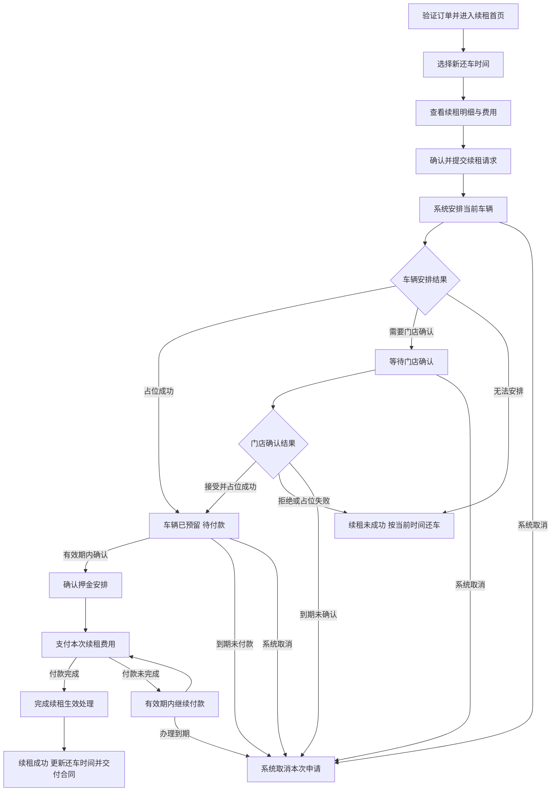

# 独立续租应用 PRD

版本：v1.5；日期：2026-11-04；所属模块：`renewal`；规格模式：Full。

## 1. 业务背景与目标

租车客户在用车期间，可通过品牌官网、车辆二维码、合同附页或“我的行程”中的 Renew 入口，在线延长当前车辆的租期。独立续租应用承接订单验证、还车时间选择、费用确认、申请提交、车辆安排、付款和续租结果查询。

同一套应用服务多个品牌，按订单所属品牌展示标识、客户支持方式和收款信息。客户通过手机浏览器办理，无需注册会员或安装应用。

**客户先确认费用并提交续租请求，系统安排当前车辆。占位成功后，客户再完成押金确认和续租付款。车辆安排失败、门店拒绝、过期未确认或系统取消的申请，在付款前结束。**

业务完成标准：客户收到续租成功结果，当前有效还车时间更新，新增期间的保障与设备安排明确，续租合同和付款凭证可查看。

### 1.1 本期范围

| 业务内容 | 应用提供的服务 |
|---|---|
| 品牌入口与订单验证 | 品牌官网、二维码、我的行程接入；验证后办理同一订单的续租 |
| 续租方案 | 选择新还车时间，查看当前车辆、保障、设备和新增费用 |
| 申请与车辆安排 | 提交续租请求，查看安排进度、门店确认结果及办理截止时间 |
| 在线付款 | 占位成功后确认押金安排，向订单所属品牌在线支付本次费用 |
| 结果与交付 | 查看新还车时间、续租记录、合同、收据及邮件通知 |

本次续租延长当前实际车辆的使用时间，主驾驶人、车辆、还车门店和在用设备按当前合同延续。换车、变更还车门店、增减驾驶人和设备由对应业务流程办理。

### 1.2 依据与采用口径

| 来源 | 日期与适用内容 |
|---|---|
| [《多品牌独立续租应用 Specification》](/Users/admin/pm-ai-learning/specs/order/feat_brand_online_rental_extension_spec.md) v1.3 | 2026-10-19；沿用独立应用定位、多品牌入口、新增租期计价、保障、设备、押金和客户交付规则 |
| 产品负责人入口与时间线确认 | 2026-11-03；首次进入直接选日期，已有生效续租进入最近一次结果；时间线突出本次延长，精简预订重复信息，历史独立查看 |
| 产品负责人本次指令 | 2026-11-03；先提交请求、占位成功再支付；占位失败、过期未确认及系统取消在付款前结束；本文以独立应用为重点 |
| [客户应用边界](../../epic/customer-applications.md)与当日续租确认 | 2026-11-03；订单号＋订单联系电话后四位验证、同订单会话、支付后生成续租合同 |
| [客户续租流程图](/Users/admin/Downloads/mermaid-diagram.svg) | 2026-11-03 提供；采用续租首页、明细确认、车辆安排、付款、结果五页结构 |
| [Customer H5 设计基线](../../../docs/templates/customer-h5-design-baseline.md) | 2026-11-03；页面层级、底部主操作、移动端状态与多语言呈现 |
| 产品负责人本次指令 | 2026-11-04；结果页对齐参考实现 ProcessingPage 生效态（实付＋车辆＋新还车时间＋合同下载），移除费用明细、付款凭证、刷新申请状态、联系门店及"完成并查看更新后的预订"等次级动作；无进行中申请且已有续租记录时进入续租记录列表页并提供"再次申请续租"主操作 |
| 产品负责人本次指令 | 2026-11-04；成功结果页唯一主操作为"返回首页"，"再次申请续租"仅在续租记录列表页提供；成功页不再展示"查看续租详情""续租记录"入口 |

本稿替换本文件 v1.0 的“查询方案后直接创建申请”页面安排，报价和正式提交分为两个客户动作。客户在详情页确认本次续租内容；付款前的合同阅读确认与手写签署已于2026-11-03取消，续租合同在付款成功后生成。客户界面沿用本仓库简中、繁中、英语、日语、韩语、泰语六语体系。

## 2. 客户、入口与业务协同

### 2.1 使用条件与入口

客户已取车、尚未还车，且当前有效还车时间尚未届满时，可申请续租。每次申请以最近一次已生效合同的还车时间为起点。

| 入口 | 进入方式 | 客户到达的位置 |
|---|---|---|
| 我的行程 → Renew | 复用已验证的订单，Push | 优先恢复进行中申请；否则进入最近一次生效续租详情；无生效记录时直接打开日期选择 |
| 品牌官网续租入口 | 打开品牌续租页面，完成统一订单验证 | 同订单按进行中申请、最近生效记录、首次选日期分流 |
| 车辆码、合同附页二维码 | 手机扫码打开品牌页面，完成统一订单验证 | 同订单按进行中申请、最近生效记录、首次选日期分流 |
| 申请进度、邮件中的链接 | 已有有效会话直接恢复；会话结束后重新验证 | 对应申请的最新进度或结果 |

订单验证使用订单号＋订单联系电话后四位，规则见[订单验证](../auth/booking-verification.md)。品牌、车辆码和进度链接提供进入位置，订单验证确定客户可办理的订单。

### 2.2 业务职责

| 参与方 | 职责 |
|---|---|
| 客户 | 选择还车时间、核对费用、提交请求、查看车辆安排、完成付款及查看合同 |
| 独立续租应用 | 组织客户办理步骤，展示报价、进度、截止时间和结果，提供恢复及支持入口 |
| 平台业务服务 | 提供订单资格、报价、车辆占位、押金、收款、续租生效、合同和通知结果 |
| FleetEdge 商户端 | 接收需要人工确认的申请，门店反馈接受或拒绝；接受并落实占位后，客户应用开放付款 |

## 3. 客户业务流程

### 3.1 主流程



申请提交、车辆预留、付款完成和续租生效是四个业务节点。当前有效还车时间在续租生效时更新；办理期间同时展示当前还车时间和本次拟延长时间。

### 3.2 各阶段的客户结果

| 阶段 | 客户已完成的事 | 应用展示 | 下一步 |
|---|---|---|---|
| 查看明细 | 选择新还车时间并取得报价 | 拟新增租期、保障、设备、费用和押金方案 | 确认续租申请 |
| 安排车辆 | 已提交请求 | 申请编号、安排进度、当前还车时间 | 查看处理进度 |
| 等待门店 | 申请需要门店确认 | 等待状态、确认截止、当前还车时间 | 刷新进度或联系支持 |
| 待付款 | 当前车辆占位成功 | 预留结果、付款截止、本次应付与押金安排 | 确认付款 |
| 付款处理中 | 已发起付款 | 付款处理状态 | 查看付款结果 |
| 续租处理中 | 付款已完成 | 已付金额、续租处理状态、当前还车时间 | 查看续租结果 |
| 续租成功 | 本次续租已生效 | 新还车时间、费用、合同和收据 | 查看合同或返回我的行程 |
| 申请结束 | 车辆安排失败、拒绝、到期或系统取消 | 结束原因、当前有效还车时间和支持入口 | 返回我的行程 |

## 4. 页面与交互

### 4.1 续租入口与日期选择

入口先查询订单资格与申请。优先恢复进行中的申请（等待门店、待付款、付款或生效处理中）；无进行中申请且已有续租记录时进入续租记录列表页，按申请时间倒序展示记录并提供"再次申请续租"主操作，结束、拒绝等历史状态以简短标签保留并可点开只读详情；从未提交申请时直接打开日期 Bottom Sheet。

日期 Bottom Sheet 显示当前有效还车时间、门店时区和新还车日期／时间，底部主操作为“确认还车时间”，不放续租记录入口。确认后仅获取报价，成功时关闭弹层并进入详情页；报价失败保留所选时间，在弹层内显示错误与重试。关闭或手机返回首次日期选择回到我的行程；从生效结果页或续租记录列表发起的再次申请，关闭日期选择返回原页面。详情页返回重新打开日期选择，保留输入。

新还车时间晚于当前有效还车时间，单次新增最多15个计费日，同时满足订单累计租期及门店可办理范围。可选时间和计费天数由续租服务提供。获取报价不创建申请，客户在下一页核对并正式提交。

### 4.2 续租详情：核对并提交

详情页复用应用壳的品牌、订单与语言页头，不重复品牌摘要卡或“重新查询”按钮。按客户决策顺序分组：

1. **这次延长多久**：当前车辆、原还车时间、拟新还车时间、新增计费天数及门店时区。
2. **这段时间包含什么**：新增期间的保障、原在用设备及数量、对应费用。
3. **本次支付多少**：续租租金、保障、设备、必要服务费及含税合计；押金单独成卡。
4. **完成后如何接收**：本次交付邮箱与客服方式。

底部唯一主操作为“确认续租申请”。点击后创建本次申请，进入车辆安排页。客户在详情页完成续租摘要确认。

“修改天数”打开日期 Bottom Sheet，确认后更新同一份报价和明细。保障按原合同延续；原 OTA 保障无法续期时，客户选择新增期间的品牌保障后更新报价。完整保障条款使用 Drawer 查看。提交前修改租期或保障，以最新明细供客户确认。

### 4.3 车辆安排页：查看确认进度

首屏先显示“正在安排车辆”或“等待门店确认”，下方依次展示申请编号、拟新还车时间、当前有效还车时间、确认截止时间。进度分为“安排车辆 → 确认付款 → 续租生效”。

车辆已预留后停留本页，展示预留结果、付款截止、本次应付及拟新还车时间，底部主操作为“去支付”。仅客户主动点击后进入银行卡付款页，定时器、轮询和重新进入均不得自动跳转。需要门店确认时停留本页，主操作为“刷新进度”。门店接受且占位成功后，同一申请更新为预留结果，由客户主动进入付款。

车辆安排失败、门店拒绝、确认到期或系统取消后，本页更新为结束结果，展示具体原因和当前还车时间，主操作为“返回我的行程”。这些结果不进入支付。

### 4.4 付款页：确认押金与付款

付款页复用应用壳页头，只显示一个当前付款标题，以轻量截止信息代替重复预留提示框。首屏展示付款截止，再展示拟新还车时间、本次费用明细、应付合计及品牌收款主体。返回时回到预留结果。

押金独立成卡，展示原押金、本次所需金额、有效期及处理方式。需要客户同意的押金条款默认未勾选；客户确认后完成所需授权，再支付续租费用。信用卡资料由支付组件采集，银行认证在支付流程内完成。

底部唯一主操作为“确认付款”，并显示金额和币种。付款入口适用于仍在有效期内、当前车辆已占位成功的申请。占位到期或申请取消后，页面转入结束结果。

应付为零时，主操作为“继续办理”；按同一车辆预留和押金规则完成确认，确认结果触发续租生效处理和合同生成，结果页展示本次费用为零。

### 4.5 结果页：确认期限与查看合同

续租生效后，首屏展示“续租成功 · 车辆已确认安排”结果标题、一句说明和“安排车辆 → 付款已受理 → 协议生效”三步完成进度，层级与分组参考 `selfservice_rental@ee9635a` ProcessingPage 生效态。其下一张卡片汇总本次实付（“付款已确认”状态胶囊）、当前承租车辆（车型、车牌、规格及本次延长天数）、新的还车时间与还车据点（品牌色高亮块，按门店时区格式化）。页面不重复驾驶人、联系方式、费用明细、付款凭证、门店地址和主合同；取还车时间线、费用明细与付款资料收纳于续租记录详情。

续租合同单独成卡，分别呈现“生成中”“可下载”“生成失败”：可下载时展示文档标题、档案说明与“下载 PDF”；生成失败保留页内刷新入口。付款已完成、续租仍在处理中时，显示已付金额、当前还车时间和“刷新进度”。合同生成中的状态独立显示，客户可稍后回到同一申请查看。

**（2026-11-04 修订）**成功页底部唯一主操作为“返回首页”，点击返回我的行程（应用首页）。付款成功落地即引导客户离开办理流，不在成功页直接发起下一次续租：“再次申请续租”仅在续租记录列表页作为无进行中申请且已有生效记录时的主操作提供，本次续租的只读详情由记录列表进入。成功页不提供“再次申请续租”“查看续租详情”“续租记录”“完成并查看更新后的预订”“刷新申请状态”“联系门店客服”入口，以及费用明细与付款凭证区块。返回我的行程后，订单展示最新有效还车时间，每次续租分别保留记录。

### 4.6 导航与手机操作

导航关系：我的行程 Push 续租模块，按 §4.1 分流；日期 Bottom Sheet 确认报价后 Push 详情页；提交后 Replace 为车辆安排页；占位成功保留结果，点击“去支付”Push 付款页；付款发起后 Replace 为处理页，再按结果展示生效或结束页。详情页返回日期 Bottom Sheet 并保留时间选择；付款页返回预留结果，其他已提交申请页面返回我的行程，再次进入时恢复原申请。子页面标题与返回由应用页头承载，内容区不重复导航。

日期选择使用 Bottom Sheet，保障长条款使用 Drawer。普通浏览器后退、手机物理返回遵循上述关系；提交后的页面由最新申请进度恢复。

页面适配320px及以上宽度，主内容最大480px，底部主操作预留 safe area。触控区域至少44×44px，软键盘打开时输入项和错误提示保持可见。提交点击立即显示处理中，请求超过5秒显示等待说明。异步内容覆盖 loading / empty / error / success，错误说明在对应区域持续展示。

二维码由系统相机或扫码应用打开 HTTPS 页面。办理本身使用网页输入与支付组件；应用内浏览器遇到支付兼容问题时提供系统浏览器继续办理入口，重新验证后恢复原申请。页面操作以点击为主，下拉刷新用于查询进度。

## 5. 业务规则

### 5.1 车辆安排与确认

1. **先报价、再申请**：查看明细计算新增费用；客户确认提交后，系统开始车辆安排。
2. **当前车辆续租**：以原预订起点至拟新还车时间的完整租期参与排单，用新租期替换本订单原区间；同一订单在排单中计为一份用车需求，当前车辆连续保留。
3. **自动安排**：完整排单可行，且其他已安排订单继续有车可用时，系统完成占位，申请进入待付款。续租安排以完整排单结果为依据。
4. **门店确认**：自动安排涉及超售或其他订单需要重新安排时，申请转为等待门店。门店接受后落实车辆预留，再向客户开放付款；门店拒绝则结束申请。人工接受可采用授权强占，具体排单操作由 FleetEdge 商户端承接。
5. **车辆适用性**：车辆维保、证照及使用安排满足新租期要求。最终无法安排当前车辆时，本次申请结束，页面提示按当前有效时间还车。
6. **单一进行中申请**：同一订单在同一时段办理一笔续租。客户重新进入、刷新或更换设备后，继续查看该申请。

### 5.2 确认截止与系统取消

沿用来源 PRD 的办理时限：**申请提交后1小时与当前有效还车时间取较早者，作为本次办理截止**。车辆占位有更早到期时间时，付款截止取占位到期与办理截止中的较早者。所有时间按门店时区展示，由服务端返回。

| 场景 | 系统处理 | 客户看到的结果 | 付款安排 |
|---|---|---|---|
| 自动安排失败，转人工 | 保留同一申请，等待门店决定 | 等待门店确认、确认截止 | 等待占位结果 |
| 当前车辆最终无法安排 | 结束本次申请 | 车辆未能安排、当前还车时间 | 不进入支付 |
| 门店拒绝 | 结束本次申请 | 门店未接受、当前还车时间 | 不进入支付 |
| 到截止仍未确认 | 系统取消申请 | 确认超时，申请已取消 | 不进入支付 |
| 已占位，到期仍未付款 | 系统取消，释放本次新增预留 | 付款已到期，申请已取消 | 付款入口关闭 |
| 付款前系统取消 | 结束申请，释放本次新增预留 | 申请已取消及取消原因 | 不进入支付 |

申请在后台等待确认时，客户仍可查看当前还车时间和支持入口。关闭页面、切后台、重新验证及更换设备沿用原办理截止。申请结束后，本次新增占位释放，原有效租期和用车安排继续履行。客户主动操作以提交、查询和付款为主，未完成申请到期后由系统取消。

### 5.3 新增租期与费用

新增租期从当前有效还车时间起算，单次最多15个计费日。计费按统一租赁日规则执行，现有按24小时向上取整的规则由计价服务计算。连续多次续租各自以最新有效还车时间为起点，累计租期仍按首次取车至新还车时间计算。

续租按**当前实际在租车型**在品牌续租渠道的现行费率计算。取车时发生过免费或付费升级的，采用实际在租车型，并在明细中展示。

| 费用 | 计算规则 |
|---|---|
| 车辆租金 | 先汇总新增期间正常租金，再加一次品牌续租加价；比例由品牌价格配置提供 |
| 保障费用 | 按当前合同续期约定或新增期间适用方案报价 |
| 在用设备 | 项目与数量延续；按天项目收新增期间费用，整租及封顶项目按连续租期已收金额计算剩余应收 |
| 必要服务费 | 按本次适用规则逐项列示 |
| 押金 | 按有效担保政策单独展示和办理 |

含税应付总额＝新增期间正常租金×（1＋续租加价比例）＋新增保障费＋新增设备费＋必要服务费。续租加价作用于车辆租金，保障、设备及服务按各自规则收费。金额按币种精度舍入。

例如新增期间正常租金10,000 JPY、加价90%、保障2,000 JPY、设备1,000 JPY，则续租租金为19,000 JPY，本次应付22,000 JPY。该算例用于验收计价方式。

报价包含计费期间、天数、金额、币种、保障、设备、押金方案及有效期。提交时确认并锁定本次内容，在办理有效期内按已确认方案完成付款。提交前发生金额或方案变化时，应用更新明细，由客户确认后再提交。再次续租重新计算新增时段的价格。

### 5.4 保障、设备与押金

原保障按真实可续期范围延续；原 OTA 平台保障只覆盖原期间且无法续期时，客户可为新增期间选择适用的品牌保障。详情和合同分段展示原保障截止、新保障起止、提供方、责任与免赔额。新增期间有可用保障方案并完成必要选择后，可提交申请。

原交付设备按项目和数量延续，续租后随车辆在新还车时间归还。原合同约定覆盖连续租期的免费、整租和封顶权益继续适用。

押金在车辆占位成功后的付款步骤办理。已有押金的金额和有效期满足要求时复用；额度不足时按政策补充授权，期限不足时重新授权。未启用押金或已有有效豁免的订单按原政策办理。客户在付款页单独确认押金条款，授权结果满足要求后再收取续租款。

重新授权时，页面说明新旧冻结金额和释放进度；有效担保接续完成后处理原授权。申请取消时，根据订单最新有效租约的责任，释放本次多余担保。续租款、押金冻结及押金释放分别展示。

### 5.5 付款、生效与合同

付款归属原订单品牌对应的收款主体。申请仍有效、当前车辆已预留、费用与押金方案已确认时，客户可付款。

付款完成后，系统核实本次租期、车辆、保障和担保，提交续租生效并更新还车时间；付款成功结果触发续租合同生成。合同记录新旧还车时间、车辆、费用、保障、设备和本次办理语言。合同与收据在应用内可查看，并通过交付邮箱通知客户。

付款结果待确认时，应用查询原交易。付款明确未完成且占位仍有效时，客户可继续付款或更换支付方式。付款处理中到达截止的，由系统核实原交易并给出最终申请结果。

已收款而本次续租最终无法生效时，系统取消本次续租，按本次实收金额全额原路退款，并按有效租约处理本次新增预留和担保。退款分别展示“处理中”“已提交支付机构”“已到账”，金额、币种和进度随处理结果更新。

## 6. 客户信息与校验

字段围绕“延长多久、包含什么、支付多少、如何接收”组织。

| 字段 | 类型与来源 | 必填、默认及校验 | 影响的客户动作／文案 key |
|---|---|---|---|
| [MOD] 订单、品牌、车辆、门店 | 对象；读取已验证订单与当前合同 | 必填，只读；归属同一订单 | 加载完成后办理；复用订单及车辆标签 |
| [MOD] 当前还车时间、时区 | 时间；读取当前有效合同与门店 | 必填，只读；每次申请以最新有效时间为准 | 时间选择；复用 `renewCurrentReturn` |
| [MOD] 拟新还车时间 | 时间；客户选择并保存 | 必填，初始为空；晚于当前时间、单次≤15个计费日及可办理截止 | 查看明细；`renewInvalidReturn` |
| [MOD] 新增计费天数 | 数值；根据租期计算 | 必填，按统一计价结果展示 | 报价与确认；复用天数标签 |
| [MOD] 保障与在用设备 | 列表；读取合同及续期方案 | 保障选择按适用条件必填；设备只读 | 提交申请；`renewCoverageRequired` |
| [MOD] 费用明细、币种、报价有效期 | 金额与时间；读取报价 | 必填；租金、保障、设备、服务及合计完整 | 提交及付款；`renewDetailsUpdated` |
| [ADD] 交付邮箱 | 字符串；订单预留邮箱 | 必填，预填；本次变更邮箱按联系方式核验流程确认，仅保存为本次交付地址 | 提交申请；`renewDeliveryEmailInvalid` |
| [MOD] 申请编号、车辆安排结果 | 编号与状态；读取申请 | 提交后必填，显示最新结果 | 付款资格；`renewAwaitingStore` |
| [ADD] 确认截止、付款截止 | 时间；读取申请及占位结果 | 等待或待付款时必填，门店时区展示 | 继续办理；`renewConfirmBy` / `renewPayBy` |
| [MOD] 押金方案、同意与授权结果 | 对象与布尔值；读取担保方案，保存客户同意 | 付款阶段必填；适用同意项默认未勾选 | 付款；复用押金同意及授权文案 |
| [MOD] 付款、生效、合同结果 | 状态及链接；读取对应业务结果 | 按当前阶段展示，合同可用后提供查看链接 | 恢复或查看；复用结果与合同资源 |

原样业务数据包括品牌名称、订单编号、车牌、门店名称、客服方式和法律主体；系统标签、按钮及状态使用多语言资源；金额、日期和时区按当前语言格式化。报价与条款内容按本次确认版本保存。

## 7. 中断与恢复

| 客户场景 | 应用处理 | 客户下一步 |
|---|---|---|
| 时间超出可办理范围 | 在时间选择处说明可选范围，保留原输入 | 修改时间 |
| 报价加载失败或已过期 | 保留车辆和租期，费用区域显示重新获取入口 | 重新查看明细 |
| 提交后网络中断 | 查询同订单进行中的申请，恢复已提交进度 | 查看进度 |
| 门店尚未确认 | 保留等待状态与确认截止 | 刷新或联系支持 |
| 门店通知发送失败 | 保留申请，通知服务继续投递，页面提供联系门店入口 | 联系门店 |
| 占位或办理到期 | 更新为申请结束，展示当前还车时间 | 返回我的行程 |
| 押金授权未完成 | 在押金区域展示原因及继续办理入口 | 重试授权或联系支持 |
| 付款返回慢、认证后回跳或结果待确认 | 查询本次付款，显示处理进度 | 刷新结果 |
| 已确认付款失败，占位仍有效 | 保留本次申请、报价和付款截止 | 继续付款或更换方式 |
| 切后台、刷新、换设备 | 读取同一申请；需要时重新验证订单 | 继续当前步骤 |
| 合同生成或下载失败 | 保留续租及付款结果，合同区域提供刷新入口 | 稍后查看或联系支持 |
| 邮件未送达 | 保留应用内结果，通知服务重试 | 在应用内查看合同 |
| 会话结束 | 回订单验证，验证后恢复申请及原截止 | 重新验证订单 |

继续办理条件分为两组：查看或提交明细需要有效会话、在租资格、有效租期及完整报价；进入付款还需要有效车辆占位、已完成门店确认或自动安排、有效付款时限及可执行押金方案。合同和邮件处理不影响客户查询已完成的付款及生效结果。

## 8. 通知与续租记录

客户邮件与应用内进度使用同一申请结果。邮箱预填当前订单地址，客户在提交前确认。办理语言在提交时记录，后续邮件和合同按该语言交付；页面切换语言保留申请、时间、金额和付款进度。

| 通知时点 | 客户收到的内容 |
|---|---|
| 申请已提交、需要门店确认 | 申请编号、拟新增租期、当前还车时间、确认截止和查询入口 |
| 占位成功、可以付款 | 车辆已预留、应付金额、付款截止和继续办理入口 |
| 申请失败或取消 | 结束原因、当前还车时间和支持方式；付款前结束的申请按未支付结果通知 |
| 付款完成、续租处理中 | 已付金额、当前处理进度及查询入口 |
| 续租生效 | 新旧还车时间、车辆与门店、保障与设备、本次费用、收据和合同入口 |
| 合同生成完成 | 同一续租记录的合同查看入口 |
| 退款阶段更新 | 本次退款金额、币种和最新处理阶段 |

我的行程按次展示续租记录。每笔记录包含申请编号、办理状态、拟新增期间、付款状态和费用；已生效记录展示新的有效期限和合同。原预订费用与每次续租费用分组展示，已生效续租计入当前订单总额，原预订的到付余额继续按原安排处理。

### 8.1 续租记录与详情呈现

依据：产品负责人2026-11-03提供的两张截图，以及参考仓库 `selfservice_rental` 的 `codex/rental-extension-connection@ee9635a` 下 `ActiveExtendedBookingPage`；仅作为客户界面参考。办理规则仍按本文，付款前不新增签名。

续租生效详情仅展示本次续租结果、紧凑租期变化摘要、本次实付、费用明细与本次合同／付款凭证。详情内容区不再单独设置大尺寸取还车时间线；首个卡片内以“本次续租前还车时间 → 新还车时间”呈现本次变化，并紧邻展示本次延长天数、门店时区和还车据点。订单取车时间不在续租详情重复展示，可在预订详情查看。多次续租仅展示该笔申请冻结的原还车时间与新还车时间，历史记录不借用当前还车时间覆盖该次日期，也不展开累计的所有续租节点。新还车时间仅出现一次，品牌色与文字共同表达新增结果。

“续租记录”为无进行中申请且已有续租记录时的默认到达页，按申请时间倒序显示状态、延长期间、天数和本次费用。列表复用应用页头的标题与返回，不在内容区重复导航，不常驻大刷新按钮；查询失败保留记录并提供重试。历史状态使用简短标签；失败记录不宣称其旧还车时间仍是当前有效时间。成功、失败、取消、过期均保留；无记录展示空态。列表底部主操作为“再次申请续租”，点击后重新查询订单资格、当前有效还车时间及进行中申请；有进行中申请则恢复其进度，无进行中申请且订单已同步生效期限时在列表上打开日期 Bottom Sheet，关闭返回列表，报价成功后进入详情页。列表请求不创建新申请，不展示整份预订摘要。

点击历史记录进入只读详情，包含本次租期变化摘要、费用与付款状态、冻结保障／设备快照、本次合同和凭证。租期变化摘要与承租车型位于同一卡片，删除车型区内重复的延长天数和新还车时间块。费用明细默认折叠，点击展开。缺少快照时显示“暂无明细”，不借用当前订单覆盖历史；未付款不展示实付或付款凭证。历史详情提供返回列表，不提供再次申请主按钮。手机返回按“历史详情 → 历史列表 → 原办理页”恢复；页面适配320px与安全区。

合同区仅展示该次续租合同，按申请结果显示生成中、失败、可查看；缺少有效文件链接时提供刷新与支持，不拼接法律正文或签署状态。付款凭证使用服务端返回的付款状态、实付、卡号末四位和交易凭证编号，不伪造下载链接。原主合同在预订详情查看。

续租记录列表的“再次申请续租”为主操作（成功结果页不提供该入口，见 §4.5）。点击后重新查询订单资格、当前有效还车时间及进行中申请；有进行中申请则恢复其进度，无进行中申请且订单已同步生效期限时打开日期 Bottom Sheet。原页面保留为日期弹层的背景，关闭返回原页面。新申请以最新有效还车时间起算；刷新中或交易结果不明时禁止重复发起，查询失败保留原结果并就地重试。

客户端接入边界：当前查询协议只有 `active_request` / `latest_request`，完整历史暂约定可选 `request_history`（同订单申请快照数组），仍需服务端联调确认。未返回时仅展示已收到的申请，不声称历史齐全。本地演示支持多次申请与历史，属于实现证据；正式合同及完整历史交付依赖服务端数据。

## 9. 文案与多语言增量

资源沿用 `src/i18n/preparation.ts` 六语结构。以下为新增或修订核心文案的简中、英语、日语审校包；繁中、韩语、泰语与对应页面一起交付。已有费用、车辆、押金、付款、合同及支持标签复用当前资源。

| resource_key | zh-CN | en | ja |
|---|---|---|---|
| [MOD] `renewSearch` | 查看续租明细 | View extension details | 延長内容を確認 |
| [MOD] `renewConfirmApply` | 确认续租申请 | Submit extension request | 延長を申請 |
| [ADD] `renewConfirmPayment` | 确认付款 | Confirm payment | 支払いを確定 |
| [ADD] `renewContinue` | 继续办理 | Continue | 手続きを続ける |
| [ADD] `renewArrangingVehicle` | 正在安排车辆 | Arranging your vehicle | 車両を手配中 |
| [MOD] `renewAwaitingStore` | 等待门店确认 | Awaiting branch confirmation | 店舗の確認待ち |
| [MOD] `renewHoldReady` | 车辆已预留，请在 {deadline} 前付款。 | Vehicle reserved. Pay by {deadline}. | 車両を確保しました。{deadline}までにお支払いください。 |
| [ADD] `renewConfirmBy` | 确认截止：{deadline} | Confirmation deadline: {deadline} | 確認期限：{deadline} |
| [ADD] `renewPayBy` | 付款截止：{deadline} | Payment deadline: {deadline} | 支払期限：{deadline} |
| [ADD] `renewArrangementFailed` | 车辆未能安排，请于 {currentReturnAt} 前还车。 | Vehicle unavailable. Return the car by {currentReturnAt}. | 車両を手配できませんでした。{currentReturnAt}までにご返却ください。 |
| [MOD] `renewStoreRejected` | 门店未接受本次续租，请于 {currentReturnAt} 前还车。 | The branch declined this extension. Return by {currentReturnAt}. | 店舗が延長を承認しませんでした。{currentReturnAt}までにご返却ください。 |
| [ADD] `renewConfirmationExpired` | 确认已超时，本次申请已取消。 | Confirmation timed out. This request was cancelled. | 確認期限が切れたため、申請はキャンセルされました。 |
| [MOD] `renewHoldExpired` | 付款已到期，本次申请已取消。 | The payment deadline passed. This request was cancelled. | 支払期限が切れたため、申請はキャンセルされました。 |
| [ADD] `renewSystemCancelled` | 本次续租申请已取消。 | This extension request was cancelled. | 延長申請はキャンセルされました。 |
| [ADD] `renewCurrentReturnNotice` | 当前还车时间：{currentReturnAt} | Current return time: {currentReturnAt} | 現在の返却日時：{currentReturnAt} |
| [ADD] `renewCoverageRequired` | 请选择新增租期的保障方案。 | Choose coverage for the extension period. | 延長期間の補償プランを選択してください。 |
| [ADD] `renewDetailsUpdated` | 续租明细已更新，请确认后提交。 | Extension details updated. Review and submit. | 延長内容が更新されました。確認して申請してください。 |
| [ADD] `renewDeliveryEmail` | 接收合同的邮箱 | Email for your contract | 契約書の送付先メールアドレス |
| [ADD] `renewDeliveryEmailInvalid` | 请输入有效的邮箱地址。 | Enter a valid email address. | 有効なメールアドレスを入力してください。 |
| [MOD] `renewContractGenerating` | 付款已完成，续租合同生成中。 | Payment completed. Preparing your extension contract. | 支払いが完了しました。延長契約書を作成中です。 |
| [MOD] `renewContractFailed` | 合同生成失败，请刷新或联系支持。 | Contract generation failed. Refresh or contact support. | 契約書を作成できませんでした。更新するかサポートへご連絡ください。 |
| [MOD] `renewNotificationFailed` | 暂未能通知门店，请联系门店确认。 | We could not notify the branch. Please contact the branch. | 店舗に通知できませんでした。店舗へご連絡ください。 |

失败、取消页面在说明下方展示当前还车时间；还车时间已过时，使用 `renewCurrentReturnNotice` 标签和值。页面文案中的确认截止、付款截止与当前还车时间分别展示。

### 9.1 记录与只读详情文案

以下均为系统文案或业务状态文案，申请编号、门店名、合同编号与支付凭证编号按服务端数据原样展示。繁中、韩语与泰语与本次页面共同交付。

| resource_key | zh-CN | en | ja |
|---|---|---|---|
| `renewHistory` | 续租记录 | Extension history | 延長履歴 |
| `renewHistoryEmpty` | 暂无续租记录 | No extension records yet | 延長履歴はありません |
| `renewRecordDetails` | 查看续租详情 | View extension details | 延長の詳細を見る |
| `renewRecordTitle` | 续租详情 | Extension details | 延長詳細 |
| [MOD] `renewExtendAgain` | 再次申请续租 | Extend your rental again | さらにレンタルを延長 |
| `renewContractManagement` | 合同管理 | Contract management | 契約書管理 |
| `renewMainContract` | 汽车租赁主合同 | Original rental agreement | 元のレンタル契約書 |
| `renewNoBreakdown` | 暂无明细 | Details unavailable | 明細はありません |
| `renewNoAddons` | 本次无附加设备及服务 | No add-on equipment or services | 今回の追加装備・サービスはありません |
| `renewOriginalReturn` | 原还车时间 | Previous return time | 延長前の返却日時 |
| `renewPaymentDetails` | 付款资料 | Payment details | お支払い情報 |
| `renewPaymentStatus` | 付款状态 | Payment status | 支払い状況 |
| `renewPaid` | 付款已确认 | Payment confirmed | 支払い確認済み |
| `renewPaidAmount` | 实付金额 | Amount paid | 支払済み金額 |
| `renewCardLast4` | 卡号末四位 | Card last four digits | カード番号下4桁 |
| `renewReceiptNumber` | 付款单据号 | Payment reference | 決済番号 |
| `renewTotalPeriod` | 总租期：{count}天 | Total rental: {count} days | 総レンタル期間：{count}日 |
| `renewRecordStatus` | 办理状态 | Request status | 申請状況 |
| `renewReviewDetails` | 查看续租明细 | View extension details | 延長内容を確認 |

新增系统文案（六语随页面交付）：

| resource_key | zh-CN | en | ja |
|---|---|---|---|
| `renewThisExtension` | 本次延长 {count} 天 | This extension: {count} days | 今回の延長：{count}日 |
| `renewBeforeExtension` | 本次续租前还车时间 | Return time before this extension | 今回の延長前の返却日時 |
| `renewPaymentReceipt` | 付款凭证 | Payment receipt | お支払い控え |
| `renewRecordEnded` | 申请已结束 | Request closed | 申請終了 |
| `renewRecordDeclined` | 门店未接受 | Declined by the branch | 店舗が承認しませんでした |
| `renewRentedVehicle` | 承租车型 | Rented vehicle | ご利用車両 |
| `renewCoverageContinues` | 原保障条款继续适用 | Existing coverage terms still apply | 既存の補償条件が引き続き適用されます |
| `renewNoNewLiability` | 不新增保险责任 | No new insurance liability is added | 新たな保険責任は追加されません |
| `renewPaymentMethod` | 付款方式 | Payment method | お支払い方法 |

### 9.2 体验 UI

| Key | zh-CN | en | ja |
|---|---|---|---|
| `renewConfirmReturnTime` | 确认还车时间 | Confirm return time | 返却日時を確認 |
| `renewVehicleReserved` | 车辆已预留 | Vehicle reserved | 車両を確保しました |
| `renewGoToPayment` | 去支付 | Continue to payment | 支払いへ進む |
| `renewPaymentDeadlineLabel` | 付款截止时间 | Payment deadline | 支払期限 |
| `renewReservedDescription` | 请核对本次续租信息，继续完成付款。续租生效前仍以当前还车时间为准。 | Review your extension and continue to payment. Your current return time applies until the extension is confirmed. | 延長内容をご確認のうえ、お支払いへお進みください。延長確定までは現在の返却日時が適用されます。 |
| `renewSuccessTitle` | 续租成功 · 车辆已确认安排 | Extension confirmed · Vehicle secured | 延長確定・車両確保済み |
| `renewSuccessDescription` | 续租已确认，请按下方新的还车时间还车。 | Your extension is confirmed. Return the vehicle at the new time below. | 延長が確定しました。以下の新しい返却日時にご返却ください。 |
| `renewCompleteBooking` | 完成并查看更新后的预订 | Done · View updated booking | 完了して更新後の予約を確認 |
| `renewAwaitingStoreTitle` | 等待门店确认 | Waiting for the branch | 店舗の確認待ち |
| `renewConfirmingTitle` | 付款成功，正在确认续租 | Payment received · Confirming extension | 支払い完了・延長を確認中 |

## 10. 验收标准

| 编号 | Given / When | Then |
|---|---|---|
| AC-RENEW-01 | Given 已验证的在租订单，When 点击 Renew | 先恢复进行中申请；无进行中申请且已有续租记录时进入续租记录列表页并提供“再次申请续租”主操作；无申请时直接弹出日期选择，不重复预订摘要 |
| AC-RENEW-02 | Given 未取车、已还车或已逾期，When 进入续租 | 显示当前资格结果及支持入口，办理范围对应当前订单 |
| AC-RENEW-03 | Given 客户已选择有效新时间，When 查看续租明细 | 确认时间后展示报价，车辆安排在客户正式提交后开始 |
| AC-RENEW-04 | Given 已取得报价，When 修改天数或适用保障 | 更新租期及费用，由客户核对最新明细后提交 |
| AC-RENEW-05 | Given 完整租期排单可行，When 确认续租申请 | 替换本订单原排单区间，连续预留当前车辆，申请进入待付款 |
| AC-RENEW-06 | Given 自动排单涉及超售或其他已排订单需重新安排，When 提交申请 | 转等待门店确认，保留原用车安排，付款入口关闭 |
| AC-RENEW-07 | Given 销售库存显示不足但完整排单可行，When 提交申请 | 按完整排单结果完成占位并进入待付款 |
| AC-RENEW-08 | Given 等待门店，When 门店接受并占位成功 | 同一申请进入待付款；接受后占位仍未成功时继续等待或显示失败结果 |
| AC-RENEW-09 | Given 当前车辆最终无法安排或门店拒绝，When 返回处理结果 | 显示续租失败及当前还车时间，申请在付款前结束 |
| AC-RENEW-10 | Given 申请待确认，When 达到办理截止仍未确认 | 系统取消申请，关闭付款入口，展示确认超时及当前还车时间 |
| AC-RENEW-11 | Given 车辆已预留尚未付款，When 占位或办理到期 | 系统取消，释放本次新增预留，付款入口关闭 |
| AC-RENEW-12 | Given 付款前系统取消申请，When 客户仍停留在付款页 | 刷新为取消结果，继续付款由服务端返回已取消 |
| AC-RENEW-13 | Given 有效占位和完整费用，When 客户确认所需押金安排 | 押金单独展示和办理，担保满足后收取续租费用 |
| AC-RENEW-14 | Given 客户确认付款，When 银行认证完成或响应中断 | 查询本次交易并恢复付款结果，重复点击和回跳归入同一交易 |
| AC-RENEW-15 | Given 付款明确未完成且占位有效，When 客户继续付款 | 在原申请与原截止内完成后续支付 |
| AC-RENEW-16 | Given 本次应付为零，When 占位及必要押金条件满足 | 使用“继续办理”完成确认，展示零费用结果 |
| AC-RENEW-17 | Given 付款成功，When 系统处理续租 | 生成本次续租合同；续租生效时展示并更新新还车时间 |
| AC-RENEW-18 | Given 车辆安排、门店等待、拒绝或付款失败，When 查询合同 | 合同保持未生成，待付款申请可按有效占位继续办理 |
| AC-RENEW-19 | Given 续租已生效但合同生成或下载失败，When 查看结果 | 保留新还车时间和付款结果，可刷新合同或联系支持 |
| AC-RENEW-20 | Given 正常租金10,000 JPY、加价90%、保障2,000 JPY、设备1,000 JPY，When 计价 | 续租租金19,000 JPY，应付22,000 JPY；已付原租期与整租权益按约定延续 |
| AC-RENEW-21 | Given 原 OTA 保障无法续期，When 客户选择适用品牌保障 | 原保障与新增保障分段显示，仅对新增期间计价 |
| AC-RENEW-22 | Given 已提交申请，When 刷新、切后台或换设备重新验证 | 恢复同一申请、付款进度及原截止 |
| AC-RENEW-23 | Given 同订单多端提交或门店确认与到期同时发生，When 查询结果 | 返回同一申请的最终结果，结束的申请保持付款入口关闭 |
| AC-RENEW-24 | Given 已收款而续租最终无法生效，When 申请取消 | 全额原路退款，展示对应退款阶段，原有效租约继续履行 |
| AC-RENEW-25 | Given 六语及320px手机页面，When 选择时间、提交、付款和返回 | 信息完整可读，主操作可达，错误就地可见，语言切换保留进度 |
| AC-RENEW-26 | Given 当前有效还车时间已过，When 展示失败或取消结果 | 展示当前还车时间标签与值，以及支持入口 |
| AC-RENEW-27 | Given 同订单多次续租，When 查看续租记录及任一详情 | 进入独立倒序列表，按申请区分期间、状态、费用、付款与合同；只读详情使用该次快照，缺失明细显示空态，不展示再次申请按钮 |
| AC-RENEW-28 | Given 续租已生效，When 再次申请 | 先刷新订单与进行中申请，无进行中申请时弹出日期选择，以最新有效还车时间报价；关闭回原结果，保留旧记录，重复点击不创建重复申请 |
| AC-RENEW-29 | Given 历史详情已打开，When 返回、语言切换或合同不可用 | 返回历史列表后可回原办理页，保留办理进度；六语内容与金额完整可读；合同异常提供刷新且不要求再次付款 |
| AC-RENEW-30 | Given 多笔生效续租，When 再次点击 Renew | 展示最新生效记录的三节点时间线，本次新增段强调；无驾驶人、车辆卡、门店地址或主合同重复区块 |
| AC-RENEW-31 | Given 日期选择已打开，When 报价失败或取消选择 | 失败保留日期并在弹层重试；首次取消返回我的行程，再次申请取消返回原生效详情；不创建申请 |
| AC-RENEW-32 | Given 已生效记录后又有失败申请，When 重新进入且无进行中申请 | 首页仍展示最后一次已生效详情；失败申请保留在历史列表；进行中申请出现时优先恢复 |
| AC-RENEW-33 | Given 首次选日期与续租明细，When 展示页面 | 弹层无记录入口，按钮为确认还车时间；详情无重复品牌卡和重新查询 |
| AC-RENEW-34 | Given 自动或门店确认已预留车辆，When 轮询、重进或付款页返回 | 停留预留结果页，展示截止及应付；主动点击去支付才进入银行卡页；到期立即关闭支付入口 |
| AC-RENEW-35 | Given 付款已确认，When 处理中或已生效 | 展示对应处理或成功结果，保留时间线、合同与收据；成功页唯一主操作为"返回首页"返回应用，不再展示再次申请、续租详情与续租记录入口 |
| AC-RENEW-36 | Given 结果页或记录页，When 展示标题与返回 | 应用页头统一承载，内容不重复导航；记录列表仅查询失败时展示重试 |

依据：产品负责人2026-11-03截图反馈及本次指令；仅确定本次交互与视觉要求，不作为生产事实。手机交互由人工验收；命令级校验覆盖文档链接、边界、类型、客户回归与构建，按本次交付涉及范围执行。

## 11. 交付对照

### 11.1 页面与数据对照

| 客户步骤 | 数据来源与接口职责 |
|---|---|
| 进入续租 | 统一订单会话；续租服务读取当前合同、资格和活动申请 |
| 查看明细 | `POST /quotes/calculate` 计算费用，返回报价和押金方案 |
| 确认续租申请 | `POST /requests/create` 创建申请并执行完整租期排单 |
| 等待及恢复 | `GET /requests/{id}` 或订单当前申请查询，读取安排和取消结果 |
| 确认付款 | `POST /requests/{id}/pay` 核实有效占位、时限、报价和担保，完成付款 |
| 查看结果 | 读取付款、生效、合同及退款结果 |

接口字段见[续租完整租期排单契约](../../../docs/shared/api-contract/rental-extension-scheduling.md)，统一会话见[客户鉴权契约](../../../docs/shared/api-contract/customer-auth.md)。联调按五页流程组织，覆盖交付邮箱、截止时间、结束原因及零额办理。

### 11.2 状态与页面映射

| 业务进度 | 接口状态 | 页面及操作 |
|---|---|---|
| 选时间、查看报价 | 报价结果 | 首页／详情，可修改并提交 |
| 等待门店 | `PENDING_STORE_CONFIRMATION` | 安排页，刷新进度 |
| 占位成功 | `AWAITING_PAYMENT`＋有效 `HELD` | 预留结果页，主动点击去支付后进入付款页 |
| 付款或生效处理中 | `PROCESSING` | 处理页，查询同一申请 |
| 续租生效 | `EFFECTIVE` | 成功页，新还车时间与合同 |
| 拒绝、失败、到期、系统取消 | `CLOSED`＋结束原因 | 结果页，当前还车时间与支持 |

合同结果独立为 `NOT_READY / GENERATING / READY / FAILED`。安排失败、门店拒绝、确认超时、付款到期和系统取消分别提供可区分的结束原因。确认截止和占位有效期均由业务服务提供，客户端按当前申请结果决定页面和操作。

```ts
interface RenewalView {
  page: 'date' | 'detail' | 'arranging' | 'payment' | 'result' | 'history' | 'record'; // Derived：按办理进度映射
  uiState: 'loading' | 'empty' | 'error' | 'success'; // Derived：当前数据加载情况
  requestedReturnAt: string | null; // Stored：客户选择，门店时区
  deliveryEmail: string; // Stored：本次交付邮箱
  booking: { orderId: string; brand: string; currentReturnAt: string }; // Mapped：订单与当前合同
  request: {
    id: string;
    status: string;
    closedReason: string | null;
    confirmationDeadline: string;
    paymentDeadline: string | null;
  } | null; // Mapped：续租服务
  canSubmit: boolean; // Derived：资格、时间、报价及必填信息齐备
  canPay: boolean; // Derived：待付款、有效占位、时限、担保及付款结果
}
```

### 11.3 恢复、记录与审计

日期草稿保留在当前订单页面会话内；申请、报价、付款和办理截止由业务服务保存。订单切换后加载对应订单的申请。离线时保留已展示信息并提示恢复连接，联网后先同步申请；处理中页面每5秒查询，切后台暂停，回前台立即刷新。

创建申请和付款使用各自的幂等标识，重复请求返回原处理结果；同订单多端操作归入同一进行中申请。付款、门店决定与到期取消由服务端按申请最新进度处理。

记录事件包括查看明细、提交申请、占位结果、等待门店、接受或拒绝、到期取消、押金确认、付款结果、生效、合同交付和退款阶段。审计关联订单、申请、报价版本、完整租期、车辆、金额、币种、操作时间、结束原因及相关业务操作人。交易信息保存在对应业务服务，客户卡资料由支付组件管理。

### 11.4 变更记录

| 日期 | 版本 | 变更 |
|---|---|---|
| 2026-11-04 | v1.5 | 续租详情移除独立大时间线，改为同卡紧凑展示原还车时间至新还车时间、延长天数、时区和还车据点；删除车型区重复租期信息 |
| 2026-11-04 | v1.4 | 成功结果页唯一主操作改为“返回首页”，“再次申请续租”仅保留在续租记录列表页；移除成功页“查看续租详情”“续租记录”文字入口 |
| 2026-11-03 | v1.3 | 按截图反馈统一页头导航，精简日期与历史入口；预留结果主动进入付款；参考既有续租的支付后结果层级，完成操作返回预订 |
| 2026-11-03 | v1.2 | 首次直接日期选择、进行中申请优先恢复、最新生效详情采用本次延长时间线；移除重复预订资料，历史列表与只读详情独立导航 |
| 2026-11-03 | v1.1 | 按参考截图补齐按次续租记录、只读详情、合同管理及再次续租；明确历史快照、缺失文件降级、六语与人工交互验收，记录完整历史的接口接入缺口 |
| 2026-11-03 | v1.1 | 沿用多品牌独立续租 PRD，聚焦客户应用；分开报价与申请，明确先占位后付款；补齐车辆安排失败、过期未确认、付款到期及系统取消；保留新增费用、保障、设备、押金与合同交付规则 |
| 2026-11-03 | v1.0 | 从客户统一入口规格拆出 Renew，建立完整租期排单、同订单付款和支付后合同生成口径 |
