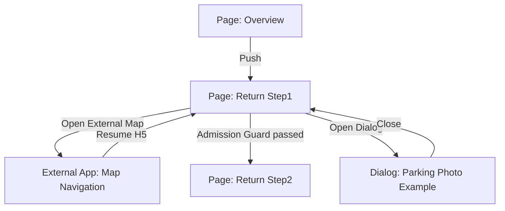
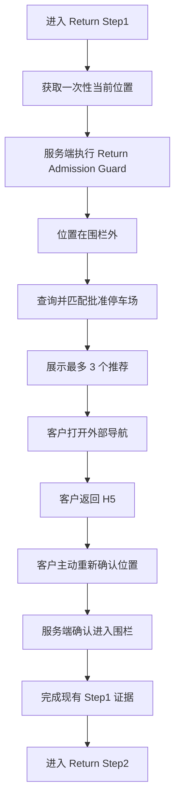
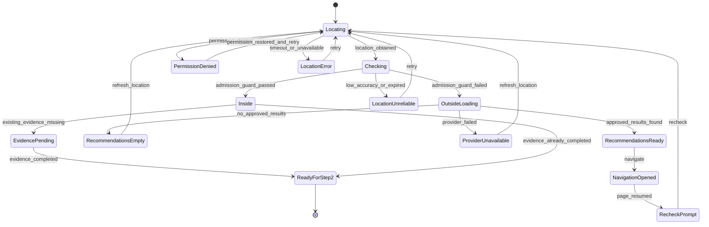

# Feature Spec: Yahoo YOLP 还车停车场推荐

- **所属模块**：`selfservice-rental`（2026-11-03 由 `specs/feature/return-parking-recommendations.md` 迁移，正文未改写）

- **所属 lane**：`customer`
- **应用入口**：`/selfservice.html`
- **影响页面**：`Return Step1 / Location & Parking`
- **基线依赖**：`specs/epic/selfservice-rental-baseline.md`
- **设计基线**：`docs/templates/customer-h5-design-baseline.md`
- **文档版本**：v1.0
- **文档状态**：Active
- **生产发布状态**：Blocked by YOLP Commercial Gate
- **当前维护日期**：2026-08-24
- **Authoring Mode**：Full

---

## 1. 文档控制与模式选择

### 1.1 适用范围

本 Spec 定义客户在自助还车 `Return Step1` 中未通过位置校验时，系统基于订单允许还车区域查询并展示门店已批准停车场的业务语义、页面交互、接口契约、Yahoo YOLP 对接、异常恢复、移动端权限与验收标准。

影响范围：

- 客户 H5 的一次性定位与位置刷新。
- 还车硬围栏失败后的停车场推荐恢复路径。
- 自有 Return Location Assistance 接口。
- Yahoo! JAPAN YOLP Local Search API Adapter。
- 门店已批准停车场配置的读取与匹配。
- 外部地图导航与返回 H5 后的位置复检。
- Yahoo attribution、配额、商业授权、缓存与隐私约束。

### 1.2 Full Mode 判断

当前采用 `Full Mode`，触发原因如下：

- 浏览器定位能力直接影响还车主流程 Admission Guard。
- 第三方 Yahoo API、订单还车政策和内部停车场批准数据发生跨系统协作。
- 需要覆盖定位拒绝、弱 GPS、弱网、切后台、第三方不可用和配额耗尽等中断。
- 需要定义服务端权威校验、审计、隐私、缓存和灰度开关。

输入层：

- **Lane Charter**：`docs/README.md`
- **Pattern Pack**：`docs/templates/customer-h5-design-baseline.md` 中的阻断性异常与恢复动作模式
- **Feature Brief**：客户位置校验失败时，展示最多 3 个门店已批准且位于允许还车区域内的停车场，并引导导航和到达后的重新定位

### 1.3 依赖与发布 Gate

| Gate | 所有者 | 完成条件 | 未完成时处理 |
|---|---|---|---|
| YOLP 商业使用确认 | Legal / Procurement / Product | 获得适用于商业租车客户页面的书面许可，按需签约 YOLP Premier | 仅允许技术验证，不允许生产开启 |
| Yahoo Client ID | Engineering / Platform | 已登记应用并完成服务端 Secret 配置 | Feature flag 保持关闭 |
| Canonical Parking Lot | Store / Operations | 每个试点门店至少配置 1 个有效批准停车场，含内部 ID、坐标和可选 Yahoo `Gid` | 页面不展示 Yahoo 临时候选 |
| Return Policy | Order / Rental Domain | 服务端可返回指定还车点、门店坐标和当前生效阈值 | 继续使用现有联系门店恢复路径 |
| Attribution Review | Product / Legal | 页面底部 attribution 位置与官方格式通过评审 | 不允许生产开启 |

---

## 2. 场景目标、角色与成功标准

### 2.1 场景目标

客户在 `Return Step1` 看到位置校验失败后，需要立即知道：

1. 当前仍不能完成还车。
2. 哪些停车场经过门店批准，并且位于订单允许还车区域内。
3. 如何导航前往其中一个停车场。
4. 到达后必须重新确认位置，不能通过点击推荐直接继续。

业务结果：

- 降低客户因不熟悉日本本地停车场而中断自助还车的概率。
- 减少位置失败后的无方向感和客服咨询成本。
- 不削弱现有硬围栏、证据上传和门店运营责任。

页面明确不承载：

- 停车位预订。
- 实时空位查询。
- 准确的小时费率、昼夜费率或封顶价格。
- 停车费支付。
- 自动驾驶导航或持续 GPS 导航。
- 将任意 Yahoo 搜索结果自动批准为还车地点。

### 2.2 角色与权限

| 角色 | 可见范围 | 可执行动作 | 禁止动作 |
|---|---|---|---|
| Customer | 当前订单 Return Step1 | 授权一次性定位、刷新位置、查看批准停车场、打开外部导航、到达后重新定位、联系门店 | 修改围栏阈值、批准停车场、通过选择停车场绕过 Admission Guard |
| Store Operator | 自有运营配置 | 创建、启停和维护 Canonical Parking Lot；关联 Yahoo `Gid`；维护门店还车政策 | 把未核实 Yahoo 结果直接批量设为批准停车场 |
| Customer Support | 订单支持工具 | 查看位置校验结果、推荐结果摘要和失败原因；提供人工指导 | 代替系统篡改客户定位或前端状态 |
| System | 服务端 | 校验订单权限、执行硬围栏、查询 Yahoo、匹配批准记录、过滤排序、审计和降级 | 将 Yahoo `Price` 解释为停车费；长期缓存 Yahoo 返回数据 |

### 2.3 成功标准

流程成功不等于“客户点击了停车场”，而是满足以下事实：

- 客户在位置校验失败后获得 0～3 个门店已批准停车场。
- 每个展示候选都位于推荐安全余量内。
- 客户可将候选坐标交给外部地图进行导航。
- 客户返回 H5 后重新获取新定位。
- 服务端依据新定位重新执行正式 `500m / 100m` Admission Guard。
- 只有最新服务端结果通过后，现有 Return Step1 才允许进入 Step2。

### 2.4 非成功状态

以下状态不得被记录为推荐成功后的还车完成：

- Yahoo 返回停车场，但没有匹配 Canonical Parking Lot。
- 客户点击或打开导航，但没有重新定位。
- 候选停车场坐标位于围栏内，但客户当前实际位置仍在围栏外。
- 定位精度不足、定位时间过期或服务端无法验证。
- Yahoo 返回 `Price` 或 `BusinessHour`，但现场收费或开放情况与其不一致。

---

## 3. 领域语言与已确认决策

### 3.1 Canonical Terms

| Term | 定义 | Source of Truth | 禁止混用 |
|---|---|---|---|
| `Canonical Parking Lot` | 由门店或运营创建并批准用于还车引导的内部停车场记录 | 自有停车场配置 | 不等于 Yahoo `Feature` |
| `Yahoo Provider Place` | YOLP Local Search 本次实时返回的第三方 POI | Yahoo YOLP | 不等于允许还车地点 |
| `Approved Parking Recommendation` | 当前 Yahoo Provider Place 与有效 Canonical Parking Lot 匹配，且处于推荐安全余量内的临时展示结果 | Return Location Assistance | 不等于位置校验已通过 |
| `Return Admission Guard` | 客户实际当前位置满足 `距指定还车点<=500m OR 距门店<=100m`，并满足现有证据条件后才可进入 Step2 的服务端守卫 | Order Return Policy + 最新定位 | 不等于点击导航或选择停车场 |
| `Recommendation Safety Margin` | 用于过滤候选停车场的保守距离余量，降低 POI 中心点与实际入口偏差造成的误导 | Return Policy 配置 | 不修改正式 500m/100m 阈值 |
| `Parking Fee` | 有明确停车运营商数据来源、币种、计费单位和有效时间的停车费用 | 专业停车数据源 | 不得来自 YOLP `Property.Price` 推断 |

### 3.2 已确认业务决策

1. MVP 采用 `APPROVED_ONLY`。
2. Yahoo 返回但未与 Canonical Parking Lot 匹配的 POI 不向客户展示。
3. 推荐停车场只提供恢复引导，不改变原有 Return Admission Guard。
4. 点击、选择或打开导航均不解锁 `Next: Vehicle Inspection`。
5. Yahoo `Property.Price`、`AveragePriceComment` 不进入停车费字段。
6. 实时空位、准确收费和预订能力不在 MVP 范围。
7. Yahoo 查询优先使用订单固定还车点和门店坐标，不将客户实时定位直接发送给 Yahoo。
8. Yahoo 结果不做长期缓存、不批量外部导出、不自动沉淀为自有停车场库。
9. 商业授权未完成时，生产 feature flag 必须关闭。

### 3.3 不创建 ADR

`APPROVED_ONLY` 是本 feature 的可演进业务策略，已由本 Spec 直接记录；当前不满足独立 ADR 的必要性。若未来改为允许任意公共停车场、离线缓存 Yahoo 数据或由第三方结果直接驱动 Return Admission Guard，应重新评审并按需创建跨系统 ADR。

---

## 4. 触发条件与进入方式

| 来源入口 | 触发条件 | 进入方式 | 目标上下文 |
|---|---|---|---|
| Overview | 订单处于用车中且允许发起自助还车 | `Push` 到 Return Step1 | `orderId`、session、当前语言 |
| Return Step1 自动校验 | 页面首次进入且定位可用 | 页内状态更新 | 最新定位、订单 Return Policy |
| Refresh Location | 客户主动点击 | 页内重试 | 新的定位 observation |
| Location Check Failed | 服务端返回 `OUTSIDE` | 页内展开推荐区块 | 推荐状态与批准候选 |
| External Map | 客户点击 `Navigate` | 离开 H5 打开外部地图 | 目标坐标和停车场名称 |
| 返回 H5 | 页面从后台恢复 | 页内提示，不自动连续定位 | 保留原候选，等待客户点击重新确认 |

进入条件：

- session 已鉴权并绑定一个订单。
- 订单处于允许发起还车的状态。
- Return Policy 存在有效指定还车点或门店坐标。

退出条件：

- 返回 Overview；或
- 最新服务端位置校验通过，并满足现有 Step1 必填条件后进入 Step2。

---

## 5. Source of Truth 与业务规则

### 5.1 Source of Truth

| 业务事实 | Source of Truth | 页面职责 |
|---|---|---|
| 订单是否允许还车 | Order Domain | 只读展示结果 |
| 指定还车点坐标 | Order Return Policy | 不允许客户修改 |
| 门店坐标 | Store / Order Return Policy Snapshot | 不允许客户修改 |
| 500m/100m 阈值 | Order Return Policy | 不接受前端传参覆盖 |
| Canonical Parking Lot 是否批准 | Store Operations Configuration | 仅展示有效批准项 |
| 当前定位 | Browser Geolocation observation | 发送给自有服务端校验 |
| Yahoo POI 数据 | Yahoo YOLP 当次响应 | 只做临时匹配与展示 |
| Step2 是否解锁 | Return Admission Guard | 依据服务端最新结果派生 |

### 5.2 硬围栏规则

正式 Admission Guard 保持生产基线不变：

```text
distance(current_location, return_point) <= return_point_radius
OR
distance(current_location, store_location) <= store_radius
```

默认值：

- `return_point_radius = 500m`
- `store_radius = 100m`

阈值由服务端 Return Policy 提供；前端不得提交或覆盖。

### 5.3 推荐安全余量

候选停车场过滤规则：

```text
distance(candidate, return_point)
  <= return_point_radius - return_point_safety_margin

OR

distance(candidate, store_location)
  <= store_radius - store_safety_margin
```

默认建议配置：

- `return_point_safety_margin = 50m`
- `store_safety_margin = 20m`

推荐安全余量只影响候选展示，不修改正式 Admission Guard。

### 5.4 APPROVED_ONLY 匹配规则

Yahoo Provider Place 必须满足全部条件才可展示：

1. `Feature.Gid` 与有效 Canonical Parking Lot 的 `provider_refs.yahoo_gid` 相等；或由服务端执行经过审批的稳定映射。
2. Canonical Parking Lot 状态为 `ACTIVE`。
3. Canonical Parking Lot 属于当前订单 Return Policy 所在门店或允许区域。
4. Yahoo Provider Place 具有合法经纬度。
5. Yahoo Provider Place 位于推荐安全余量内。
6. 当前请求未超过门店、订单、用户或 Yahoo 配额限制。

不得使用名称模糊匹配自动批准新的停车场。名称和坐标近似匹配只能用于诊断或向运营提供候选，不得在客户运行时自动放行展示。

### 5.5 排序与数量

展示结果按以下顺序排序：

1. 距客户当前位置的直线距离升序。
2. 距指定还车点距离升序。
3. Canonical Parking Lot 内部优先级升序。
4. `canonical_parking_lot_id` 作为稳定排序兜底。

页面最多展示 3 个候选。

距离文案必须表达为“直线约 X 米”，不得表达为驾驶距离或预计驾驶时间。

---

## 6. Yahoo YOLP API 对接契约

### 6.1 使用的外部 API

MVP 只要求 Yahoo! JAPAN YOLP Local Search API：

```http
GET https://map.yahooapis.jp/search/local/V1/localSearch
```

不要求 Yahoo Geocoder、Reverse Geocoder、Distance API 或地图嵌入能力。

### 6.2 Client ID 获取与环境配置

1. 使用企业管理的 Yahoo! JAPAN ID。
2. 在 `https://e.developer.yahoo.co.jp/register` 登记应用。
3. 获取 Client ID。
4. 通过 Yahoo 法人渠道确认商业租车客户页面的许可方式，并按需签约 YOLP Premier。
5. Client ID 仅配置于服务端 Secret Manager。
6. 开发、测试、生产环境按授权约定使用独立应用或独立配置。
7. Client ID 不得进入 React bundle、前端环境变量、浏览器请求、日志或错误正文。

### 6.3 请求参数

```text
appid=<server-side-client-id>
lat=<return-point-or-store-latitude>
lon=<return-point-or-store-longitude>
dist=<search-radius-km>
gc=0306005
sort=geo
results=30
detail=full
output=json
device=mobile
```

| 参数 | 必填 | 默认/限制 | 业务规则 |
|---|---|---|---|
| `appid` | 是 | Yahoo Client ID | 仅服务端注入 |
| `lat` | 是 | 世界测地系十进制 | 使用固定还车点或门店坐标 |
| `lon` | 是 | 世界测地系十进制 | 使用固定还车点或门店坐标 |
| `dist` | 是 | 最大 20km | MVP 通常为 `0.5` 或 `0.1` |
| `gc` | 是 | `0306005` | 独立停车场行业代码 |
| `sort` | 是 | `geo` | Yahoo 查询中心距离排序 |
| `results` | 是 | 默认 30，最大 100 | 服务端过滤前候选数，可配置 |
| `detail` | 是 | `full` | 获取地址及可选详情 |
| `output` | 是 | `json` | 不使用 JSONP |
| `device` | 是 | `mobile` | 当前数据用于移动端展示 |

禁止使用 `parking=true` 搜索独立停车场。该参数只表示筛选“附带停车场的店铺”。

### 6.4 查询中心与调用次数

1. 服务端先执行当前定位硬围栏；已通过时不调用 Yahoo。
2. 未通过时，以指定还车点查询 `500m` 范围。
3. 门店不在上述查询覆盖范围时，再以门店查询 `100m` 范围。
4. 两个区域高度重叠时，允许通过单一覆盖圆查询一次，并在服务端按正式区域过滤。
5. 单次 Assistance 请求最多调用 Yahoo 2 次。

### 6.5 Yahoo 字段归一化

| Yahoo 字段 | 内部字段 | 规则 |
|---|---|---|
| `Feature.Gid` | `provider_place_id` | 仅用于当次匹配，不作为 Canonical ID |
| `Feature.Name` | `provider_name` | UTF-8；安全转义；限制展示长度 |
| `Feature.Geometry.Coordinates` | `provider_location` | Yahoo 顺序为 `longitude,latitude` |
| `Feature.Property.Address` | `provider_address` | 可空；安全转义 |
| `Feature.Property.Detail.BusinessHour` 或等价 Detail 子项 | `business_hours` | 可空；仅在可解析时展示；不作为准入条件 |
| `Feature.Property.Price` | 不映射 | 代表价格，不是停车计费契约 |
| `Feature.Property.AveragePriceComment` | 不映射 | 平均预算，不是停车计费契约 |
| `Feature.Property.Detail` | 不直接展示 | 结构不固定，不允许原样渲染 |

`Property.Detail` 在 JSON 中可能存在结构差异。Adapter 必须做 schema 容错，不能假设它永远是单一对象。

### 6.6 价格与空位边界

MVP 对客户返回：

```json
{
  "fee": null,
  "availability": null
}
```

页面统一提示现场信息为准。若未来接入准确停车费或实时空位，必须由专业停车数据源提供，并至少携带：

- `provider`
- `currency`
- `rate_unit`
- `effective_at`
- `expires_at`
- `availability_updated_at`

### 6.7 错误与重试

| Yahoo 结果 | Adapter 处理 | 重试 |
|---|---|---|
| `400` | 参数或配置错误，返回 provider unavailable 并告警 | 否 |
| `401` | Client ID 权限错误并告警 | 否 |
| `403` | 可能为额度、权限或 Client ID 失效，触发熔断和告警 | 否 |
| `404` | Endpoint 或资源配置错误 | 否 |
| `500` | 第三方内部错误 | 最多 1 次 |
| `503` | 第三方临时不可用 | 最多 1 次，带短随机退避 |
| Timeout | 返回第三方不可用 | 最多 1 次 |
| `200 + empty` | 正常空结果 | 否 |
| `200 + invalid schema` | schema 错误并告警 | 否 |

外部请求建议超时为 1.5～2 秒。整个 Return Location Assistance P95 目标小于 2.5 秒。

### 6.8 额度、缓存与 attribution

- 每个 Yahoo 应用 24 小时最多 50,000 次请求。
- 服务端应监控 60%、80%、90% 配额阈值。
- 短时间大量请求可能被 Yahoo 限制。
- 每个订单 10 分钟内最多发起 5 次推荐请求，具体值可配置。
- 允许同一时刻的 in-flight request 合并；禁止长期缓存 Yahoo 结果。
- HTTP 响应必须携带 `Cache-Control: no-store`。
- 页面必须按官方要求展示 `Web Services by Yahoo! JAPAN` attribution 及链接。
- Yahoo attribution 不得暗示双方合作、认证或联合运营关系。

---

## 7. 自有 Return Location Assistance 接口

### 7.1 Endpoint

```http
POST /api/v1/selfservice/orders/{orderId}/return/location-assistance
Authorization: Bearer <online-checkin-session>
Content-Type: application/json
Cache-Control: no-store
```

使用 `POST`，避免定位数据进入 URL、浏览器历史和常规 access log。

### 7.2 Request

```json
{
  "location": {
    "lat": 35.67452,
    "lng": 139.76318,
    "accuracyM": 24,
    "capturedAt": "2026-08-24T10:20:30+09:00"
  },
  "locale": "ja-JP",
  "clientRequestId": "018f56e3-0000-7000-8000-000000000000"
}
```

Request 规则：

- `lat` 必须在 `-90..90`。
- `lng` 必须在 `-180..180`。
- `accuracyM` 必须为正数。
- 定位 observation 默认不超过 60 秒。
- 默认要求 `accuracyM <= 100` 才可执行正式 Admission Guard。
- `clientRequestId` 用于请求链路诊断和前端重复响应淘汰，不改变业务状态。
- 客户不得提交围栏阈值、批准停车场或 Yahoo 参数。

### 7.3 Response

```json
{
  "locationCheckId": "rlc_01J00000000000000000000000",
  "fence": {
    "status": "OUTSIDE",
    "distanceToReturnPointM": 778,
    "distanceToStoreM": 826,
    "matchedBy": null,
    "thresholds": {
      "returnPointM": 500,
      "storeM": 100
    }
  },
  "recommendationsStatus": "READY",
  "recommendations": [
    {
      "suggestionId": "rps_01J00000000000000000000000",
      "canonicalParkingLotId": "cpl_tokyo_yaesu_001",
      "name": "八重洲地下街駐車場",
      "address": "東京都中央区八重洲二丁目",
      "location": {
        "lat": 35.6809,
        "lng": 139.7682
      },
      "distanceFromCurrentM": 680,
      "distanceToReturnPointM": 312,
      "distanceToStoreM": 540,
      "matchedFence": "RETURN_POINT",
      "approvalStatus": "APPROVED",
      "fee": null,
      "availability": null,
      "businessHours": null,
      "source": "YAHOO_YOLP"
    }
  ],
  "attribution": {
    "label": "Web Services by Yahoo! JAPAN",
    "url": "https://developer.yahoo.co.jp/sitemap/"
  },
  "generatedAt": "2026-08-24T10:20:31+09:00"
}
```

### 7.4 状态枚举

`fence.status`：

```text
INSIDE_RETURN_POINT
INSIDE_STORE
OUTSIDE
LOCATION_UNRELIABLE
LOCATION_EXPIRED
POLICY_UNAVAILABLE
```

`recommendationsStatus`：

```text
NOT_REQUIRED
READY
EMPTY
PROVIDER_UNAVAILABLE
COMMERCIAL_USE_DISABLED
```

MVP 的 `approvalStatus` 只能返回：

```text
APPROVED
```

未批准项在服务端过滤，不返回前端。

### 7.5 服务端 Interface

服务端应通过一个深模块承载完整行为：

```ts
interface ReturnLocationAssistanceModule {
  getAssistance(input: {
    orderId: string;
    sessionId: string;
    observedLocation: ObservedLocation;
    locale: string;
    clientRequestId: string;
  }): Promise<ReturnLocationAssistanceResult>;
}
```

模块内部允许存在：

- `OrderReturnPolicy` owned-service Adapter。
- `CanonicalParkingLot` repository Adapter。
- `YahooYolpParkingDiscovery` external Adapter。
- Haversine 与安全余量计算。
- 审计、限流、熔断与指标。

页面和自有接口不得暴露 Yahoo YDF 原始结构。

---

## 8. 字段清单与字段分类

| 字段 / 资源 | Source Type | 业务用途 | 是否阻塞 | 是否必填 | 默认值 | 校验规则 | 错误文案 |
|---|---|---|---|---|---|---|---|
| [ADD] `observed_location.lat` | Stored observation | 当前定位 | 是 | 是 | 无 | `-90..90` | `returnLocationUnavailable` |
| [ADD] `observed_location.lng` | Stored observation | 当前定位 | 是 | 是 | 无 | `-180..180` | `returnLocationUnavailable` |
| [ADD] `observed_location.accuracy_m` | Stored observation | 判断定位可信度 | 是 | 是 | 无 | `>0` 且默认 `<=100` | `returnLocationUnreliable` |
| [ADD] `observed_location.captured_at` | Stored observation | 判断定位是否过期 | 是 | 是 | 无 | 默认 60 秒内 | `returnLocationExpired` |
| [MOD] `return_point_radius_m` | Stored policy | 正式硬围栏 | 是 | 是 | `500` | 服务端配置 | `locationDistanceErrorBody` |
| [MOD] `store_radius_m` | Stored policy | 门店兜底硬围栏 | 是 | 是 | `100` | 服务端配置 | `locationDistanceErrorBody` |
| [ADD] `recommendation_safety_margin_m` | Stored policy | 保守过滤候选 | 否 | 是 | `50/20` | 小于对应正式半径 | 不展示 |
| [ADD] `canonical_parking_lot_id` | Stored | 内部批准停车场 ID | 否 | 是 | 无 | 必须 ACTIVE 且属于当前政策 | 不展示未批准项 |
| [ADD] `provider_place_id` | Mapped | 当次 Yahoo 匹配 | 否 | 是 | 无 | 与批准映射一致 | 不展示未匹配项 |
| [ADD] `recommendation_status` | Derived | 控制推荐区块状态 | 否 | 是 | `NOT_REQUIRED` | 枚举 | 对应页内状态文案 |
| [ADD] `distance_from_current_m` | Derived | 客户选择排序 | 否 | 是 | 无 | Haversine，取整 | 不展示异常值 |
| [ADD] `matched_fence` | Derived | 解释候选属于哪个允许区域 | 否 | 是 | 无 | `RETURN_POINT/STORE` | 不展示内部枚举 |
| [ADD] `business_hours` | Mapped | 可选参考信息 | 否 | 否 | `null` | 只接受安全纯文本 | 不展示 |
| [ADD] `fee` | Mapped contract | 为未来专业数据源保留 | 否 | 否 | `null` | MVP 必须为 `null` | 使用统一免责声明 |
| [ADD] `availability` | Mapped contract | 为未来实时数据源保留 | 否 | 否 | `null` | MVP 必须为 `null` | 使用统一免责声明 |
| [ADD] `provider_attribution` | Mapped | Yahoo credit | 否 | 是 | 官方文本 | 位置和链接符合官方规则 | 推荐结果展示时必须出现 |

字段分组：

- **主决策字段**：`fence.status`、两类距离、正式阈值。
- **恢复动作字段**：推荐状态、候选名称、地址、距离、坐标。
- **风险判断字段**：定位精度、定位时间、provider 状态、批准状态。
- **可选参考字段**：营业时间。
- **明确缺失字段**：停车费和实时空位在 MVP 为 `null`。

---

## 9. 页面交互与 CTA

### 9.1 首屏层级

`Return Step1` 的 Location & Parking 卡片顺序：

1. 当前步骤标题与 Parking Photo 标题。
2. 位置检查状态条。
3. 位置失败原因、当前距离和 `Refresh Location`。
4. 门店已批准停车场推荐区块。
5. 联系门店恢复入口。
6. 责任提示。
7. Parking Photo、View Example 与 Location Notes。
8. Key Return Confirmation。
9. 吸底 `Next: Vehicle Inspection`。

推荐区块必须位于位置失败信息之后、联系门店和责任提示之前。

### 9.2 推荐卡片字段

单个推荐项只展示：

- 停车场名称。
- 地址；缺失时不显示空占位。
- 距当前位置直线约 X 米。
- `Store-approved` 标签。
- `Navigate` 次级按钮。
- 统一的费用和开放状态免责声明。

不得展示：

- 未经专业数据源确认的停车费。
- 实时空位。
- 虚构驾驶时间。
- Yahoo 原始 Detail。
- “保证可以还车”或“位置已通过”。

### 9.3 CTA 策略

| 操作 | 类型 | 触发位置 | 阻断条件 | 成功后行为 |
|---|---|---|---|---|
| `Next: Vehicle Inspection` | Primary | 吸底 | 最新服务端围栏未通过；现有钥匙照片等必填未完成 | 进入 Step2 |
| `Refresh Location` | Secondary | 位置错误卡片 | 正在定位或正在提交 | 获取新定位并调用 Assistance |
| `Navigate` | Secondary | 推荐停车场卡片 | 坐标无效 | 打开外部地图；不改变围栏状态 |
| `Confirm location again` | Secondary | 从地图返回后的页内提示 | 正在定位或提交 | 获取新定位并重新执行 Admission Guard |
| `Call store` | Text / Link | 联系门店卡片 | 门店电话缺失时禁用并显示其他支持方式 | 打开电话能力 |
| `View Example` | Text | Parking Photo 区块 | 无 | 打开现有示例 Dialog |

### 9.4 交互容器

| 对象 | 容器 | 原因 |
|---|---|---|
| 推荐停车场列表 | 当前页面内嵌 Card | 它是位置失败后的直接恢复路径，不应隐藏到二级页面 |
| 停车场详细地图 | External Map | MVP 不引入新地图页面或 Yahoo Map SDK |
| Parking Photo 示例 | 现有 Dialog | 沿用当前页面交互 |
| 定位权限解释 | 页内 Inline Alert | 阻断原因必须常驻可见，不只使用 Toast |

### 9.5 导航行为

- `Navigate` 只把单个批准停车场的名称和坐标交给外部地图。
- 同时向外部导航输出的停车场数据不得超过官方允许范围；MVP 每次只输出 1 个目标。
- 外部地图失败时保留当前页面，并显示可恢复提示。
- 页面从后台恢复时不得自动连续调用定位；显示重新确认提示，由客户主动触发。

---

## 10. 阻断 / 非阻断矩阵

| 条件 | 是否阻断进入 Step2 | 是否阻断查看推荐 | 页面反馈 |
|---|---|---|---|
| 服务端围栏 `OUTSIDE` | 是 | 否 | 位置失败 + 推荐区块 |
| 定位权限拒绝 | 是 | 是 | 开启定位说明 + 联系门店 |
| 定位精度不足 | 是 | 否，可显示既有候选但不显示可信当前距离 | 移动到开阔区域后重试 |
| 定位 observation 过期 | 是 | 否 | 要求重新定位 |
| Return Policy 缺失 | 是 | 是 | 联系门店，不调用 Yahoo |
| Yahoo `EMPTY` | 是 | 否 | 未找到门店已批准停车场 |
| Yahoo 不可用 | 是 | 否 | 推荐暂不可用；保留刷新和联系门店 |
| Yahoo 商业 Gate 关闭 | 是 | 否 | 不展示推荐；保留原恢复路径 |
| 候选未批准 | 是 | 不展示该候选 | 无客户可见痕迹 |
| 点击 Navigate | 是 | 否 | 离开页面导航；不更新围栏状态 |
| 到达后围栏通过 | 否，仍受现有证据条件约束 | 不再需要 | 显示位置确认成功 |
| Parking Photo/钥匙证据未完成 | 是 | 否 | 沿用现有页内校验 |

---

## 11. 异常中断与恢复

| 触发场景 | 当前状态 | 阻断级别 | 恢复策略 | 页内反馈 |
|---|---|---|---|---|
| 浏览器拒绝定位 | `LOCATION_PERMISSION_DENIED` | 阻断 | 引导系统设置开启权限；保留联系门店 | Location & Parking 卡片内错误 |
| 定位超时 | `LOCATION_TIMEOUT` | 阻断 | `Refresh Location` | 页内错误和重试按钮 |
| 定位精度大于阈值 | `LOCATION_UNRELIABLE` | 阻断 | 移动到开阔位置后重试 | 不显示通过状态 |
| 定位时间过期 | `LOCATION_EXPIRED` | 阻断 | 获取新 observation | 页内提示重新定位 |
| 弱网/断网 | `NETWORK_UNAVAILABLE` | 阻断 | 恢复网络后重试 | 保留页面和已填写证据，不使用旧围栏结果解锁 |
| Yahoo 超时/5xx | `PROVIDER_UNAVAILABLE` | 非推荐功能阻断 | 保留刷新位置、联系门店 | 推荐区块错误态 |
| Yahoo 403 | `PROVIDER_UNAVAILABLE` | 非推荐功能阻断 | 服务端熔断并告警 | 客户只见统一错误态 |
| Yahoo 空结果 | `EMPTY` | 非推荐功能阻断 | 联系门店 | 空态文案 |
| 无批准停车场匹配 | `EMPTY` | 非推荐功能阻断 | 联系门店 | 不展示未批准结果 |
| 外部地图无法打开 | `NAVIGATION_FAILED` | 非阻断 | 保留当前页面，允许重试或联系门店 | 推荐项邻近提示 |
| 切后台 | 保留当前页面 | 非阻断 | 返回后提示重新确认位置 | 不自动连续定位 |
| 乱序响应 | 保留最新 request | 非阻断 | 按 `clientRequestId` 淘汰旧响应 | 不向客户展示内部冲突 |

提交拦截：

- [x] Return Admission Guard 未通过。
- [x] 定位 observation 不可信或已过期。
- [x] 现有 Parking Photo/钥匙归还等必填证据未完成。
- [x] 正在提交位置复检。
- [x] 最新请求失败后没有有效服务端通过结果。

---

## 12. i18n 增量资源包

运行时交付语言为 `en / zh-TW / ja / ko / th`。为满足共享 Spec authoring 规则，同时提供 `zh-CN` 值；本 feature 不新增 `zh-CN` 语言切换入口。

| resource_key | zh-CN | zh-TW | en | ja | ko | th |
|---|---|---|---|---|---|---|
| `returnParkingSuggestionsTitle` | 建议还车停车场 | 建議還車停車場 | Suggested return parking | 返却におすすめの駐車場 | 추천 반납 주차장 | ที่จอดรถแนะนำสำหรับการคืนรถ |
| `returnParkingSuggestionsLoading` | 正在查找门店确认的停车场… | 正在尋找門店確認的停車場… | Searching for store-approved parking... | 店舗確認済みの駐車場を検索しています… | 지점 확인 주차장을 찾는 중입니다... | กำลังค้นหาที่จอดรถที่สาขายืนยัน... |
| `returnParkingSuggestionsEmpty` | 附近未找到门店确认的停车场，请联系门店。 | 附近未找到門店確認的停車場，請聯絡門店。 | No store-approved parking was found nearby. Please contact the store. | 近くに店舗確認済みの駐車場が見つかりません。店舗へご連絡ください。 | 근처에 지점 확인 주차장이 없습니다. 지점에 문의해 주세요. | ไม่พบที่จอดรถที่สาขายืนยันในบริเวณใกล้เคียง โปรดติดต่อสาขา |
| `returnParkingSuggestionsUnavailable` | 停车场建议暂时不可用，请刷新位置或联系门店。 | 停車場建議暫時無法使用，請重新整理位置或聯絡門店。 | Parking suggestions are temporarily unavailable. Refresh your location or contact the store. | 駐車場の候補を一時的に取得できません。位置情報を更新するか、店舗へご連絡ください。 | 주차장 추천을 일시적으로 사용할 수 없습니다. 위치를 새로고침하거나 지점에 문의해 주세요. | ไม่สามารถแสดงคำแนะนำที่จอดรถได้ชั่วคราว โปรดรีเฟรชตำแหน่งหรือติดต่อสาขา |
| `returnParkingApprovedBadge` | 门店已确认 | 門店已確認 | Store-approved | 店舗確認済み | 지점 확인 완료 | สาขายืนยันแล้ว |
| `returnParkingDistanceApprox` | 距当前位置直线约 {distance} 米 | 距目前位置直線約 {distance} 公尺 | About {distance} m away in a straight line | 現在地から直線で約 {distance} m | 현재 위치에서 직선거리 약 {distance}m | ห่างจากตำแหน่งปัจจุบันเป็นเส้นตรงประมาณ {distance} ม. |
| `returnParkingNavigate` | 导航前往 | 導航前往 | Navigate | ナビを開く | 길찾기 | นำทาง |
| `returnParkingRecheckPrompt` | 已到达停车场？请再次确认当前位置。 | 已抵達停車場？請再次確認目前位置。 | Arrived at the parking lot? Confirm your location again. | 駐車場に到着しましたか？位置情報をもう一度確認してください。 | 주차장에 도착했나요? 위치를 다시 확인해 주세요. | ถึงที่จอดรถแล้วใช่ไหม โปรดยืนยันตำแหน่งอีกครั้ง |
| `returnParkingRecheckAction` | 再次确认位置 | 再次確認位置 | Confirm location again | 位置情報を再確認 | 위치 다시 확인 | ยืนยันตำแหน่งอีกครั้ง |
| `returnParkingFeeDisclaimer` | 停车费用及开放状态可能变化，请以停车场现场标识为准。 | 停車費用及開放狀態可能變動，請以停車場現場標示為準。 | Parking fees and availability may change. Check the signs at the parking lot. | 駐車料金や利用状況は変更される場合があります。現地の案内をご確認ください。 | 주차 요금과 이용 가능 여부는 변경될 수 있습니다. 현장 안내를 확인해 주세요. | ค่าจอดรถและสถานะการให้บริการอาจเปลี่ยนแปลง โปรดตรวจสอบป้าย ณ ที่จอดรถ |
| `returnParkingProviderAttribution` | Web Services by Yahoo! JAPAN | Web Services by Yahoo! JAPAN | Web Services by Yahoo! JAPAN | Web Services by Yahoo! JAPAN | Web Services by Yahoo! JAPAN | Web Services by Yahoo! JAPAN |
| `returnLocationPermissionDenied` | 无法获取位置。请在设备设置中允许位置访问，或联系门店。 | 無法取得位置。請在裝置設定中允許位置存取，或聯絡門店。 | Location access is off. Allow location access in your device settings or contact the store. | 位置情報を取得できません。端末の設定で位置情報を許可するか、店舗へご連絡ください。 | 위치를 가져올 수 없습니다. 기기 설정에서 위치 권한을 허용하거나 지점에 문의해 주세요. | ไม่สามารถเข้าถึงตำแหน่งได้ โปรดอนุญาตสิทธิ์ตำแหน่งในการตั้งค่าอุปกรณ์หรือติดต่อสาขา |
| `returnLocationUnreliable` | 当前定位信号较弱，请移动到开阔区域后重试。 | 目前定位訊號較弱，請移動到開闊區域後重試。 | Your location signal is weak. Move to an open area and try again. | 位置情報の精度が低くなっています。開けた場所へ移動して、もう一度お試しください。 | 위치 신호가 약합니다. 탁 트인 곳으로 이동한 후 다시 시도해 주세요. | สัญญาณตำแหน่งอ่อน โปรดไปยังบริเวณเปิดโล่งแล้วลองอีกครั้ง |
| `returnLocationExpired` | 位置信息已过期，请重新确认。 | 位置資訊已過期，請重新確認。 | Your location has expired. Confirm it again. | 位置情報の有効時間が切れました。もう一度確認してください。 | 위치 정보가 만료되었습니다. 다시 확인해 주세요. | ข้อมูลตำแหน่งหมดอายุ โปรดยืนยันอีกครั้ง |
| `returnParkingNavigationFailed` | 无法打开地图，请重试或联系门店。 | 無法開啟地圖，請重試或聯絡門店。 | The map could not be opened. Try again or contact the store. | 地図を開けませんでした。もう一度試すか、店舗へご連絡ください。 | 지도를 열 수 없습니다. 다시 시도하거나 지점에 문의해 주세요. | ไม่สามารถเปิดแผนที่ได้ โปรดลองอีกครั้งหรือติดต่อสาขา |

数据源分类：

- **系统文案**：标题、加载、空态、错误、按钮、免责声明。
- **核心业务枚举文案**：`Store-approved`。
- **原样展示业务数据**：停车场名称、地址、距离数字。
- **官方固定 credit**：`Web Services by Yahoo! JAPAN` 不本地化改写。

---

## 13. 导航栈与页面流转

### 13.1 Stack Map



### 13.2 权限与深链拦截

- 登录拦截：继续沿用 Online Check-In session 与订单绑定。
- 定位权限：首次需要时调用浏览器 Geolocation；拒绝后不反复弹系统权限。
- 外部地图：仅在客户主动点击时打开。
- 返回 H5：恢复原页面，不自动改变围栏结果。
- 物理返回：从 Step1 返回 Overview；从 Step2 返回 Step1，沿用现有行为。

---

## 14. Logical View 与状态

```ts
type ReturnFenceStatus =
  | 'INSIDE_RETURN_POINT'
  | 'INSIDE_STORE'
  | 'OUTSIDE'
  | 'LOCATION_UNRELIABLE'
  | 'LOCATION_EXPIRED'
  | 'POLICY_UNAVAILABLE';

type ParkingRecommendationsStatus =
  | 'NOT_REQUIRED'
  | 'LOADING'
  | 'READY'
  | 'EMPTY'
  | 'PROVIDER_UNAVAILABLE'
  | 'COMMERCIAL_USE_DISABLED';

interface ReturnParkingRecommendationView {
  suggestionId: string; // Mapped
  canonicalParkingLotId: string; // Mapped
  name: string; // Mapped and sanitized
  address: string | null; // Mapped and sanitized
  location: { lat: number; lng: number }; // Mapped
  distanceFromCurrentM: number | null; // Derived
  matchedFence: 'RETURN_POINT' | 'STORE'; // Derived
  approvalStatus: 'APPROVED'; // Derived
  fee: null; // Explicitly unavailable in MVP
  availability: null; // Explicitly unavailable in MVP
  businessHours: string | null; // Mapped optional reference
}

interface ReturnLocationAssistanceView {
  locationState:
    | 'IDLE'
    | 'LOCATING'
    | 'CHECKING'
    | 'PERMISSION_DENIED'
    | 'TIMEOUT'
    | 'ERROR'
    | 'SUCCESS'; // Derived
  fenceStatus: ReturnFenceStatus | null; // Mapped
  distanceToReturnPointM: number | null; // Mapped
  distanceToStoreM: number | null; // Mapped
  recommendationsStatus: ParkingRecommendationsStatus; // Mapped and Derived
  recommendations: ReturnParkingRecommendationView[]; // Mapped
  navigationState: 'IDLE' | 'OPENED' | 'FAILED'; // Derived
  shouldPromptRecheck: boolean; // Derived from page resume after navigation
  canProceedToStep2: boolean; // Derived from latest server fence result and existing evidence
  activeRequestId: string | null; // Stored in session memory
}
```

字段来源：

| 字段 | 来源 | 说明 |
|---|---|---|
| `locationState` | Derived | 浏览器定位和自有请求状态 |
| `fenceStatus` | Mapped | 自有服务端返回，不在前端重新裁决 |
| 两类距离 | Mapped | 服务端统一计算 |
| `recommendationsStatus` | Mapped / Derived | 服务端业务状态加前端 loading |
| `recommendations` | Mapped | 自有 DTO，不包含 YDF 原始结构 |
| `shouldPromptRecheck` | Derived | 外部地图打开后页面重新 visible |
| `canProceedToStep2` | Derived | 最新服务端通过结果 + 现有证据条件 |
| `activeRequestId` | Stored in memory | 淘汰乱序旧响应，离开页面后清理 |

---

## 15. 主流程、Interruptions 与状态机

### 15.1 Main Happy Path



### 15.2 State Machine



### 15.3 Interruptions

| 场景 | 恢复策略 |
|---|---|
| 切后台前仍在 Yahoo 请求 | 请求可完成，但回前台只采纳 active request 的最新响应 |
| 外部地图停留较久 | 原围栏结果不再作为放行依据；要求新定位 |
| 页面刷新 | 清空 Yahoo 临时结果，重新执行定位和服务端校验 |
| 网络恢复 | 客户主动刷新位置；不自动高频重试 |
| 订单被取消或状态变化 | Assistance 返回订单不可处理；页面阻断并回到订单状态提示 |
| Canonical Parking Lot 在展示后被停用 | 下一次 Assistance 不再返回；选择动作不保证继续有效 |

---

## 16. 存储、缓存、离线、并发与审计

| 能力 | 方案 | 说明 |
|---|---|---|
| 页面草稿 | 保留现有 Return Step1 表单会话状态 | 推荐结果不作为长期草稿 |
| Yahoo 缓存 | 禁止长期缓存 | 页面刷新或离开后清理；服务端响应 `no-store` |
| In-flight 合并 | 允许 | 同一订单、同一区域、同一时刻可合并正在进行的请求 |
| 离线 | 不支持推荐和正式位置校验 | 保留现有输入，恢复网络后由客户重试 |
| 并发 | `clientRequestId` + latest-wins | 旧请求不得覆盖新定位结果 |
| 幂等 | Assistance 为无状态查询 | 重复调用不推进订单状态 |
| Audit | 记录正式位置校验与推荐摘要 | 不在分析事件记录完整 GPS |

### 16.1 Audit 最小字段

```text
location_check_id
order_id
session_id
captured_at
accuracy_m
distance_to_return_point_m
distance_to_store_m
fence_status
recommendations_status
approved_recommendation_count
selected_canonical_parking_lot_id
provider
provider_status
request_id
created_at
```

精确经纬度如因还车证据需要留存，必须由隐私与合规策略定义保留周期、访问权限和删除规则；普通产品分析事件不得携带完整经纬度。

---

## 17. Mobile Constraints、权限与宿主能力

### 17.1 Geolocation

浏览器定位建议参数：

```text
enableHighAccuracy=true
timeout=10000ms
maximumAge=0
```

规则：

- 页面必须运行于 HTTPS。
- 首次需要时申请定位权限。
- 权限拒绝后不循环弹系统权限。
- 不使用持续 `watchPosition` 作为 MVP 主路径。
- 不在切回前台时无用户动作地自动请求新定位。
- 定位结果必须携带 `accuracy` 和采集时间。

### 17.2 外部导航

- 只在用户主动点击时打开地图。
- 优先使用宿主支持的通用地图 Deep Link；具体地图应用选择不改变业务语义。
- 目标名称来自安全处理后的停车场名称。
- 坐标来自当次批准推荐结果。
- 无法打开时在推荐项附近提示，不使用 Toast 作为唯一反馈。

### 17.3 物理约束

- 推荐项最小点击热区 `44x44`。
- 吸底 Primary CTA 继续处理 `safe-area-bottom`。
- 推荐列表最多 3 项，避免在窄屏产生过长首屏。
- 长地址最多展示 2 行，完整地址可交给外部地图，不新增详情页。
- 横屏不作为核心布局；仍需保持按钮可用和文本不溢出。
- 页面从外部地图返回时保持滚动位置，重新确认提示应靠近推荐区块。

---

## 18. 安全、隐私与合规

### 18.1 Client ID

- 仅服务端持有。
- 通过 Secret Manager 注入。
- 不进入前端 bundle、源码、URL、日志或错误正文。
- Client ID 失效或 403 时触发告警和熔断。

### 18.2 定位隐私

- 定位权限说明必须明确用途是还车位置校验和停车场推荐。
- Yahoo 查询使用固定还车点/门店坐标，避免向 Yahoo 发送客户实时定位。
- APM、反向代理和 access log 应对 Assistance request body 做屏蔽或脱敏。
- 产品分析仅记录距离 bucket，不记录完整经纬度。
- 正式位置审计按订单证据政策控制保留与访问。

### 18.3 Yahoo 数据

- 不长期缓存。
- 不批量导出。
- 不自动建设自有停车场数据库。
- 不把 `Price` 解释为停车费。
- 不把 Yahoo credit 设计成合作关系背书。
- 原始 `Detail` 不直接渲染，防止结构异常或不安全内容进入页面。

### 18.4 商业 Gate

生产发布前必须完成：

- 商业使用方式确认。
- 按需签约 YOLP Premier。
- attribution 评审。
- 日配额与短时限流方案。
- 数据缓存与外部导航方式确认。

---

## 19. 非功能需求、Tracking 与监控

### 19.1 性能

- 浏览器定位默认 timeout：10 秒。
- Assistance API P95：小于 2.5 秒，不含用户授权定位时间。
- Yahoo 单次请求 timeout：1.5～2 秒。
- 推荐列表首批最多 3 项，无无限滚动。
- 同一用户动作必须防重复点击和重复请求。

### 19.2 服务端指标

```text
yahoo_yolp_request_total
yahoo_yolp_error_total
yahoo_yolp_latency_ms
yahoo_yolp_result_count
yahoo_yolp_daily_quota_estimate
parking_candidates_after_policy_filter
parking_recommendations_empty_total
return_location_assistance_total
return_location_pass_after_recommendation_total
```

告警：

- 每日额度 60%：提示。
- 每日额度 80%：警告。
- 每日额度 90%：严重告警并评估关闭推荐 feature flag。
- Yahoo 403 连续出现：立即熔断并检查额度和 Client ID。
- 5 分钟第三方错误率超过 10%：降级推荐功能。
- Approved filter 后空结果率异常升高：检查 Canonical Mapping 或 Yahoo 数据变化。

### 19.3 Product Tracking

| 事件名 | 触发时机 | 关键属性 |
|---|---|---|
| `return_location_check_failed` | 服务端返回 OUTSIDE | `distance_bucket`, `locale` |
| `return_parking_recommendations_requested` | 围栏失败并开始查询 | `store_id`, `locale` |
| `return_parking_recommendations_loaded` | 返回至少 1 个批准候选 | `recommendation_count`, `provider` |
| `return_parking_recommendations_empty` | 无批准候选 | `reason`, `provider_status` |
| `return_parking_recommendation_selected` | 点击推荐项 | `canonical_parking_lot_id`, `rank` |
| `return_parking_navigation_opened` | 成功打开外部地图 | `canonical_parking_lot_id`, `rank` |
| `return_location_recheck_requested` | 返回后主动重新定位 | `source=parking_recommendation` |
| `return_location_passed_after_recommendation` | 新定位通过 | `matched_fence`, `distance_bucket` |
| `return_parking_store_contact_clicked` | 推荐不可用或空结果后联系门店 | `recommendations_status` |

Tracking 禁止属性：

- 完整 `lat/lng`。
- Yahoo Client ID。
- Yahoo 原始 Detail。
- 客户电话或其他个人信息。

---

## 20. BDD 验收标准

```gherkin
Scenario: 客户已经位于允许还车范围
  Given 客户实际位置距离指定还车点 480m
  And 最新定位精度满足要求
  When 客户进入 Return Step1
  Then 服务端返回 INSIDE_RETURN_POINT
  And 系统不调用 Yahoo 停车场查询
  And 页面不展示停车场推荐区块
  And 客户完成现有必填证据后可进入 Step2
```

```gherkin
Scenario: 围栏外客户获得门店已批准停车场
  Given 客户距离指定还车点 778m
  And 门店存在有效 Canonical Parking Lot
  And Yahoo 返回匹配该停车场 Gid 的 Provider Place
  And 该停车场位于推荐安全余量内
  When 服务端完成位置校验和停车场查询
  Then 页面展示该停车场
  And 展示 Store-approved 标签
  And 展示距当前位置的直线近似距离
  And 不展示停车费或实时空位
```

```gherkin
Scenario: Yahoo 返回未批准停车场
  Given Yahoo 返回 10 个停车场
  And 其中只有 2 个匹配有效 Canonical Parking Lot
  When 服务端生成推荐结果
  Then 页面最多只收到这 2 个批准停车场
  And 未批准停车场不出现在响应中
```

```gherkin
Scenario: 点击导航不能绕过 Return Admission Guard
  Given 客户当前位于围栏外
  And 页面展示一个批准停车场
  When 客户点击 Navigate
  Then 系统打开外部地图
  And Next Vehicle Inspection 继续保持禁用
  And 订单状态不发生变化
```

```gherkin
Scenario: 客户到达停车场后重新定位通过
  Given 客户已经打开停车场导航
  And 客户到达允许还车范围
  When 客户返回 H5 并点击 Confirm location again
  Then 浏览器获取新的定位 observation
  And 服务端重新执行正式 500m 或 100m Admission Guard
  And 通过后页面显示位置确认成功
  And 页面仍要求完成现有 Step1 证据
```

```gherkin
Scenario: 定位权限被拒绝
  Given 客户拒绝浏览器定位权限
  When 页面尝试执行位置校验
  Then 页面在 Location Parking 卡片内说明如何开启权限
  And 不调用 Yahoo
  And 保留联系门店入口
  And 禁止进入 Step2
```

```gherkin
Scenario: 定位精度不足
  Given 浏览器返回 accuracyM 180
  When 页面提交位置校验
  Then 服务端不返回围栏通过
  And 页面提示移动到开阔区域后重试
  And 禁止进入 Step2
```

```gherkin
Scenario: Yahoo 返回空结果
  Given 客户位于围栏外
  And Yahoo 返回空 Feature 列表
  When 推荐请求完成
  Then 页面显示未找到门店已批准停车场
  And 保留 Refresh Location 和 Call Store
  And 页面不崩溃
```

```gherkin
Scenario: Yahoo 暂时不可用
  Given Yahoo 返回 503
  When 服务端在允许范围内重试仍失败
  Then 页面显示停车场建议暂时不可用
  And 保留原有位置刷新和联系门店恢复路径
  And 不使用旧 Yahoo 缓存结果
```

```gherkin
Scenario: Yahoo 返回 Price 字段
  Given Yahoo Provider Place 包含 Property Price
  When Adapter 归一化结果
  Then 自有响应 fee 为 null
  And 页面只展示统一现场收费免责声明
```

```gherkin
Scenario: 外部地图返回后的旧位置不可放行
  Given 客户打开地图后停留超过位置有效期
  When 客户返回 H5
  Then 页面提示重新确认位置
  And 旧位置结果不得解锁 Step2
```

```gherkin
Scenario: Yahoo 商业 Gate 未完成
  Given 生产环境 commercial feature flag 为关闭
  And 客户位于围栏外
  When 页面请求 Location Assistance
  Then 服务端返回 COMMERCIAL_USE_DISABLED
  And 页面不调用 Yahoo
  And 页面保留联系门店和 Refresh Location
```

### 20.1 验收清单

- [ ] 首屏可快速理解位置失败原因和下一步。
- [ ] 推荐区块位于失败提示和联系门店之间。
- [ ] 只展示门店已批准停车场。
- [ ] 点击导航不会解锁 Step2。
- [ ] 最新服务端定位结果才是 Admission Guard 真值。
- [ ] 定位拒绝、弱信号、超时、弱网和切后台均有恢复路径。
- [ ] Yahoo 失败不导致 Return Step1 崩溃。
- [ ] `Price` 不被解释为停车费。
- [ ] attribution 完整展示。
- [ ] `en / zh-TW / ja / ko / th` 文案完整交付。
- [ ] 阻断原因页内可见，不依赖 Toast。

---

## 21. 测试与验证计划

### 21.1 单元测试

覆盖：

- Haversine 距离。
- `longitude,latitude` 坐标解析顺序。
- 500m/100m 临界值。
- 推荐安全余量。
- Canonical Parking Lot 与 Yahoo `Gid` 匹配。
- 未批准候选过滤。
- 去重与稳定排序。
- `Detail` 对象、数组、缺失和异常结构。
- `Price` 永远不进入停车费。
- 定位过期与精度不足。
- `clientRequestId` 淘汰乱序响应。

### 21.2 Adapter Contract Test

固定 Yahoo fixture 至少包括：

- 完整停车场。
- 只有名称和坐标。
- 地址缺失。
- 带 `Price` 和 `AveragePriceComment`。
- 带 `Detail.BusinessHour`。
- `Detail` 为对象或数组。
- 坐标非法。
- 重复 `Gid`。
- 空列表。
- 400、401、403、500、503 和 timeout。

Contract Test 只断言自有 Interface 的可观察结果，不让页面测试依赖 Yahoo 原始字段。

### 21.3 前端静态验证

- `npm run build`
- 建议新增 Customer Return 专项静态回归，检查：
  - i18n key 齐全。
  - Yahoo Client ID 未出现在前端源码和构建产物。
  - Return Step2 Admission Guard 未被推荐选择替代。
  - 页面不引用 Yahoo 原始 YDF 类型。

### 21.4 人工浏览器与真机验收

根据仓库规则，AI 不执行浏览器交互验收。人工需要覆盖：

- iOS Safari。
- Android Chrome。
- 首次允许定位。
- 拒绝定位和系统关闭定位。
- 地下停车场弱 GPS。
- 从外部地图返回 H5。
- 切后台和重新激活。
- 真实 Yahoo 返回和失败降级。
- 500m/100m 边界点。
- `en / zh-TW / ja / ko / th`。

验证报告必须区分：

- 静态和构建检查。
- Adapter Contract Test。
- 自有 API 集成验证。
- 真实 Yahoo API 验证。
- 人工浏览器和真机验收。

---

## 22. 实施拆分与灰度

### 22.1 Phase 0: Spec 与商业 Gate

- 本 Spec 评审完成。
- `APPROVED_ONLY` 已确认。
- 完成商业使用确认和 YOLP Premier 判断。
- 确认 attribution 形式。
- 定义 Canonical Parking Lot 最小配置。
- 定义精确定位数据的保留策略。

### 22.2 Phase 1: 服务端

- 实现 Return Location Assistance Module。
- 接入 Order Return Policy。
- 实现权威硬围栏。
- 实现 Canonical Parking Lot Repository。
- 实现 Yahoo YOLP Adapter。
- 实现批准匹配、安全余量、排序、限流、熔断和审计。
- 完成 Contract Test 和监控。

### 22.3 Phase 2: Customer H5

- 接入符合本 Spec 的一次性定位。
- 接入自有 Assistance API。
- 新增推荐卡片与页面状态。
- 接入外部地图。
- 处理回前台后的重新定位。
- 补齐运行时五语言。
- 保持现有 Step1 证据和 Step2 Admission Guard。

### 22.4 Phase 3: 灰度

- 按 `market + store_id` feature flag 开启。
- 先选择少量日本门店和已配置批准停车场。
- 观察推荐空结果率、导航打开率、复检通过率、Yahoo 错误率和门店投诉。
- 达到稳定阈值后逐步扩大。

### 22.5 Phase 4: 专业停车数据

仅在业务需要准确价格和实时空位时启动：

- 接入停车运营商或专业停车数据供应商。
- 建立独立 `ParkingRateQuote` 和 `ParkingAvailability` 契约。
- 保留 provider、币种、计费单位和有效时间。
- 不复用 Yahoo `Price`。

---

## 23. Definition of Done

- [ ] 本 Spec 完成评审并作为实现依据。
- [ ] YOLP 商业使用获得明确许可。
- [ ] Yahoo Client ID 只存在于服务端。
- [ ] 页面不直接请求 Yahoo。
- [ ] Yahoo 结果经过 Canonical Parking Lot 批准匹配。
- [ ] 未批准候选不返回前端。
- [ ] 推荐安全余量生效。
- [ ] 推荐选择不改变 Return Admission Guard。
- [ ] 到达后必须重新定位。
- [ ] `Price` 不进入停车费。
- [ ] Yahoo 数据不长期缓存或批量导出。
- [ ] attribution 按官方要求展示。
- [ ] 五种运行时语言完整。
- [ ] Yahoo 故障不破坏原有联系门店恢复路径。
- [ ] 单元、Contract、API 集成和构建检查通过。
- [ ] 人工浏览器和真机定位验收通过。

---

## 24. Feature Brief 摘要

- **本次只新增/变更**：Return Step1 位置失败后的门店已批准停车场推荐、外部导航和到达后的重新定位恢复路径。
- **不涉及**：改变 500m/100m 正式围栏、停车预订、停车支付、准确费用、实时空位、任意 Yahoo 结果自动批准、Return Step2 业务改造。
- **复用 pattern**：Inline blocking alert、邻近恢复动作、单一吸底 Primary CTA、外部能力返回后的显式重新确认。

---

## 25. 官方参考

- Yahoo Local Search API：<https://developer.yahoo.co.jp/webapi/map/openlocalplatform/v1/localsearch.html>
- YDF Reference：<https://developer.yahoo.co.jp/webapi/map/openlocalplatform/v1/ydf/reference.html>
- YOLP 行业代码：<https://developer.yahoo.co.jp/webapi/map/openlocalplatform/genre.html>
- YOLP FAQ 与商业使用：<https://developer.yahoo.co.jp/webapi/map/faq.html>
- Yahoo 应用登记指南：<https://developer.yahoo.co.jp/start/>
- Yahoo attribution：<https://developer.yahoo.co.jp/attribution/>
- Yahoo Web API 错误：<https://developer.yahoo.co.jp/appendix/errors.html>

---

## 26. 修改记录

| 日期 | 版本 | 修改内容 |
|---|---|---|
| 2026-08-24 | v1.0 | 新增 Yahoo YOLP 还车停车场推荐 Full Mode Spec；确认 MVP 采用 `APPROVED_ONLY` |
