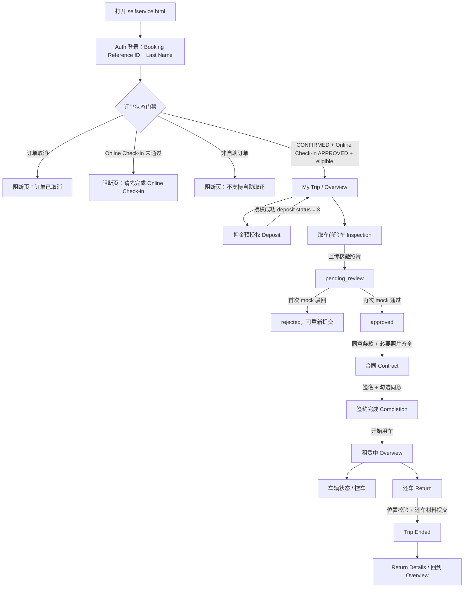
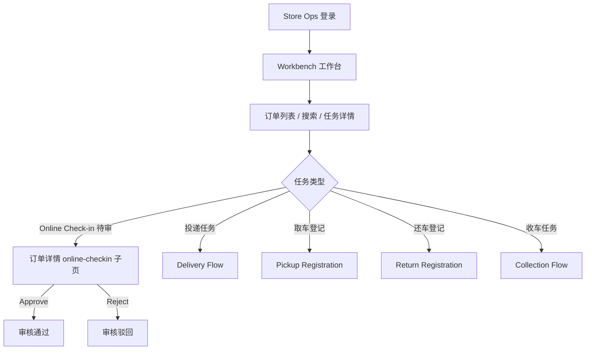

# 自助取还车运行时业务主流程

## 文档信息

| 字段 | 内容 |
|---|---|
| 创建时间 | 2026-07-07 14:18:37 CST |
| 文档类型 | 运行时代码业务流程梳理 |
| 适用入口 | `/selfservice.html`、`/store-ops.html` |

## 适用范围

本文记录当前代码中 `/selfservice.html` 与相关 Store Ops 审核链路的业务主流程。

本文基于运行时代码静态梳理，目标是说明当前 demo 已实现的页面、状态门禁、主路径和缺口。本文不是新的产品规范，也不替代 `workspace/customer/specs/epic/selfservice-rental-baseline.md`。

## 代码入口

| 入口 | 代码位置 | 说明 |
|---|---|---|
| `/selfservice.html` | `src/apps/selfservice-rental/entry/index.tsx` | 乘客自助取还车 H5 入口 |
| Selfservice 主状态机 | `src/apps/selfservice-rental/App.tsx` | 维护 `currentView`、订单 mock、押金、验车、合同、还车状态 |
| Selfservice 页面枚举 | `src/apps/selfservice-rental/types.ts` | 定义 `AppView`、订单状态、Online Check-in 状态、合同状态、验车记录 |
| `/store-ops.html` | `src/apps/store-ops/app/router.tsx` | 门店端入口，包含 Online Check-in 审核页 |

## 当前代码中的核心状态

### 订单主状态

`CanonicalStatus` 定义在 `src/apps/selfservice-rental/types.ts`：

| 状态 | 含义 |
|---|---|
| `CREATED` | 已创建 |
| `RESERVED` | 已预留 |
| `PENDING` | 待处理 |
| `CONFIRMED` | 已确认 |
| `PICKED_UP` | 已取车 |
| `RETURNED` | 已还车 |
| `COMPLETED` | 已完成 |
| `CANCELLED` | 已取消 |
| `REJECTED` | 已拒绝 |

### Online Check-in 核验状态

`OnlineCheckinVerificationStatus` 定义在 `src/apps/selfservice-rental/types.ts`：

| 状态 | 含义 | 当前 selfservice 行为 |
|---|---|---|
| `NOT_SUBMITTED` | 未提交 | 未进入完整提交页；应视作外部 Online Check-in app 处理 |
| `PENDING_REVIEW` | 待审核 | 进入阻断页：请先完成 Online Check-in |
| `APPROVED` | 已通过 | 允许进入自助取还车主流程 |
| `REJECTED` | 已驳回 | 进入阻断页：请先完成 Online Check-in |

### Selfservice 页面状态

`AppView` 是当前乘客端的页面状态机：

| View | 页面 |
|---|---|
| `AUTH` | 登录 / 订单查询 |
| `OVERVIEW` | 我的行程 / 主流程步骤 |
| `DEPOSIT` | 押金预授权 |
| `INSPECTION` | 取车前验车 |
| `INSPECTION_DETAILS` | 验车记录详情 |
| `CONTRACT` | 合同签署 |
| `COMPLETION` | 签约完成 / 开始用车 |
| `VEHICLE_STATUS` | 车辆状态 / 控车 |
| `RETURN` | 自助还车 |
| `TRIP_ENDED` | 行程结束 |
| `RETURN_DETAILS` | 还车详情 |
| `SERVICE_TERMS` | 服务条款 |
| `AUTH_BLOCKED_CANCELLED` | 订单取消阻断 |
| `AUTH_BLOCKED_ONLINE_CHECKIN_REQUIRED` | Online Check-in 未通过阻断 |
| `AUTH_BLOCKED_NOT_ELIGIBLE` | 非自助订单阻断 |

## 乘客端业务主流程

## 登录与 Admission Guard

登录页只做 mock 鉴权：

- 订单号会 `trim().toUpperCase()`。
- 姓氏会 `trim().toLowerCase()`。
- 当前有效姓氏固定为 `Smith`。
- 当前有效订单号来自 `src/apps/selfservice-rental/mockAccounts.ts` 的 `MOCK_ACCOUNTS`。

登录成功后进入订单状态门禁：

| 门禁条件 | 结果 |
|---|---|
| `canonical_status === CANCELLED` | 进入 `AUTH_BLOCKED_CANCELLED` |
| `online_checkin_verification_status !== APPROVED` | 进入 `AUTH_BLOCKED_ONLINE_CHECKIN_REQUIRED` |
| `is_selfservice_eligible === false` | 进入 `AUTH_BLOCKED_NOT_ELIGIBLE` |
| `CONFIRMED + APPROVED + eligible` | 设置 `orderDetails`，进入 `OVERVIEW` |

## 当前 mock 账号

| Booking Reference ID | Last Name | 结果 |
|---|---|---|
| `DEMO` | `Smith` | 进入自助取还车主流程 |
| `CANCEL01` | `Smith` | 订单取消阻断 |
| `REGULAR01` | `Smith` | 非自助订单阻断 |
| `NOT_ELIGIBLE` | `Smith` | 非自助订单阻断 |
| `NOT_STARTED01` | `Smith` | 进入 Online Check-in 资料提交演示 |
| `PENDING01` | `Smith` | Online Check-in 待审核阻断 |
| `REJECT01` | `Smith` | Online Check-in 未完成阻断 |
| `PICKUP01` | `Smith` | 进入 Overview；押金已授权且车辆已就绪，可从概览进入取车验车 |

## Overview 步骤条

`OverviewScreen` 当前显示的主步骤如下：

| 步骤 | 进入条件 | 完成条件 | 说明 |
|---|---|---|---|
| Online Check-in | 已进入 Overview | 固定显示完成 | 当前 selfservice 主流程默认 Online Check-in 已通过 |
| Deposit | 始终可点，未授权时为主动作 | `deposit.status` 属于 `3 / 4 / 5` | 当前 demo 成功后写为 `3` |
| Inspection | 押金已授权后可点 | 验车记录 `verificationStatus === approved` 且资料齐全 | 包含 mock 异步审核 |
| Contract | 押金已授权 + 验车已完成后可点 | `contract_sign_status === SIGNED` | 签名后进入完成页 |
| Return | `isRentalActive` 或 `isReturned` 后显示 | `isReturned === true` | 租赁开始后才出现 |

Overview 的 Inspection 步骤只保留验车状态、操作入口与必要提示，不重复显示约定取车地址或停车场。`INSPECT01` 用于验证“押金已授权、Inspection 未完成”的主路径：用户进入 Overview 后可以开始验车，Contract 与 Return 尚未开放。Return 步骤只保留还车截止时间、操作提示与动作入口，不重复展示地点摘要。页面底部“还车停车场”卡片只显示 SaaS 当前有效还车停车计划的名称与地址；`return_location` 仅作为推荐搜索中心与围栏输入。电话与聊天仍用于联系履约门店。

## 押金预授权流程

页面：`src/apps/selfservice-rental/components/DepositScreen.tsx`

关键规则：

- 当前 mock 订单押金金额为 `1000`，币种为 `$`。
- 只有取车前 24 小时内才允许预授权；demo 中第二次进入押金页会通过 `simulateTimePassed` 绕过时间限制。
- 持卡人姓名需匹配订单客户名，当前允许包含 `smith`。
- 卡号末四位触发不同 mock 错误：
  - `1111`：余额不足。
  - `2222`：风控拒绝。
  - `3333`：需要 3D Secure。
  - 其他末四位：授权成功。
- 授权成功后调用 `onDepositComplete()`，将 `deposit.status` 写为 `3`。

## 取车前验车流程

页面：`src/apps/selfservice-rental/components/InspectionScreen.tsx`

关键规则：

- 用户上传核验照片后，`verificationStatus` 进入 `pending_review`。
- `App.tsx` 使用 timer 模拟审核：
  - 第一次提交后 mock 为 `rejected`。
  - 第二次提交后 mock 为 `approved`。
- 只有满足以下条件才允许继续到合同：
  - `verificationStatus === approved`。
  - 至少有一张核验照片。
  - 已同意条款。
  - 如果选择上报异常，必须上传异常照片。

## 合同与开始用车流程

页面：`src/apps/selfservice-rental/components/ContractScreen.tsx`

关键规则：

- 合同页展示预订信息、驾驶人信息和已通过 Online Check-in 的证件资料。
- 用户必须完成签名并勾选同意，才能提交合同。
- 合同签署后：
  - `contract_sign_status` 变为 `SIGNED`。
  - `canonical_status` 变为 `PICKED_UP`。
  - 合同附件状态先变为 `GENERATING`。
  - 4 秒后 mock 变为 `READY` 并写入 PDF URL。
- 签约完成页点击开始用车后，`isRentalActive` 变为 `true`，返回 Overview。

## 租赁中与还车流程

租赁中 Overview 会展示车辆控制相关入口，包括车辆状态和控车动作。

还车页面：`src/apps/selfservice-rental/components/ReturnScreen.tsx`

关键规则：

- 还车前会做位置校验。
- mock 位置规则：
  - 距离指定还车点 500 米内，或
  - 距离门店 100 米内。
- 确认还车后：
  - `isRentalActive` 变为 `false`。
  - `isReturned` 变为 `true`。
  - 页面进入 `TRIP_ENDED`。

## Online Check-in 乘客提交页现状

当前 selfservice-rental 提供一个不落地生产证件数据的乘客端 Online Check-in 提交演示页，用于体验 `NOT_SUBMITTED -> PENDING_REVIEW` 的状态流转。

当前行为是：

1. 用户输入 `NOT_STARTED01 + Smith`。
2. 登录校验通过，进入 Online Check-in 资料提交演示页。
3. 用户填写驾驶人资料、上传本地或示例证件并同意条款。
4. 提交后进入 `PENDING_REVIEW` 阻断页，提示资料已提交、等待商家审核。
5. 用户输入 `PENDING01 + Smith` 或 `REJECT01 + Smith` 时，仍只进入对应状态阻断页，不重复进入提交流程。

该演示页只模拟表单交互与状态回写，不保存真实证件文件，也不替代生产 Online Check-in 服务。

## Store Ops 侧 Online Check-in 审核旁路

入口：`/store-ops.html`

Store Ops 当前实现了门店端审核已提交 Online Check-in 材料的页面。该流程不是乘客提交页，而是员工审核页。

关键代码位置：

| 能力 | 代码位置 |
|---|---|
| Store Ops 主路由 | `src/apps/store-ops/app/router.tsx` |
| Workbench 任务主动作路由 | `src/apps/store-ops/app/useStoreOpsState.ts` |
| 打开 Online Check-in 详情页 | `src/apps/store-ops/views/TaskDetailView.tsx` |
| Approve / Reject 审核按钮 | `src/apps/store-ops/views/task-detail/workflowRenderers.tsx` |

## 自助取还通知节点

当前通知节点来自 `workspace/customer/specs/epic/selfservice-rental-baseline.md` 第 7 章「平台端与商户端配置要求」。

该 spec 明确写明：

- 平台端配置包含 `enable_online_checkin`，默认关闭。
- 平台端配置包含 `supplier_service_email`，必填，需做邮箱格式校验。
- 商户端模板级通知方式为 **Email（本期）**。
- `EVT_01` 至 `EVT_05` 为本期必须支持业务事件。
- `EVT_06` 在 PRD 提供了模板，但是否启用取决于业务配置 / 发送策略。
- 发件箱默认使用系统服务邮箱，例如 `servicenoreply@email.fleetedge.com`，以实际配置为准。

### 核心邮件模板

`selfservice-rental-baseline.md` 明确列出以下 6 类生产落地模板：

1. 订单确认 ONLINE CHECK-IN 邮件模板（邀请客户提交）
2. ONLINE CHECK-IN 待审核通知模板（通知商户审核人）
3. ONLINE CHECK-IN 审核通过模板（通知客户）
4. ONLINE CHECK-IN 审核驳回模板（通知客户重提）
5. 合同签署完成模板（通知客户下载合同）
6. 自助取还取车通知模板（车辆就绪时，按业务配置触发）

### 通知触发矩阵（Email）

| 事件 ID | 流程节点 | 触发条件 | 接收人 | 模板名称 | 主题示例 | 本期必需 |
|---|---|---|---|---|---|---|
| `EVT_01_ORDER_CREATED` | `C -> D` 后（订单可处理） | 新增并确认 ONLINE CHECK-IN 订单 | 客户 | 订单确认 ONLINE CHECK-IN 邮件模板 | `Complete Your Online Check-In — Save Time at Pickup` | 是 |
| `EVT_02_SUBMITTED_PENDING_REVIEW` | 客户提交资料后 | ONLINE CHECK-IN 资料提交成功，进入待审核 | 门店 / 商户审核人 | ONLINE CHECK-IN 待审核通知模板 | `New Online Check-In Submission – Please Review Now` | 是 |
| `EVT_03_REVIEW_APPROVED` | 审核完成 | ONLINE CHECK-IN 审核通过 | 客户 | ONLINE CHECK-IN 审核通过模板 | `Your Online Check-In Has Been Approved — See You Soon!` | 是 |
| `EVT_04_REVIEW_REJECTED` | 审核完成 | ONLINE CHECK-IN 核验驳回 | 客户 | ONLINE CHECK-IN 审核驳回模板 | `Action Required — Your Online Check-In Could Not Be Verified` | 是 |
| `EVT_05_CONTRACT_SIGNED` | `G -> H` | 客户完成电子合同签署 | 客户 | 合同签署完成模板 | `Your Rental Agreement Has Been Signed — Download Your Copy` | 是 |
| `EVT_06_VEHICLE_READY` | 车辆分配完成（取车前） | 车辆已分配且可取车 | 客户 | 自助取还取车通知模板 | `Your Vehicle Is Ready — Meet Your {{brand_name}} Representative Soon` | 否（可配置） |

### 当前运行时代码中出现的相关文案和入口

当前 `src/apps/selfservice-rental` 代码中可以看到以下通知相关文案或联系入口：

| 代码位置 / i18n key | 明确内容 |
|---|---|
| `howToFindConfirmationCodeBody` | 提示用户查看预订确认邮件或 App 中的 `My Bookings` 查找 Booking Reference ID |
| `authBlockedPendingBody` | 文案写明资料已提交并等待商家审核，审核通过后会通知用户 |
| `agreementEmailed` | 文案写明租赁协议已通过电子邮件发送给用户 |
| `emailLabel` / `emailPlaceholder` | 押金页和合同相关页面存在 Email 字段展示或输入 |
| `messageStore` | 车辆状态 / 还车相关页面存在联系门店入口 |
| `ReturnScreen.tsx` 的 `sms:${sanitizedStorePhone}` | 还车页面存在调用系统短信应用联系门店的链接 |

以上内容仅表示当前代码中存在对应文案或入口。通知触发节点、通知方式和模板要求以 `workspace/customer/specs/epic/selfservice-rental-baseline.md` 第 7 章为准。

### Store Ops 投递执行页面边界

`workspace/store-ops/specs/selfservice/feat_delivery-execution_spec.md` 明确写明：

- `Customer 交接通知` 属于 Out of Scope。
- 投递执行页面不做 customer 通知发送。
- 该 spec 的 Feature Brief 摘要中再次说明：不涉及 customer 通知。

因此，当前 Store Ops 投递执行页面的文档边界是：处理自助投递任务领取、证据采集、取车指引和完成追溯；不在该页面内定义 customer 通知发送。

## 当前已实现与缺口

### 已实现

- 乘客登录与订单状态门禁。
- 自助取车 Overview 主流程。
- 押金预授权 mock。
- 取车前验车与 mock 审核。
- 合同签署与 mock 合同附件生成。
- 开始用车与车辆状态入口。
- 自助还车与位置校验 mock。
- 门店端 Store Ops 的 Online Check-in 审核页。

### 缺口

- 乘客端 Online Check-in 提交审核页未实现。
- `PENDING01` 与 `REJECT01` 不能进入上传证件/提交审核流程，只能进入阻断页。
- `Overview` 中 Online Check-in 步骤当前固定显示完成，没有查看已提交资料的乘客端详情页。
- 押金、验车、合同、位置校验均为前端 mock，没有真实 API 回写。

## 后续补齐建议

若要实现乘客端 Online Check-in 提交审核页，建议新增独立流程：

1. `AUTH` 后根据状态进入 Online Check-in submission flow。
2. 支持 `NOT_SUBMITTED` 初次提交。
3. 支持 `REJECTED` 查看驳回原因并重提。
4. 支持 `PENDING_REVIEW` 查看等待审核状态，避免重复提交。
5. 支持 `APPROVED` 查看已通过资料摘要，并回到自助取车主流程。
6. 与 Store Ops `onlineCheckInReview` 数据模型对齐，保证门店端可审核乘客提交材料。
