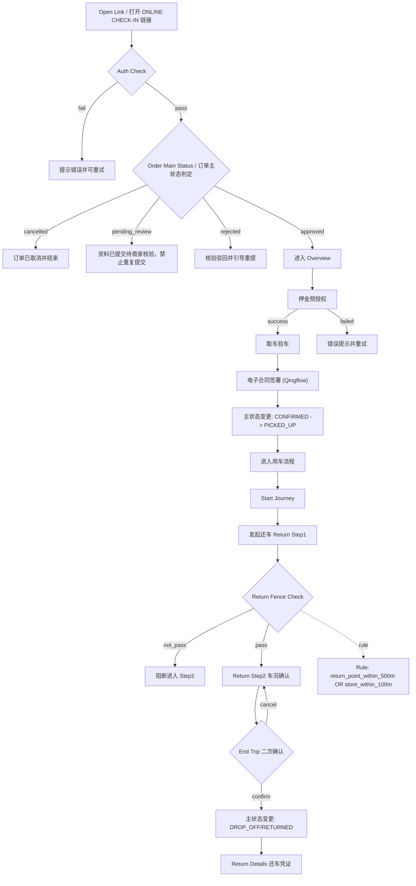
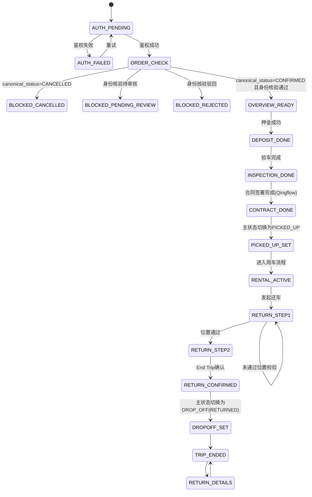

# 自助取还 ONLINE CHECK-IN 需求规格说明（生产基线）

- 文档版本：**v1.0（PROD 基线）**
- 基线日期：2025-10-15
- 当前维护日期：2026-03-09
- 说明：本文件的业务版本固定为 `v1.0`。后续 AI 或人工改动统一记录在「11. AI 修改记录」，不变更业务版本号。

---

## 1. 文档目标与范围

### 1.1 目标

统一 ONLINE CHECK-IN 的核心业务目标、流程、字段约束与状态流转，确保产品、开发、测试、运营在同一基线上协作。

### 1.2 业务范围

- 在线核验（鉴权）
- 押金预授权
- 取车验车
- 电子合同签署（Qingflow 低代码）
- 自助还车（两步）
- 还车后凭证查看

### 1.3 不在本期范围

- 计费引擎细则
- 第三方支付网关完整风控细节
- 运营 BI 报表实现细节

---

## 2. 核心业务规则（必须遵守）

1. 一个 ONLINE CHECK-IN 链接唯一指向一个订单；同一订单可存在多个链接。
2. 鉴权规则：`平台订单号 + 主驾驶人姓氏`。
3. 订单状态判定（主状态 + 子状态）：
   - 主状态为已取消（`canonical_status=CANCELLED`）：禁止进入流程，提示订单已取消。
   - 身份核验状态为待审核（`online_checkin_verification_status=PENDING_REVIEW`）：提示资料已提交、待商家核验，不允许重复按新用户逻辑提交。
   - 身份核验状态为驳回（`online_checkin_verification_status=REJECTED`）：提示驳回并引导重提资料。
   - 身份核验状态为通过（`online_checkin_verification_status=APPROVED`）：允许进入后续流程。
4. 多语言优先交付：英语、繁中、日语、韩语、泰语。
5. 语言默认策略：港澳台-繁中，日本-日语，韩国-韩语，泰国-泰语，其余-英语。
6. 轻流表单提交后必须进入提交完成落地页，且可跳回 ONLINE CHECK-IN 首页。
7. 电子合同签署由 Qingflow 低代码表单/合同能力承载。
8. 用户取车不执行 H5 硬围栏拦截。
9. 商家投递软围栏属于运营侧流程，不进入本文件“租车客户主状态流程”。
10. 用户还车执行硬围栏校验：`距还车点<=500m` 或 `距门店<=100m`。
11. 合同签署阶段的数据采集、附件上传、签署留痕由 Qingflow 承载；H5 侧仅负责流程跳转与签约完成后的状态回写触发。
12. 合同资料必须满足等保与数据监管的可追溯、可审计、可导出要求；H5 不落地持久化原始证件文件。

---

## 3. 端到端业务流程（Human Friendly）

### 3.1 主流程图（Mermaid）

### 3.2 状态约束图（Mermaid）

---

## 4. 页面职责与准入/准出约束

| 页面 | 职责 | 准入条件 | 准出条件 |
|---|---|---|---|
| Auth | 鉴权入口 | 打开链接 | 鉴权成功 + `canonical_status=CONFIRMED` + `online_checkin_verification_status=APPROVED` |
| Overview | 展示订单与步骤 | 鉴权成功 | 进入押金/验车/合同/还车 |
| Deposit | 押金预授权 | 订单可处理 | 预授权成功 |
| Inspection | 取车验车 | 已完成押金 | 验车完成 |
| Contract | 电子合同签署（Qingflow） | 验车完成 | 在 Qingflow 完成主驾驶+额外驾驶人（最多3人）信息与证件提交、签约确认，并触发主状态 `CONFIRMED -> PICKED_UP` |
| Completion | 启程确认（UI） | 主状态已 `PICKED_UP` | 进入用车页面（不改变主状态） |
| Return Step1 | 位置确认与还车检查提示 | 用车中 | 位置通过 |
| Return Step2 | 车况确认 | Step1 条件满足 | End Trip 确认 |
| Trip Ended | 成功结束与返回首页入口 | `canonical_status=RETURNED (DROP_OFF)` | 返回 Overview（Back Home） |
| Return Details | 查看还车凭证 | `canonical_status=RETURNED (DROP_OFF)` | 返回 Trip Ended |

---

## 5. 字段级约束（Dev/Ops 对齐重点）

### 5.1 链接与鉴权字段

| 字段 | 必填 | 约束 | 用途 |
|---|---|---|---|
| `vendor_brand` | 是 | 非空字符串 | 品牌展示 |
| `platform_order_no` | 是 | 可唯一定位订单 | 鉴权主键 |
| `last_name` | 是 | 与主驾驶人一致 | 鉴权校验 |
| `channel_id` | 是 | 渠道标识 | 统计归因 |

说明：历史参数 `confirmation_code` 可保留兼容，但语义应映射到平台订单号。

### 5.2 主状态与 CONFIRMED 子状态字段（最小必需）

| 字段 | 类型 | 说明 |
|---|---|---|
| `canonical_status` | enum | 订单主状态（由订单域 FSM 裁决），如 `CREATED/RESERVED/PENDING/CONFIRMED/PICKED_UP/RETURNED/COMPLETED/CANCELLED/REJECTED` |
| `online_checkin_verification_status` | enum | Online Check-In 身份核验状态：`NOT_SUBMITTED/PENDING_REVIEW/APPROVED/REJECTED` |
| `deposit_preauth_status` | enum | 押金预授权状态：`NOT_STARTED/SUCCEEDED/FAILED/EXPIRED` |
| `contract_sign_status` | enum | 合同签署状态：`UNSIGNED/SIGNED` |
| `contract_attachment_status` | enum | 合同附件状态：`GENERATING/READY` |
| `contract_attachment_url` | string | 合同 PDF 下载链接（仅 `READY` 时可用） |
| `isIdentityVerified` | boolean | 派生字段，等价于 `online_checkin_verification_status=APPROVED` |
| `isDepositPaid` | boolean | 派生字段，等价于 `deposit_preauth_status=SUCCEEDED` |
| `contractSigned` | boolean | 派生字段，等价于 `contract_sign_status=SIGNED` |
| `isRentalActive` | boolean | 是否用车中（等同于 `PICKED_UP` 已取车且未还车） |
| `isReturned` | boolean | 是否还车完成 |

说明：

1. `canonical_status` 是订单域唯一真值，禁止被本模块直接改写为自定义主状态。
2. 本文的核验、押金、合同流转属于 `CONFIRMED` 阶段下的业务子状态流转，不等同于订单主状态机。
3. 客户完成签约并确认取车后，主状态应切换为 `PICKED_UP`；完成还车后主状态切换为 `RETURNED (DROP_OFF)`。
4. 合同签署后 Overview 的合同步骤仅有两态：`contract_attachment_status=GENERATING` 显示“合同生成中”并禁点；`READY` 且有下载链接时显示 `View` 并直接触发 PDF 下载。

### 5.3 取车验车（Inspection）页面内容规范

> 以下以生产截图（2026-03-09）为基线，描述 Inspection 页面的真实区块构成、顺序与字段约束。
> 说明：`Vehicle Exterior / Lights Check / Damage Report` 及其 `Photo Guide` 的展示风格与还车阶段（Return Step2）保持一致。

#### 5.3.0 页面区块顺序（生产基线）

| 顺序 | 区块名称 | 是否必填 |
|---|---|---|
| 1 | Vehicle Stats（车机数据） | 只读展示，无需填写 |
| 2 | License & Plate Photo（驾照与车牌合照） | 必传 ≥1 张 |
| 3 | Vehicle Exterior（车辆外观四方位拍照） | 必传，每方位 ≥1 张 |
| 4 | Lights Check（灯光检查） | 建议必传，前灯/后灯各 ≥1 张 |
| 5 | Damage Report（车损报告） | 可选文字 |
| — | 底部固定按钮：Continue to Contract | 满足条件后可点击 |

#### 5.3.1 车机数据（只读，系统自动读取）

| 字段 | 类型 | UI 呈现 | 说明 |
|---|---|---|---|
| `vehicle_mileage` | number | 大字体数字，单位 km | 当前里程，由车机/IoT 系统实时读取，用户不可编辑 |
| `vehicle_fuel_level` | number（格数） | 图形油表（E—■■■■■■■—F，共 8 格），右下角显示 "N/8" | 当前油量，由车机/IoT 系统实时读取，用户不可编辑 |

说明：
1. 两字段均以只读形式呈现，页面顶部展示，取车前最先展示给用户确认。
2. 若用户发现里程或油量与实际不符，须在取车前立即联系门店（橙色警告提示条）。
3. 车机数据随验车记录一并写入电子合同验车单，作为取车状态证明存档。

#### 5.3.2 驾照与车牌合照（License & Plate Photo）

| 字段 | 类型 | 最小要求 | 说明 |
|---|---|---|---|
| `driver_license_plate_photo` | image[] | 必传 ≥1 张，上限 3 张 | 手持本国驾照靠近车牌（前牌或后牌），一张照片同时清晰呈现驾照与车牌 |

UI 说明：
- 右上角提供 **View Example** 入口，点击弹出示例图（驾照贴近车牌的合照）。
- 上传后触发模拟 OCR 校验，状态：`idle → verifying（2.5s）→ success / error`。
- 校验成功后底部按钮才可解锁。
- 隐私声明：`These photos are used to verify the driver and vehicle for this rental and are stored securely.`

#### 5.3.3 车辆外观拍照（Vehicle Exterior）

| 字段 | 方位标签（UI 显示） | 最小要求 | 说明 |
|---|---|---|---|
| `inspection_photos.front` | Front | 必传 ≥1 张 | 车头正面或斜前方 |
| `inspection_photos.rear` | Rear | 必传 ≥1 张 | 车尾正面或斜后方 |
| `inspection_photos.left` | Left Side | 必传 ≥1 张 | 左侧整体 |
| `inspection_photos.right` | Right Side | 必传 ≥1 张 | 右侧整体 |

UI 说明：
- 标题右侧提供 **Photo Guide** 入口，点击弹出拍摄角度示意图（图文说明）。
- 四方位 2×2 网格排列，每格独立上传，单槽位 1 张。

#### 5.3.4 灯光检查（Lights Check）

| 字段 | 方位标签（UI 显示） | 最小要求 | 说明 |
|---|---|---|---|
| `inspection_photos.front_lights` | Front Lights (On) | 建议 ≥1 张 | 拍摄开启状态的前大灯 |
| `inspection_photos.rear_lights` | Rear Lights (On) | 建议 ≥1 张 | 拍摄开启状态的后尾灯 |

UI 说明：
- 与外观拍照共用 **Photo Guide** 弹窗，或可独立关联同一 Guide 入口。
- 2×1 排列，各独立上传，单槽位 1 张。

#### 5.3.5 车损报告（Damage Report）

| 字段 | 类型 | 最小要求 | 说明 |
|---|---|---|---|
| `damage_description` | string | 可选，≤1000 字 | 损伤描述，Placeholder：`Describe any scratches, dents or cleanliness issues...` |

UI 说明：
- 无损伤标签（Tag）多选项，仅保留文本框输入。
- 文本框标题：`Damage Description`。

#### 5.3.6 Sample Photo 拍摄指引规范（Photo Guide 弹窗）

Photo Guide 弹窗由外观拍照区块与灯光检查区块的 "Photo Guide" 按钮共同触发，图文展示以下项目：

| 拍照项目 | 展示说明 |
|---|---|
| Front（车头） | 从车头正前方或斜前方完整拍摄保险杠与车牌 |
| Rear（车尾） | 从车尾正后方或斜后方完整拍摄保险杠与车牌 |
| Left Side（左侧） | 站在左侧，完整拍摄左侧门板与车身 |
| Right Side（右侧） | 站在右侧，完整拍摄右侧门板与车身 |
| Front Lights（前灯） | 开启前大灯后拍摄，确认灯光正常点亮 |
| Rear Lights（后灯） | 开启后尾灯后拍摄，确认灯光正常点亮 |
| Damage（损伤特写） | 尽量靠近损伤部位，确保损伤边界清晰，可附手指/钢笔参照比例 |

### 5.4 还车上传字段约束

| 字段 | 约束 |
|---|---|
| `keyReturnReminder` | 单行文字提示（无拍照语义、无上传字段） |
| `parkingPhoto` | 0~1 张（建议必传） |
| `appearancePhotos` | 前/后/左/右（建议各>=1） |
| `lightPhotos` | 前灯/后灯（建议各>=1） |
| `parkingNote` | 文本，可选，建议 <= 500 字 |
| `damageNote` | 文本，可选，建议 <= 1000 字 |

### 5.5 客户侧地理围栏规则（MVP）

| 场景 | 判定规则 | 执行策略 |
|---|---|---|
| 客户还车硬围栏校验 | `dist(current_location, return_point) <= 500m` OR `dist(current_location, store_location) <= 100m` | 满足则允许进入 Step2 |
| 客户还车围栏不满足 | 超出还车围栏阈值 | 阻断并提示用户靠近还车点 |

说明：

1. 该规则参考 `docs/feat_selfservice_management_spec.md`（6.6.3 MVP版本还车位置约束）。
2. 距离计算建议使用 Haversine；若定位失败需提供重试与手动刷新机制。
3. 默认阈值：POI 半径 500m，门店兜底 100m；阈值应支持后续配置化。
4. 商家投递软围栏属于运营侧流程，作为上下文存在，但不进入本文件客户主状态机。

### 5.6 电子合同（Qingflow）字段约束

#### 5.6.1 合同载荷结构（逻辑模型）

| 字段 | 类型 | 约束 | 说明 |
|---|---|---|---|
| `additional_driver_count` | integer | `0..3` | 额外驾驶人数量选择 |
| `primary_driver` | object | 必填 | 主驾驶人信息对象 |
| `additional_drivers` | array<object> | 长度必须等于 `additional_driver_count`，最大 3 | 额外驾驶人信息数组 |
| `primary_driver.first_name` | string | 必填 | 主驾驶名字 |
| `primary_driver.last_name` | string | 必填 | 主驾驶姓氏 |
| `primary_driver.residency_status` | enum | 必填，`local` / `international` | 居住身份（本地/国际访客） |
| `primary_driver.home_country_license_front` | file | 基础必填 | 本国驾照正面 |
| `primary_driver.home_country_license_back` | file | 基础必填 | 本国驾照反面 |
| `primary_driver.passport_front` | file | 条件必填 | 护照正面 |
| `primary_driver.passport_back` | file | 条件必填 | 护照反面 |
| `primary_driver.idp` | file | 条件必填 | 国际驾照（IDP） |
| `primary_driver.certified_translation` | file | 条件必填 | 认证翻译件 |
| `primary_driver.entry_exit_records` | file | 条件必填 | 出入境记录 |
| `additional_drivers[i]` | object | 同构约束 | 每位额外驾驶人字段与主驾驶同构，含身份与证件集合 |

#### 5.6.2 条件必填策略

1. 基础必填：主驾驶及每位额外驾驶人均需提交本国驾照正反面（`home_country_license_front/back`）。
2. 条件必填：护照、IDP、认证翻译、出入境记录由居住身份（`residency_status`）与门店模板规则联合触发。
3. 条件规则由 Qingflow 模板配置驱动，本文定义规则框架，不固化单门店差异阈值。

#### 5.6.3 重复录入规则（额外驾驶人）

1. 当 `additional_driver_count = N`（`N∈[0,3]`）时，系统需展示并要求完成 `N` 组额外驾驶人信息录入。
2. 当 `additional_driver_count = 0` 时，不展示额外驾驶人录入块。
3. 截图示例为 `N=2`，即需录入 2 组额外驾驶人信息；该值是示例，不是固定上限。
4. 电子签名提交前需要上传「手写签名」，不论主驾驶人还是额外驾驶人。
---

## 6. ONLINE CHECK-IN 子流程状态流转矩阵（Dev/Ops）

| 当前状态 | 触发动作 | 守卫条件（Guard） | 下一状态 | 失败处理 |
|---|---|---|---|---|
| `AUTH_PENDING` | 提交鉴权 | 订单号+姓氏匹配 | `ORDER_CHECK` | 鉴权失败提示 |
| `ORDER_CHECK` | 状态核验 | `canonical_status=CANCELLED` | `BLOCKED_CANCELLED` | 拦截并提示订单已取消 |
| `ORDER_CHECK` | 状态核验 | `online_checkin_verification_status=PENDING_REVIEW` | `BLOCKED_PENDING_REVIEW` | 提示资料待商家核验，禁止重复提交 |
| `ORDER_CHECK` | 状态核验 | `online_checkin_verification_status=REJECTED` | `BLOCKED_REJECTED` | 提示驳回并引导重提资料 |
| `ORDER_CHECK` | 状态核验 | `canonical_status=CONFIRMED` 且 `online_checkin_verification_status=APPROVED` | `OVERVIEW_READY` | - |
| `OVERVIEW_READY` | 支付押金 | 预授权成功 | `DEPOSIT_DONE` | 错误码提示+重试 |
| `DEPOSIT_DONE` | 提交验车 | 证据满足最小要求 | `INSPECTION_DONE` | 表单校验提示 |
| `INSPECTION_DONE` | 合同签署（Qingflow） | 签名非空+同意条款 | `CONTRACT_DONE` | 按钮禁用/提示 |
| `CONTRACT_DONE` | 完成签约并确认取车 | 主状态写入：`canonical_status: CONFIRMED -> PICKED_UP` | `RENTAL_ACTIVE` | 状态写入失败则阻断并告警 |
| `RENTAL_ACTIVE` | 发起还车 | 无 | `RETURN_STEP1` | - |
| `RETURN_STEP1` | Next Step | `dist(current,return_point)<=500m` OR `dist(current,store)<=100m` | `RETURN_STEP2` | 阻断+提示 |
| `RETURN_STEP2` | End Trip | 二次确认 | `RETURN_CONFIRMED` | 返回当前页 |
| `RETURN_CONFIRMED` | 完成还车（Dropoff） | 主状态写入：`canonical_status: PICKED_UP -> RETURNED` | `TRIP_ENDED` | 状态写入失败则阻断并告警 |

注：额外驾驶人完整性、证件条件必填与签署校验属于 `Contract(Qingflow)` 内部校验，不新增主流程状态节点，不改变上述 Guard 表达式。

---

## 7. 平台端与商户端配置要求

### 7.1 平台端（租户级）

- `enable_online_checkin`：默认关闭。
- `supplier_service_email`：必填，邮箱格式校验。
- 关闭已启用能力必须二次确认，防止影响进行中订单。

### 7.2 商户端（模板级）

通知方式：**Email（本期）**。

核心模板（生产落地）：

1. 订单确认 ONLINE CHECK-IN 邮件模板（邀请客户提交）
2. ONLINE CHECK-IN 待审核通知模板（通知商户审核人）
3. ONLINE CHECK-IN 审核通过模板（通知客户）
4. ONLINE CHECK-IN 审核驳回模板（通知客户重提）
5. 合同签署完成模板（通知客户下载合同）
6. 自助取还取车通知模板（车辆就绪时，按业务配置触发）

### 7.3 通知触发矩阵（Email）

| 事件ID | 流程节点（见第3章） | 触发条件 | 接收人 | 模板名称 | 主题（示例） | 本期必需 |
|---|---|---|---|---|---|---|
| `EVT_01_ORDER_CREATED` | `C -> D` 后（订单可处理） | 新增并确认 ONLINE CHECK-IN 订单 | 客户 | 订单确认 ONLINE CHECK-IN 邮件模板 | `Complete Your Online Check-In — Save Time at Pickup` | 是 |
| `EVT_02_SUBMITTED_PENDING_REVIEW` | 客户提交资料后 | ONLINE CHECK-IN 资料提交成功，进入待审核 | 门店/商户审核人 | ONLINE CHECK-IN 待审核通知模板 | `New Online Check-In Submission – Please Review Now` | 是 |
| `EVT_03_REVIEW_APPROVED` | 审核完成 | ONLINE CHECK-IN 审核通过 | 客户 | ONLINE CHECK-IN 审核通过模板 | `Your Online Check-In Has Been Approved — See You Soon!` | 是 |
| `EVT_04_REVIEW_REJECTED` | 审核完成 | ONLINE CHECK-IN 核验驳回 | 客户 | ONLINE CHECK-IN 审核驳回模板 | `Action Required — Your Online Check-In Could Not Be Verified` | 是 |
| `EVT_05_CONTRACT_SIGNED` | `G -> H` | 客户完成电子合同签署 | 客户 | 合同签署完成模板 | `Your Rental Agreement Has Been Signed — Download Your Copy` | 是 |
| `EVT_06_VEHICLE_READY` | 车辆分配完成（取车前） | 车辆已分配且可取车 | 客户 | 自助取还取车通知模板 | `Your Vehicle Is Ready — Meet Your {{brand_name}} Representative Soon` | 否（可配置） |

说明：

1. `EVT_01`~`EVT_05` 为 PRD 列出的本期必须支持业务事件。
2. `EVT_06` 在 PRD 提供了模板，但是否启用取决于业务配置/发送策略。
3. 发件箱默认使用系统服务邮箱（如 `servicenoreply@email.fleetedge.com`），以实际配置为准。

### 7.4 通知模板变量最小集（字段约束）

| 变量名 | 必填 | 用途 |
|---|---|---|
| `{{brand_name}}` | 是 | 品牌标识 |
| `{{customer_name}}` | 是 | 收件人称呼 |
| `{{order_no}}` | 是 | 订单定位 |
| `{{pickup_time}}` | 是 | 取车时间 |
| `{{pickup_location}}` | 是 | 取车地点 |
| `{{return_time}}` | 是 | 还车时间 |
| `{{return_location}}` | 是 | 还车地点 |
| `{{car_model}}` | 是 | 车型描述 |
| `{{online_check_in_link}}` | 条件必填 | 引导客户进入/重提 |
| `{{review_link}}` | 条件必填 | 审核人进入审核面板 |
| `{{rental_agreement_link}}` | 条件必填 | 合同下载链接 |
| `{{support_email}}` | 建议必填 | 客服支持 |
| `{{support_phone}}` | 建议必填 | 客服支持 |

---

## 8. 非功能与审计要求

1. 上传链路 HTTPS。
2. 图片与合同文件需可审计（订单号、上传时间、操作人、来源渠道）。
3. 关键动作留痕：鉴权结果、押金结果、验车提交、合同签署、End Trip。
4. 端侧需支持 iOS/Android 主流 WebView。
5. 合同阶段主驾驶与额外驾驶人资料按同一审计等级留痕（字段变更、附件上传、提交动作均可追溯）。

---

## 9. 当前演示代码与生产基线差异（用于后续 feat）

| 主题 | 生产基线（本 spec） | 当前演示代码现状 |
|---|---|---|
| 鉴权 | 平台订单号+姓氏+状态门禁 | 固定账号密码演示 |
| 押金 | 真实支付网关+风控+3DS | 卡号末四位模拟分支 |
| OCR/验车 | 真实识别与证据存储 | 固定延时成功+占位图 |
| 地理围栏 | 真实定位判定 | 首次失败/重试成功模拟 |
| 合同签署 | Qingflow 动态表单：额外驾驶人 `0~3`、重复录入 `N` 组、证件条件必填与附件审计 | 若未完全体现动态重复录入或条件必填，需补齐 |
| 合同下载 | Completion 页不提供即时下载按钮；Overview 合同步骤按附件状态显示“生成中(禁点)”或“View(直接下载 PDF)” | 按钮占位 |
| 评价 | 生产暂未部署评分能力，UI 不展示评分 | Trip Ended 不展示评分 UI，页面仅保留 Back Home；还车凭证入口保留在 Overview 时间线 |

---

## 10. 验收要点（最小闭环）

1. 可按真实鉴权规则进入流程。
2. 可完成押金、验车、签约、启程、还车两步、结束行程。
3. Step1 不满足守卫条件时，禁止进入 Step2。
4. 已取消/已完成订单必须拦截。
5. 关键动作可追溯（日志与证据链完整）。

---

## 11. AI 修改记录（不改变业务版本）

| 日期 | 修改人 | 变更说明 |
|---|---|---|
| 2026-03-06 | Codex | 重构文档结构：去重、恢复主流程表达、补充 Mermaid 流程图与状态图、补充字段约束与状态流转矩阵、将版本规则固定为 v1.0 + 独立修改记录。 |
| 2026-03-06 | Codex | 新增第7章通知体系：补充 Email 通知模板清单、通知触发矩阵（事件-节点-模板-收件人）、模板变量最小集约束。 |
| 2026-03-06 | Codex | 根据 `docs/_index.md` 统一术语：将“订单状态”拆分为 `canonical_status`（主状态）与 `online_checkin_status`（CONFIRMED 阶段子状态），并同步修正流程门禁与流转矩阵。 |
| 2026-03-06 | Codex | 修正主状态跃迁：合同签署完成后主状态切换为 `PICKED_UP` 并进入用车流程；`Completion/Start Journey` 定义为 UI 确认，不再承担主状态变化。 |
| 2026-03-06 | Codex | 细化状态语义：入口明确 `canonical_status=CONFIRMED`，还车后主状态定义为 `RETURNED(DROP_OFF)`；子状态拆分为身份核验/押金预授权/合同签署三类。 |
| 2026-03-06 | Codex | 调整门禁语义：将流程分支从“已完成/可处理”改为“主状态取消 / 身份核验通过或驳回”；并将电子合同签署明确为 Qingflow 低代码承载。 |
| 2026-03-06 | Codex | 明确 `isRentalActive` 语义：等同于 `PICKED_UP`（已取车且未还车）。 |
| 2026-03-06 | Codex | 引入电子围栏规则：取/还车围栏统一为“POI 500m 或门店 100m”判定，补充到流程图、状态图、字段约束与流转矩阵。 |
| 2026-03-06 | Codex | 新增待审核门禁：`online_checkin_verification_status=PENDING_REVIEW` 时提示“已提交待商家核验”，并阻止按新用户逻辑重复提交。 |
| 2026-03-06 | Codex | 围栏策略修正：用户取车不做硬围栏校验；改为商家投递阶段软围栏（超阈值告警不阻断），用户还车保留硬围栏（500m/100m）校验。 |
| 2026-03-06 | Codex | 按反馈纠偏：将“商家投递软围栏”移出租车客户主状态流程与状态矩阵，仅保留为上下文说明；客户主流程仅保留客户侧状态与还车硬围栏门禁。 |
| 2026-03-06 | Codex | 状态集收敛：身份核验去除 `SUBMITTED`（与 `PENDING_REVIEW` 合并）；押金预授权去除 `PENDING` 中间态。 |
| 2026-03-06 | Codex | Mermaid 兼容性优化：主流程图改为保守语法（短边标签、规则节点外置、避免复杂符号直接写在连线上），降低解析失败概率。 |
| 2026-03-06 | Codex | 术语优化：将"Status Gate/状态门禁"改为"订单主状态判定（含核验状态）"，降低技术化表达。 |
| 2026-03-09 | Codex | 新增 5.3 取车验车字段约束：补充 5.3.1 车机数据（vehicle_mileage/vehicle_fuel_level 只读字段）、5.3.2 验车信息字段（四角 45° 外观拍照/车内检查/车损报告）、5.3.3 Sample Photo 拍摄指引规范；同步更新 InspectionScreen 组件与多语言翻译，新增车内检查区块（图文 Sample）及 Photo Guide 弹窗图文示例。 |
| 2026-03-09 | Codex | 按生产截图（2026-03-09）重构 §5.3：新增 5.3.0 页面区块顺序基线表，修正外观拍照字段命名（front/rear/left/right，非 front_left 等45°命名），补充独立 §5.3.4 灯光检查区块（front_lights/rear_lights），修正 §5.3.5 车损报告（无 damage_tags，仅文字+照片），删除非生产的"车内检查"独立区块，修正 UI 标签与 Placeholder 为截图实际文案；修正 §5.5 编号重复（原两个 5.4 合并为 5.4/5.5）。 |
| 2026-03-09 | Codex | 生产对齐优化：取车验车的 Exterior/Lights/Damage 与 Photo Guide 风格对齐还车阶段；Completion 页移除 Download PDF 按钮；还车 Step1 移除钥匙归还拍照上传门槛，仅保留文字提示；同步修正流程图/状态矩阵/字段约束中的钥匙照片条件。 |
| 2026-03-09 | Codex | 追加生产对齐：Trip Ended 下线 Trip Rating（仅保留结束成功与还车凭证入口）；Return Step1 的钥匙 checklist 改为与其他条目一致的单行提示；同步更新范围定义与差异表。 |
| 2026-03-09 | Codex | 补充电子合同（Qingflow）生产规范：明确等保/监管场景下的合同数据采集与审计边界；新增额外驾驶人上限 `0~3`、`N` 组重复录入规则与证件条件必填策略；注明截图示例为 `N=2` 需录入 2 组额外驾驶人信息。 |
| 2026-03-09 | Codex | 基线统一：合同签署后引入附件两态（`GENERATING/READY`）并在 Overview 合同步骤分别呈现“生成中禁点/可下载”；Trip Ended 页面收敛为仅 `Back Home`；Returned 态 Dashboard 去除 `Receipt Pending` 按钮。 |
